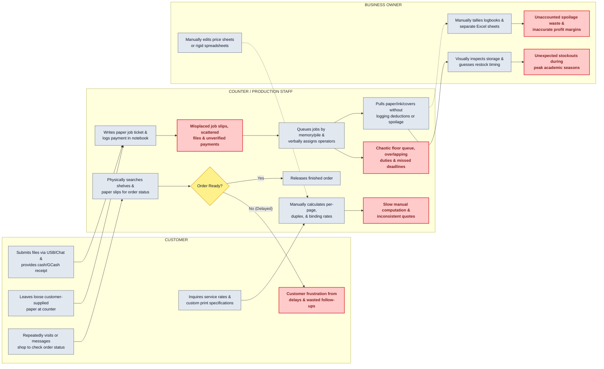
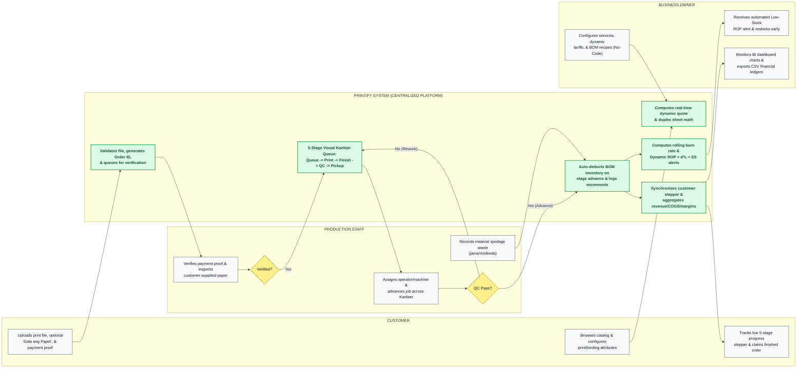

# Outline Defense PPT Guide: AS-IS and TO-BE Process Diagrams

**Target Deliverable:** Slides 3–6 of the Capstone Outline Defense Presentation  
**Reference Alignment:** `capstone_paper/outline_capstone_v1.docx` (Chapter 1: Introduction, Statement of the Problem, Objectives, and Chapter 3: System Architecture)  
**Benchmark PPT Style:** Cross-Functional Matrix Swimlane Diagram (modeled after `ppt_sample_1.pdf` Slides 3–6 and `ppt_sample_2.pdf` Slides 3–4)

---

## Why the Cross-Functional Matrix Swimlane Diagram Fits Best

After analyzing both `ppt_sample_1.pdf` (YouthLink) and `ppt_sample_2.pdf` (Hospital Information System) alongside your manuscript (`outline_capstone_v1.docx`), the **Cross-Functional Matrix Swimlane Diagram** (`ppt_sample_1.pdf` style) is the strongest choice for **Printify** for three reasons:

1. **Shows Multi-Stakeholder Disconnection vs. Integration:** Your Statement of the Problem explicitly categorizes pain points across three actors (**Customers**, **Production Staff**, and **Business Owners**). Vertical actor columns make this immediately visible to the defense panel.
2. **Mirrors Your 5 Core System Domains (Horizontal Rows):** By organizing the horizontal rows into your 5 operational workflows (**1. Pricing & Quotation**, **2. Order & Payment Intake**, **3. Job Scheduling & Production**, **4. Inventory & Replenishment**, and **5. Order Tracking & Financial Reporting**), the panel can trace every row of the **AS-IS** diagram directly to the **TO-BE** diagram.
3. **Visualizes the "Printify System" as the Central Bridge:** In the **AS-IS** diagram, actors pass physical paper slips, USB drives, and verbal instructions directly to one another (causing red bottleneck boxes). In the **TO-BE** diagram, inserting the **`PRINTIFY SYSTEM`** column in the center visually proves how your web platform centralizes and automates all transactions.

---

# PART 1: CURRENT PROCESS (AS-IS SWIMLANE DIAGRAM)

**Slide Title:** `Current Process of Printing Services`  
**Diagram Header Bar:** `AS-IS SWIMLANE DIAGRAM (TRADITIONAL / MANUAL WORKFLOW)`

---

## 1A. Human-Readable ASCII Art Diagram (AS-IS)

> **How to Read This Matrix:**  
> * **Rows (Left to Right):** The 5 core operational workflows in a traditional printing shop.  
> * **Columns (Top to Bottom):** Who performs the action (`CUSTOMER`, `COUNTER / PRODUCTION STAFF`, `BUSINESS OWNER`).  
> * **`[!! ... !!]` Boxes:** Highlighted in **Red/Pink** on your slide to show where manual errors and bottlenecks occur.

```text
+===================================================================================================================================+
|                                            AS-IS SWIMLANE DIAGRAM (CURRENT PROCESS)                                               |
+======================+===================================+=====================================+==================================+
|   OPERATIONAL PHASE  |             CUSTOMER              |     COUNTER / PRODUCTION STAFF      |          BUSINESS OWNER          |
+======================+===================================+=====================================+==================================+
|                      |                                   |                                     |                                  |
| 1. SERVICE PRICING   |  [Walks into shop or messages     |  [Checks printed tariff sheet &     |  [Manually updates price lists   |
|    & QUOTATION       |   page to inquire print/binding   |   manually computes page rates,     |   or modifies hardcoded spreadsheets|
|                      |   rates and custom specs]         |   color pages, & binding add-ons]   |   when material costs change]    |
|                      |                 |                 |                 |                   |                 |                |
|                      |                 +---------------->|                 v                   |                 v                |
|                      |                                   |  [!! Slow manual calculation &      |  [!! Rigid pricing; prone to     |
|                      |                                   |      inconsistent price quotes !!]  |      miscalculated surcharges !!]|
|                      |                                   |                                     |                                  |
+----------------------+-----------------------------------+-------------------------------------+----------------------------------+
|                      |                                   |                                     |                                  |
| 2. ORDER INTAKE      |  [Hands over files via USB flash  |  [Writes order specs on paper job   |                                  |
|    & PAYMENT         |   drive / chat & pays cash or     |   slip & logs cash/GCash reference  |                                  |
|                      |   shows mobile wallet screenshot] |   in a physical logbook]            |                                  |
|                      |                 |                 |                 |                   |                                  |
|                      |                 +---------------->|                 v                   |                                  |
|                      |  (If bringing own paper:          |  [Stacks customer paper on counter  |                                  |
|                      |   leaves loose paper bundle) ---->|   without formal sheet verification]|                                  |
|                      |                                   |                 |                   |                                  |
|                      |                                   |                 v                   |                                  |
|                      |                                   |  [!! Scattered files, unverified    |                                  |
|                      |                                   |      payments & lost job slips !!]  |                                  |
|                      |                                   |                                     |                                  |
+----------------------+-----------------------------------+-------------------------------------+----------------------------------+
|                      |                                   |                                     |                                  |
| 3. JOB SCHEDULING    |                                   |  [Verbally passes job slip to       |                                  |
|    & PRODUCTION      |                                   |   operators; prioritizes jobs by    |                                  |
|    WORKFLOW          |                                   |   memory or physical pile order]    |                                  |
|                      |                                   |                 |                   |                                  |
|                      |                                   |                 v                   |                                  |
|                      |                                   |  [Prints & binds documents ------> < Quality / Spec Error? >           |
|                      |                                   |   across workshop machines]         |     | (Yes)          | (No)      |
|                      |                                   |                                     |     v                v           |
|                      |                                   |  [!! Overlapping duties, missed     |  [Reprints job;   [Places finished|
|                      |                                   |      deadlines & queue chaos !!]    |   unlogged waste]  job on shelf] |
|                      |                                   |                                     |                                  |
+----------------------+-----------------------------------+-------------------------------------+----------------------------------+
|                      |                                   |                                     |                                  |
| 4. INVENTORY &       |                                   |  [Pulls paper reams, ink, & binding |  [Visually inspects storage      |
|    MATERIAL          |                                   |   covers from storage without       |   shelves or guesses when to     |
|    MONITORING        |                                   |   recording sheet deductions]       |   reorder supplies by intuition] |
|                      |                                   |                 |                   |                 |                |
|                      |                                   |                 +------------------>|                 v                |
|                      |                                   |  [Paper jams / spoilage thrown      |  < Stock Visually Low? >         |
|                      |                                   |   away without waste logging]       |     | (Missed)       | (Noticed) |
|                      |                                   |                                     |     v                v           |
|                      |                                   |                                     |  [!! Unexpected    [Places manual|
|                      |                                   |                                     |   stockouts during  restock order|
|                      |                                   |                                     |   peak season !!]   too late]    |
|                      |                                   |                                     |                                  |
+----------------------+-----------------------------------+-------------------------------------+----------------------------------+
|                      |                                   |                                     |                                  |
| 5. ORDER TRACKING    |  [Repeatedly visits shop or       |  [Manually searches physical        |  [Manually tallies logbooks &    |
|    & FINANCIAL       |   messages staff to ask if        |   shelves and paper slips to        |   separate Excel sheets to compute|
|    REPORTING         |   print/binding job is ready]     |   check if order is finished]       |   sales; no spoilage COGS data]  |
|                      |                 |                 |                 |                   |                 |                |
|                      |                 +---------------->|                 v                   |                 v                |
|                      |  [!! Customer frustration from    |  < Order Found & Ready? >           |  [!! Inaccurate profit margins   |
|                      |      unexpected delays & wasted   |     | (No)          | (Yes)         |      & delayed financial         |
|                      |      follow-up trips !!] <--------+-----+               v               |      consolidation !!]           |
|                      |                                   |              [Releases order]       |                                  |
|                      |                                   |                                     |                                  |
+======================+===================================+=====================================+==================================+
```

---

## 1B. Written Step-by-Step Guide to Draw the AS-IS Diagram (For PowerPoint / Canva / Draw.io)

If you are drawing this on a 16:9 widescreen slide (like `ppt_sample_1.pdf` Slide 3), set up a **Grid Table** with **4 Columns** and **5 Horizontal Rows**:

### Table Structure:
* **Column 1 (Left Header Column - Blue/Teal Fill):** `Operational Phase` (Row headers)
* **Column 2 (Actor Lane 1):** `CUSTOMER`
* **Column 3 (Actor Lane 2):** `COUNTER / PRODUCTION STAFF`
* **Column 4 (Actor Lane 3):** `BUSINESS OWNER`

### Colour Key for Shapes:
* **Grey Rounded Rectangles:** Normal manual steps
* **Yellow Diamonds:** Decision checks
* **Red / Pink Rounded Rectangles:** Operational bottlenecks / pain points (visualizes why the current system fails)

### Row-by-Row Box & Arrow Guide:

1. **Row 1: `SERVICE PRICING & QUOTATION`**
   * **Box 1 (Customer Lane):** `"Inquires about printing/binding services & submits custom specifications"` $\longrightarrow$ Arrow right to Staff Lane:
   * **Box 2 (Staff Lane):** `"Consults static price sheet & manually calculates pages, color rates, and finishing surcharges"` $\longrightarrow$ Arrow down to Red Box:
   * **Red Bottleneck Box (Staff Lane):** `"Slow manual computation & inconsistent quotations"`
   * **Box 3 (Owner Lane):** `"Manually updates spreadsheets or hardcoded tariffs when supply costs change"`

2. **Row 2: `ORDER INTAKE & PAYMENT`**
   * **Box 1 (Customer Lane):** `"Submits document via USB / chat & pays cash or sends GCash screenshot"` $\longrightarrow$ Arrow right to Staff Lane:
   * **Box 2 (Staff Lane):** `"Writes specs on paper job ticket & records payment in physical logbook"`
   * **Box 3 (Customer Lane):** `"Leaves customer-supplied paper bundle ('Dala ang Papel') at counter"` $\longrightarrow$ Arrow right to Staff Lane:
   * **Red Bottleneck Box (Staff Lane):** `"Scattered digital files, unverified payment logs & misplaced paper job tickets"`

3. **Row 3: `JOB SCHEDULING & FLOOR PRODUCTION`**
   * **Box 1 (Staff Lane):** `"Verbally hands off job ticket to machine operators; queues orders by memory or physical stack"` $\longrightarrow$ Arrow right to:
   * **Box 2 (Staff Lane):** `"Executes printing & binding; reprints manually if errors occur"` $\longrightarrow$ Arrow down to Red Box:
   * **Red Bottleneck Box (Staff Lane):** `"Chaotic shop floor queue, overlapping staff duties & missed deadlines"`

4. **Row 4: `INVENTORY & MATERIAL MONITORING`**
   * **Box 1 (Staff Lane):** `"Consumes paper sheets, toner, and binding materials without logging deductions or spoilage waste"` $\longrightarrow$ Arrow right to Owner Lane:
   * **Box 2 (Owner Lane):** `"Visually checks stock room shelves & relies on guesswork/intuition to restock"` $\longrightarrow$ Arrow down to Red Box:
   * **Red Bottleneck Box (Owner Lane):** `"Unexpected material stockouts & lost revenue during peak academic seasons"`

5. **Row 5: `ORDER TRACKING & FINANCIAL REPORTING`**
   * **Box 1 (Customer Lane):** `"Repeatedly visits or messages shop to ask for order status"` $\longrightarrow$ Arrow right to Staff Lane:
   * **Box 2 (Staff Lane):** `"Physically searches shelves and paper slips to verify completion"` $\longrightarrow$ Arrow to Decision Diamond `< Order Ready? >`:
     * If `No` $\longrightarrow$ Arrow back to Customer Red Box: `"Customer inconvenience & dissatisfaction from unexpected delays"`
     * If `Yes` $\longrightarrow$ `"Releases finished print job at counter"`
   * **Box 3 (Owner Lane):** `"Manually consolidates paper logbooks & separate Excel files at month-end"` $\longrightarrow$ Arrow down to Red Box:
   * **Red Bottleneck Box (Owner Lane):** `"Unrecorded spoilage costs & delayed financial reporting"`

---

## 1C. Mermaid.js Code for Diagram 1 (AS-IS Process)



---

## 1D. Slide Following the AS-IS Diagram: "Current Problems Faced by Printing Services"

Place this on the slide immediately after the AS-IS Swimlane Diagram (matching `ppt_sample_1.pdf` Slide 4). Every item directly reflects your **Statement of the Problem** in `outline_capstone_v1.docx`:

### Slide Title: `Current Problems Faced by Printing Services`

* **Service Configuration & Quotation**  
  Rigid, hardcoded software or manual tariff sheets prevent owners from easily modifying services and pricing rules, leading to slow, error-prone manual quotations for custom print specifications.
* **Order Intake & Payment Verification**  
  Customer files, custom binding attributes, customer-supplied paper (*"Dala ang Papel"*), and payment receipts are recorded across separate logbooks and chat threads, causing misplaced job tickets and unverified transactions.
* **Job Scheduling & Shop-Floor Production**  
  Reliance on manual, paper-based queuing and verbal task delegation creates chaotic workshop workflows, overlapping staff duties, and missed fulfillment deadlines during peak surges.
* **Inventory Monitoring & Material Replenishment**  
  Raw material deductions and print spoilage are not tracked in real time, forcing business owners to rely on pure guesswork and visual checks that result in unexpected stockouts during peak seasons.
* **Order Status Tracking & Financial Reporting**  
  The absence of live order tracking forces customers to repeatedly visit or contact the shop for updates, while manual consolidation of logbooks and spreadsheets delays financial and margin reporting.

---
---

# PART 2: PROPOSED SOLUTION: PRINTIFY (TO-BE SWIMLANE DIAGRAM)

**Slide Title:** `Proposed Solution: Printify`  
**Diagram Header Bar:** `TO-BE SWIMLANE DIAGRAM (INTEGRATED PRINTIFY WORKFLOW)`

---

## 2A. Human-Readable ASCII Art Diagram (TO-BE)

> **How to Read This Matrix:**  
> * **Rows (Left to Right):** The exact same 5 operational phases as the AS-IS diagram, showing a 1-to-1 transformation.  
> * **Columns (Top to Bottom):** Notice how **`PRINTIFY SYSTEM`** sits right between the actors as the central automated engine synchronizing all operations.  
> * **`[** ... **]` Boxes:** Highlighted in **Green / Teal** on your slide to emphasize key automated innovations.

```text
+======================================================================================================================================================+
|                                                 TO-BE SWIMLANE DIAGRAM (PROPOSED SOLUTION: PRINTIFY)                                                 |
+====================+===========================+======================================+==============================+===============================+
| OPERATIONAL PHASE  |         CUSTOMER          |           PRINTIFY SYSTEM            |       PRODUCTION STAFF       |        BUSINESS OWNER         |
+====================+===========================+======================================+==============================+===============================+
|                    |                           |                                      |                              |                               |
| 1. DYNAMIC SERVICE | [Browses catalog & selects| [** Dynamically computes real-time   |                              | [Configures services, dynamic |
|    & QUOTATION     |  size, GSM, color, duplex,|     itemized quote & physical sheet  |                              |  pricing rates, & BOM recipes |
|    CONFIGURATION   |  & binding options] ----->|     math: ceil(P/2)*Copies **] <-----+------------------------------+--without code changes]       |
|                    |                           |                                      |                              |                               |
+--------------------+---------------------------+--------------------------------------+------------------------------+-------------------------------+
|                    |                           |                                      |                              |                               |
| 2. DIGITAL ORDER   | [Uploads document file,   | [Validates MIME/size, tokenizes file,| [Audits payment reference    |                               |
|    & PAYMENT       |  toggles 'Dala ang Papel' |  generates Order ID, & applies       |  against ledger & physically |                               |
|    INTAKE          |  if applicable, & uploads |  cover-only discount if applicable]  |  inspects customer-supplied  |                               |
|                    |  payment proof receipt] ->|                  |                   |  paper at counter]           |                               |
|                    |                           |                  +------------------>|              |               |                               |
|                    |                           |                                      |              v               |                               |
|                    | [Receives verified alert] | <------ [Updates status to Paid & <--+-- < Payment & Paper Valid? > |                               |
|                    |                           |          unlocks production queue]   |    (Yes: Approve / Release)  |                               |
|                    |                           |                                      |                              |                               |
+--------------------+---------------------------+--------------------------------------+------------------------------+-------------------------------+
|                    |                           |                                      |                              |                               |
| 3. 5-STAGE KANBAN  |                           | [** Organizes active jobs into       | [Assigns operator & machine; | [Monitors live workshop queue |
|    JOB SCHEDULING  |                           |     5-Stage Visual Kanban Board:     |  advances job across stages  |  load & staff assignments]    |
|    & QC WORKFLOW   |                           |     1.Queue -> 2.Print -> 3.Finish   |  as work progresses]         |                               |
|                    |                           |     -> 4.QC Inspect -> 5.Pickup **] <|              |               |                               |
|                    |                           |                  ^                   |              v               |                               |
|                    |                           |                  | (Step-back if No) |   < Passes Quality Check? >  |                               |
|                    |                           |                  +-------------------+---- (No: Flag QC Rework)     |                               |
|                    |                           |                                      |     (Yes: Advance to Pickup) |                               |
|                    |                           |                                      |                              |                               |
+--------------------+---------------------------+--------------------------------------+------------------------------+-------------------------------+
|                    |                           |                                      |                              |                               |
| 4. AUTOMATED BOM   |                           | [** Auto-deducts raw materials via   | [Logs manual spoilage waste  | [Receives automated low-stock |
|    DEDUCTION &     |                           |     linked BOM recipe upon stage     |  for paper jams or misprints]|  alerts on dashboard &        |
|    DYNAMIC ROP     |                           |     advance (bypasses paper if       |              |               |  restocks supplies on time]   |
|    REPLENISHMENT   |                           |     customer-supplied) **] <---------+--------------+               |               ^               |
|                    |                           |                  |                   |                              |               |               |
|                    |                           |                  v                   |                              |               |               |
|                    |                           | [** Computes rolling daily burn rate |                              |               |               |
|                    |                           |     & Dynamic ROP = (d x L) + SS;    |                              |               |               |
|                    |                           |     triggers Low-Stock Alert **] ----+------------------------------+---------------+               |
|                    |                           |                                      |                              |                               |
+--------------------+---------------------------+--------------------------------------+------------------------------+-------------------------------+
|                    |                           |                                      |                              |                               |
| 5. LIVE ORDER      | [Views real-time 5-stage  | [Synchronizes live milestone stepper | [Releases completed order    | [Views automated sales, COGS, |
|    TRACKING &      |  progress stepper online &|  & aggregates revenue, material COGS,|  to customer at counter &    |  spoilage loss, & net margin  |
|    BI ANALYTICS    |  claims finished order] <-+--spoilage costs, and net margins] ---+-> marks job as Claimed]      |  charts; exports CSV ledgers] |
|                    |                           |                  |                   |                              |               ^               |
|                    |                           |                  +-------------------+------------------------------+---------------+               |
|                    |                           |                                      |                              |                               |
+====================+===========================+======================================+==============================+===============================+
```

---

## 2B. Written Step-by-Step Guide to Draw the TO-BE Diagram (For PowerPoint / Canva / Draw.io)

Set up a **Grid Table** on your slide with **5 Columns** and **5 Horizontal Rows** (just like `ppt_sample_1.pdf` Slide 5):

### Table Structure:
* **Column 1 (Left Header Column - Blue/Teal Fill):** `Operational Phase`
* **Column 2 (Actor Lane 1):** `CUSTOMER`
* **Column 3 (Center System Lane - Highlighted Border):** `PRINTIFY SYSTEM`
* **Column 4 (Actor Lane 2):** `PRODUCTION STAFF`
* **Column 5 (Actor Lane 3):** `BUSINESS OWNER`

### Row-by-Row Box & Arrow Guide:

1. **Row 1: `DYNAMIC SERVICE & QUOTATION`**
   * **Box 1 (Owner Lane):** `"Configures print services, dynamic rates, & BOM recipes (No-Code)"` $\longrightarrow$ Arrow left to Printify System Lane:
   * **Box 2 (Customer Lane):** `"Selects service, dimensions, GSM, color mode, duplex, & binding options"` $\longrightarrow$ Arrow right to Printify System Lane:
   * **Box 3 (Printify System Lane - Highlighted):** `"Automatically computes real-time itemized quotation & duplex sheet requirements"`

2. **Row 2: `DIGITAL ORDER & PAYMENT INTAKE`**
   * **Box 1 (Customer Lane):** `"Uploads document file, toggles 'Dala ang Papel' (optional), & submits payment receipt"` $\longrightarrow$ Arrow right to Printify System Lane:
   * **Box 2 (Printify System Lane):** `"Validates file, generates tracking ID, & applies cover-only discount if customer-supplied paper"` $\longrightarrow$ Arrow right to Staff Lane:
   * **Box 3 (Staff Lane):** `"Verifies payment receipt & inspects customer-supplied paper at counter"` $\longrightarrow$ Decision Diamond `< Approved? >`:
     * If `Yes` $\longrightarrow$ Arrow back to Printify System Lane: `"Marks order Paid/Paper Received & releases to active production queue"` $\longrightarrow$ Notifies Customer.

3. **Row 3: `5-STAGE KANBAN JOB SCHEDULING`**
   * **Box 1 (Printify System Lane):** `"Organizes jobs in 5-Stage Visual Kanban Board (Queue → Printing → Finishing → QC → Ready for Pickup)"`
   * **Box 2 (Staff Lane):** `"Assigns operator/machine & advances job across stages"` $\longrightarrow$ Decision Diamond `< Passes QC? >`:
     * If `No` $\longrightarrow$ `"Steps back stage for rework & logs reason in Printify"`
     * If `Yes` $\longrightarrow$ `"Advances job to Ready for Pickup"`
   * **Box 3 (Owner Lane):** `"Monitors real-time workshop queue load and turnaround adherence"`

4. **Row 4: `AUTOMATED BOM & DYNAMIC ROP`**
   * **Box 1 (Printify System Lane - Highlighted):** `"Automatically deducts stock balances via BOM recipe upon stage advance (bypasses paper if customer-supplied)"`
   * **Box 2 (Staff Lane):** `"Logs material spoilage waste (jams/misprints) into system"` $\longrightarrow$ Arrow left to Printify System Lane:
   * **Box 3 (Printify System Lane - Highlighted):** `"Calculates rolling daily burn rate & Dynamic ROP = (Burn Rate × Lead Time) + Safety Stock; triggers Low-Stock Alert"` $\longrightarrow$ Arrow right to Owner Lane:
   * **Box 4 (Owner Lane):** `"Receives automated restocking alert banner & replenishes inventory before stockout"`

5. **Row 5: `LIVE TRACKING & BI ANALYTICS`**
   * **Box 1 (Printify System Lane):** `"Updates live 5-stage customer progress stepper & compiles financial ledgers"`
   * **Box 2 (Customer Lane):** `"Tracks real-time job milestone online & picks up completed order"`
   * **Box 3 (Owner Lane):** `"Reviews automated sales, material COGS, spoilage loss, & net profit analytics; exports CSV reports"`

---

## 2C. Mermaid.js Code for Diagram 2 (TO-BE Process: Printify)



---

## 2D. Slide Following the TO-BE Diagram: "Proposed Solution: Printify"

Place this on the slide immediately after the TO-BE Swimlane Diagram (matching `ppt_sample_1.pdf` Slide 6). Notice how the 5 headings match the exact 5 headings from the **Current Problems** slide:

### Slide Title: `Proposed Solution: Printify`

* **Service Configuration & Quotation**  
  No-code dynamic service builder and reactive quotation engine that allows owners to configure rates and BOM recipes while giving customers instant, accurate price breakdowns.
* **Order Intake & Payment Verification**  
  Centralized digital order placement with tokenized document upload, *"Dala ang Papel"* cover-only fee deduction, and structured staff payment and paper counter verification.
* **Job Scheduling & Shop-Floor Production**  
  Interactive 5-stage visual Kanban production queue (*Queue, Printing, Finishing, Quality Inspection, Ready for Pickup*) with operator/machine assignment and QC rework loops.
* **Inventory Monitoring & Material Replenishment**  
  Automated Bill of Materials (BOM) stock deduction triggered by production stage transitions, paired with real-time burn rate calculation and Dynamic Reorder Point ($ROP = (d \times L) + SS$) alerts.
* **Order Status Tracking & Financial Reporting**  
  Live 5-stage milestone progress stepper for customers and an automated Business Intelligence dashboard tracking gross revenue, material COGS, spoilage waste, and exportable CSV ledgers.
