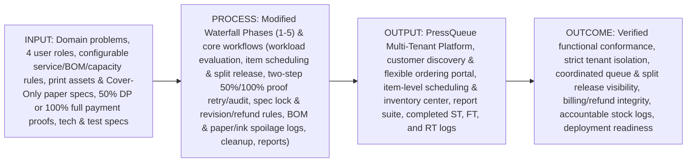

# Part 1: Preliminaries & Chapter 1 (Introduction) - PressQueue v2 Guide & Text

> **System Name**: **PressQueue**
> **Approved v2 Title**: ***PressQueue: A Multi-Tenant Web-Based Printing Shop Operations, Job Scheduling, and Inventory Management System***
> **Scope of This Document**: Unified, panel-aligned revision guide and ready-to-use academic text for the **Preliminaries** and **Chapter 1** matching [PressQueue_Chapter_1_v2.docx](file:///home/imaginarycjay/printify/capstone_paper/outline_paper/scratch/PressQueue_Chapter_1_v2.docx). Incorporates panel corrections (`N`, `B`, `R`), ethics-exempt functional verification (`outline_example_1.pdf`), flexible upfront payment verification (50% downpayment or 100% full payment), **`Normal`, `Busy`, and `At capacity`** workload labels, and **Cover-Only (customer-supplied paper)** intake support.

---

## 1. Preliminaries (Pages i-xvi)

### 1.1 Quick Summary of Changes (v1 to v2)
- **Title Page**: Replace the v1 title with ***PressQueue: A Multi-Tenant Web-Based Printing Shop Operations, Job Scheduling, and Inventory Management System***.
- **Table of Contents (Chapter 1 Order Updated)**:
  - `INTRODUCTION`
  - `Statement of the Problem` *(moved directly after `INTRODUCTION`, cohesive narrative paragraphs)*
  - `Significance of the Study`
  - `Objectives of the Study` *(exact heading required by Panelist `B`)*
  - `Scope and Limitations of the Study`
  - `Expected Outputs of the Study`
  - `Operational Definition of Terms` *(starts on a fresh page)*
  - `Conceptual Framework` *(4-Stage IPOO model, `IMPACT` removed)*
- **Table of Contents (Chapter 2 and Chapter 3 Headers)**:
  - Update Chapter 2 title to **Review of Related Literature** and include **Functional Testing and Quality Assurance**.
  - Update Chapter 3 subsections to the ethics-exempt structure (`Research Design`, `Project Locale`, `Testing Personnel and Materials`, `Data Collection Procedure`, `Data Analysis Procedure`, `Validity of the Testing Procedure`, `Ethical Consideration`, `System Architecture`, `Software Development Methodology: Modified Waterfall Model`, `Project Assessment and System Testing Plan`, `Deployment Planning and Readiness`).
- **List of Tables and Appendices**:
  - Replace v1's ISO/IEC 25010 respondent and Likert scale tables with Smoke Testing (`ST`), Role-Based Functional Testing (`FT`), Functional Requirements Specification (`FR`), and Deployment Specification tables.
  - Replace v1's questionnaire appendix with Smoke Testing Plan (`Appendix F`), Functional Testing Plan (`Appendix G`), Regression Test Records (`Appendix H`), and Task Allocation Matrix (`Appendix I`), keeping USM institutional forms in `Appendices A–E`.

### 1.2 Ready-to-Use Title Page Text
```text
PRESSQUEUE: A MULTI-TENANT WEB-BASED PRINTING SHOP OPERATIONS,
JOB SCHEDULING, AND INVENTORY MANAGEMENT SYSTEM


CHRISTIAN JAMES J. PEREZ
KAYE P. COMISSION


CAPSTONE PROJECT OUTLINE SUBMITTED TO THE FACULTY OF THE
DEPARTMENT OF COMPUTING AND LIBRARY INFORMATION SCIENCE,
COLLEGE OF ENGINEERING AND INFORMATION TECHNOLOGY,
UNIVERSITY OF SOUTHERN MINDANAO, KABACAN, COTABATO
IN PARTIAL FULFILLMENT OF THE
REQUIREMENTS FOR THE
DEGREE OF


BACHELOR OF SCIENCE IN INFORMATION SYSTEMS


OCTOBER 2026
```

---

## 2. Chapter 1: INTRODUCTION

### 2.1 What Changed and Why
- **De-Jargoned, Problem-First Narrative**: Opens with real campus and community printing demand, moves directly into concrete student and customer frustrations alongside shop-floor bottlenecks, and then introduces **PressQueue** in plain operational language.
- **Minimal Natural Citations (`2` total)**: Retained only `Anisa et al. (2025)` (manual chat-based print ordering problems) and `Tanaman et al. (2023)` (Philippine SME manual inventory and sales inaccuracy). Both sources are present in [REVISED_REVIEW_RELATED_LITERATURE.docx](file:///home/imaginarycjay/printify/capstone_paper/outline_paper/REVISED_REVIEW_RELATED_LITERATURE.docx).
- **Clean Terminology and Natural Human Cadence**: Removed em-dashes, en-dashes, heavy semicolon chains, and repetitive informal phrasing, replacing local jargon with **Cover-Only (customer-supplied paper)** across all sections.

### 2.2 Final Text: `INTRODUCTION`

> Local printing and binding shops support everyday academic and community work, especially near colleges and universities. Throughout each semester, university students, faculty members, campus organizations, and neighborhood clients depend on nearby print shops for lecture handouts, laboratory manuals, formal proposals, reviewers, and bound thesis manuscripts. Demand is rarely even. During midterms, final examinations, and defense weeks, small independent shops suddenly absorb heavy waves of rush orders spanning different paper sizes, weights, color settings, and finishing steps.
>
> In day-to-day manual operations, customers, particularly university students working under tight deadlines, feel these bottlenecks right away. A student rushing between classes has no reliable way to check whether a nearby shop is already swamped before walking over or messaging online. As a result, many end up waiting at overloaded counters while another shop down the street sits idle. Getting simple price quotes across counter queues or chat threads also requires slow clarifications over page counts, paper thickness, and binding fees. Submitting files through flash drives or unstructured messaging apps often causes communication errors, mixed-up document versions, and delayed production (Anisa et al., 2025). Students who print their own sheets beforehand and bring them in solely for binding under a **Cover-Only (customer-supplied paper)** option face similar friction because intake relies on manual page counting without formal drop-off tracking. Even after checkout, clients rarely know if an online payment proof has been checked, struggle when shops insist on 100% upfront cash for costly thesis packages instead of offering a 50% downpayment choice, and keep sending follow-up messages when quick handouts get stuck behind multi-day binding orders.
>
> Inside the shop, business owners and production staff deal with an equally disconnected workflow. Walk-in notebooks, chat messages, and paper receipts do little to coordinate multiple printers and operators working side by side. When multi-service orders are written down as a single flat ticket, short document runs and lengthy binding tasks share the floor without item-level queues or clear operator assignments. Staff also download client files onto desktop computers and print directly outside any shared ledger. That habit breaks the link between finished jobs, physical sheets used, and extra paper wasted on jams or quality-assurance reprints. Relying on paper tallies and visual stock checks leaves shops prone to inaccurate inventory counts and unexpected paper shortages during busy weeks (Tanaman et al., 2023). Over time, old client print files pile up unchecked on shop computers while owners still compile stock movements, sales totals, and pending schedules by hand.
>
> Standalone spreadsheets and single-shop tools keep records locked inside one store and still cannot show students which participating shops currently have lighter queues. To address both customer and operational challenges together, the project developers propose **PressQueue: A Multi-Tenant Web-Based Printing Shop Operations, Job Scheduling, and Inventory Management System**. Built as a shared web platform that gives each enrolled shop its own separate workspace, **PressQueue** lets students and walk-in clients browse participating shops, check live service workload indicators (*Normal*, *Busy*, or *At capacity*) before ordering, see instant itemized price quotes, and upload print files or submit Cover-Only (customer-supplied paper) requests. Customers can also choose between a 50% downpayment, paying the rest upon pickup, or 100% full payment upfront, and track each order item online. On the shop side, owners set up their own services, pricing rules, printer fleet, and material requirements, while staff manage item-level multi-printer queues, print approved jobs straight from the browser print dialog without cluttering shop desktops, log reprint waste separately, run scheduled cleanup on completed print files, and export printable Inventory, Sales, and Job Schedule reports. The capstone project follows the Modified Waterfall methodology and verifies system behavior through developer-executed smoke, functional, and regression testing.

---

## 3. Statement of the Problem *(Immediately After `INTRODUCTION`, Purely Narrative)*

> Independent printing and binding shops, together with the students and local clients they serve, face recurring delays caused by uncoordinated order intake, poor queue visibility, and manual floor management. From the customer perspective, university students and walk-in clients cannot easily see how busy nearby printing shops are before visiting or messaging online, leading to wasted trips and missed academic deadlines during peak weeks. Calculating prices across black-and-white or colored pages, paper sizes, GSM weights, and binding styles requires slow manual estimation, while Cover-Only jobs using customer-supplied preprinted sheets lack structured drop-off confirmation. Requiring full upfront payment on expensive thesis binding packages also strains student budgets, whereas informal counter arrangements without verified payment proofs expose shops to unclaimed custom work. At the same time, customers receive no clear item-by-item updates when quick handouts and multi-day binding jobs are placed inside a single order.
>
> Inside the workshop, owners and production staff lack unified scheduling and stock control across multiple printers and operators. Paper notebooks and rigid single-shop programs make it hard for owners to update service options, pricing rules, and material formulas through a self-service setup page. Without item-level job scheduling, staff have no shared view of job priorities or machine assignments. Operators routinely download customer files onto desktop computers to print outside the system, disconnecting actual paper output and quality-assurance reprint waste from recorded inventory. Concurrent orders can over-allocate limited materials when stock reservations are not protected, unpurged artwork files accumulate across local storage, and post-approval specification changes disrupt billing and downpayment records. Because records remain scattered, owners cannot quickly produce printable summaries of live job schedules, stock movements, and verified sales.
>
> Accordingly, this capstone project seeks to design, develop, and verify **PressQueue** to connect customers and multiple independent printing shops within one isolated multi-tenant platform. The system aims to coordinate item-level multi-printer scheduling, enforce flexible upfront payment verification (50% downpayment or 100% full payment) alongside controlled prepress and material tracking, and confirm requirement conformance through structured smoke, functional, and regression testing.

---

## 4. Significance of the Study

> The completion and verification of **PressQueue** will provide practical value to the following stakeholders:
>
> **University Students and Customers.** Students and walk-in clients can browse participating shops before leaving campus, check live service workload indicators (*Normal*, *Busy*, or *At capacity*), and see itemized pricing for printing and binding specifications upfront. Flexible payment options let students submit a 50% downpayment on expensive thesis packages and settle the remaining balance at pickup, or pay 100% upfront on quick handout orders. They can also submit Cover-Only (customer-supplied paper) orders with clear intake tracking and follow item-level progress without repeated follow-up messages.
>
> **Printing Shop Owners (Tenant Administrators).** Each shop operates inside a private workspace where owners define custom services, pricing formulas, printer fleets, staff accounts, and Bill of Materials (BOM) stock baselines without relying on manual notebooks. Verified upfront payments (50% downpayment or 100% full payment), prepress specification locks, separate QA reprint tracking, Reorder Point (ROP) alerts, and printable or downloadable Inventory, Sales, and Job Schedule reports protect stock accuracy and financial records.
>
> **Production Staff.** Workshop operators gain clear item-level queues across assigned printers and finishing stations, structured intake confirmation for customer-supplied sheets, and direct browser print dispatch that keeps loose client files off shop desktops. Scheduled file cleanup also clears old print files automatically after order completion.
>
> **Platform Administrator and Future Project Developers.** Platform administrators can onboard and monitor tenant shops centrally without viewing or altering private shop pricing and orders. Future capstone project developers gain a practical reference architecture for multi-tenant workspace isolation, flexible downpayment and full-payment workflows, atomic stock locking, and developer-executed functional verification.

---

## 5. Objectives of the Study

> The general objective of this capstone project is to design and develop **PressQueue: A Multi-Tenant Web-Based Printing Shop Operations, Job Scheduling, and Inventory Management System** to coordinate customer queue visibility, multi-printer item scheduling, flexible multi-tenant order billing, material inventory control, and standardized operational reporting across participating printing shops.
>
> Specifically, this capstone project aims to:
>
> 1. develop a **Job Scheduling and Production Queue Module** that shows customers each shop's live service workload (*Normal*, *Busy*, or *At capacity*), assigns and tracks order items independently across multiple printers and production staff, and supports direct browser-based print dispatch;
> 2. build a **Multi-Tenant Order, Prepress, and Billing Management Module** with isolated shop workspaces, owner-configured pricing and Cover-Only (customer-supplied paper) intake, flexible upfront payment verification (50% downpayment or 100% full payment), prepress specification locking, and scheduled post-completion file cleanup;
> 3. implement an **Inventory Management and Operational Reporting Module** that applies Bill of Materials (BOM) stock deduction with concurrent checkout protection and separate rework spoilage logging, triggers Reorder Point (ROP) alerts, and produces printable and downloadable Inventory, Sales, and Schedule reports; and
> 4. verify functional conformance, multi-tenant data isolation, and operational readiness through developer-executed **Smoke, Functional, and Regression Testing** supported by a documented deployment plan.

---

## 6. Scope and Limitations of the Study

> This capstone project covers the design, development, requirements-based functional verification, and deployment planning of **PressQueue**, a multi-tenant web-based printing shop operations, job scheduling, and inventory management system. To establish clear project boundaries, its functional scope, exclusions, and operational limitations are defined below.
>
> **In-Scope**
>
> **1. Users and Multi-Tenant Isolation.** All shop records reside inside a shared database strictly partitioned by tenant boundaries across four roles: **Platform Administrator (Super Admin)** for shop onboarding and approval; **Printing Shop Owners** for shop catalogs, BOM baselines, printer fleets, staff accounts, payment verification, and reports; **Production Staff** restricted to their assigned tenant shop for prepress inspection, Cover-Only paper intake confirmation, multi-printer item queues, browser print dispatch, and QA spoilage logging; and **Customers and University Students** for approved-shop browsing, live workload checks, order configuration, payment upload, and item-level tracking. Customer checkout enforces shop approval, active service availability, and active service-pause rules.
>
> **2. Job Scheduling and Browser Print Dispatch.** The platform computes each shop service's live queue load (*Normal*, *Busy*, or *At capacity*, indicating current queue volume rather than promised completion times), decomposes multi-service orders into item-level job tickets assigned across multiple printers and staff, supports early pickup on completed individual items while marking parent orders complete only after every item is claimed with zero balance due, tracks optional shelf/bin labels and pickup aging indicators, and opens approved print files directly through the workstation's browser print dialog.
>
> **3. Order Intake, Prepress Lock, Flexible Payment, and File Cleanup.** Customers receive itemized quotes upfront, submit full-package or Cover-Only (customer-supplied paper) orders, save pending orders safely before proof upload with retryable payment-proof submission (GCash or Maya screenshot and reference number) for either a 50% downpayment or 100% full payment upfront, pass prepress specification locking (allowing pre-print Specification Revision Requests that calculate upgrade top-ups, downgrade balance reductions, or `refund_due` manual-refund flags), and trigger automated deletion of heavy uploaded print files after a configurable post-completion window while preserving metadata and receipts.
>
> **4. BOM Inventory, QA Spoilage Tracking, and Standardized Reports.** Services map to consumables through Bill of Materials rules with concurrent stock reservation locks during checkout, separate QA reprint spoilage logging (for both paper sheets and configured ink or toner consumables) without altering customer billing, Reorder Point alerts, and printable or downloadable (Print View, PDF, and CSV) **Inventory and Stock Movement**, **Sales and Revenue**, and **Schedule and Live Job Status Reports**.
>
> **5. Documentation, Functional Testing, and Deployment Planning.** Verification covers technical documentation, requirements-based Smoke Testing, Role-Based Functional Testing, and Regression Testing using synthetic datasets, alongside a Deployment Planning and Readiness specification and fallback procedures (excluding live production hosting and commercial rollout).
>
> **Out-of-Scope**
>
> The following functions and claims are excluded from the capstone project:
>
> - **Automated payment gateway webhooks, live banking APIs, and automated e-wallet refund disbursements.** Digital e-wallet payments rely on manual proof and reference-number verification; counter cash applies only to shop-recorded walk-ins and pickup balances. Transfers sent via external e-wallet apps before saving a web order must be resolved via counter receipt checks, and overpayment credits from approved pre-print specification downgrades are logged as manual refunds settled offline via direct e-wallet transfer or counter cash.
> - **Hardware printer firmware telemetry, drop-level ink sensing, and sheet-counter polling.** Browser printing uses standard operating system print dialogs rather than proprietary printer firmware polling; paper and ink consumption (including QA reprint spoilage) rely on locked order specs, BOM estimates, and manual QA spoilage entries.
> - **Post-printing specification edits, physical shelf allocation enforcement, and ancillary ERP features.** Revisions and downgrades are blocked once physical printing begins; physical storage rack space and unclaimed-item disposal rules remain manual shop operations. The platform also excludes built-in canvas graphic editors, automated B2B supplier purchase orders, payroll and double-entry accounting, and third-party courier delivery (in-store pickup only).
> - **Live production deployment and infrastructure provisioning.** The project produces deployment-readiness specifications and fallback steps rather than provisioning ongoing commercial hosting servers.
> - **Claims not measured by functional testing.** The capstone project excludes human-respondent usability scores, customer satisfaction questionnaires, commercial adoption metrics, and empirical turnaround-time reduction measurements, as those require separate respondent-based evaluation.
>
> **Limitations**
>
> **People**
>
> Access depends on authenticated role accounts and assigned shop tenant boundaries across Platform Administrators, Shop Owners, Production Staff, and Customers. PressQueue enforces recorded permissions and updates inside the platform, but it cannot stop personnel from handling counter requests, verbal revisions, or printing tasks outside the software. Furthermore, system evaluation is executed by the project developers using representative role accounts and synthetic tenant workloads rather than external respondent shops.
>
> **Data**
>
> Stock ledgers, Reorder Point alerts, and Inventory, Sales, and Schedule reports depend entirely on accurate Bill of Materials ratios (including paper and ink/toner estimates), payment proofs, and spoilage entries recorded inside PressQueue. Unlogged walk-in jobs or unrecorded physical shelf withdrawals directly affect ledger completeness. The platform stores operational ordering and stock data rather than acting as an audited double-entry accounting ledger, and scheduled cleanup deletes uploaded print files after the configured retention window.
>
> **Process**
>
> PressQueue supports structured online intake, two-step pending-payment recovery, flexible payment auditing (50% downpayment or 100% full payment), Cover-Only sheet confirmation, prepress specification locking, pre-print revision recalculation (including upgrade top-up charges and downgrade manual-refund flags), item-level split release, browser print dispatch, and stock deduction workflows. Verified upfront payment officially marks the order as accepted, while prepress inspection confirms printability and locks agreed specifications before printing starts. Because automated banking APIs are excluded, any external e-wallet payment sent before a web order is saved must be reconciled offline with a receipt, and manual refunds on overpaid pre-print downgrades are disbursed offline by the shop. Production steps executed outside the platform (such as manual Ctrl+P printing on desktop downloads), physical rack capacity constraints during delayed customer pickups, and queue load labels (*Normal*, *Busy*, *At capacity*) remain outside automated timing or hardware guarantees.
>
> **Hardware and Technical Conditions**
>
> The web platform requires compatible client devices (desktop computers, laptops, tablets, or smartphones), modern web browsers, active internet connectivity, and available server resources. Transactional pessimistic row locking (`SELECT ... FOR UPDATE`) for concurrent stock reservation requires a relational database engine supporting row-level locks in production deployment (such as MySQL InnoDB or PostgreSQL, whereas single-writer SQLite serializes writes globally in local testing). Direct browser printing requires properly installed operating system printer drivers on the shop workstation for standard document jobs, whereas wide-format plotters or specialty presses requiring proprietary Raster Image Processor (RIP) software require exporting the locked job file into the host RIP application. Performance varies with device capability, network stability, uploaded file size, and external email service availability; this project does not include procurement or maintenance of printers, computers, racks, routers, or hosting hardware.

---

## 7. Expected Outputs of the Study

> Upon completion, this capstone project will deliver **PressQueue: A Multi-Tenant Web-Based Printing Shop Operations, Job Scheduling, and Inventory Management System**, comprising the following functional outputs and artifacts:
>
> 1. **Multi-Tenant Workshop Scheduling and Browser Print Hub.** An operations console supporting multi-printer and multi-staff item assignment, independent progress across order items (*Queued*, *Printing*, *Binding*, *Quality Check*, and *Ready for Pickup*), real-time service workload badges (*Normal*, *Busy*, or *At capacity*), and direct browser print dispatch avoiding loose desktop file downloads.
> 2. **Multi-Tenant Shop Administration Workspace.** An isolated configuration portal where approved printing shop owners define service catalogs, pricing formulas, rush fees, staff accounts, and printer fleets.
> 3. **Customer Ordering, Prepress Lock, and Flexible Payment Portal.** A portal enabling students and clients to view instant itemized quotes, submit Cover-Only (customer-supplied paper) requests, verify flexible payments (50% downpayment with pickup balance settlement, or 100% full payment upfront), enforce prepress specification locks with revision recalculation, and run scheduled post-completion file cleanup.
> 4. **BOM Inventory Ledger, Spoilage Tracker, and Standardized Report Suite.** An inventory subsystem with concurrent reservation protection, separate QA reprint spoilage logging, ROP alerts, and printable or downloadable (Print View, PDF, and CSV) **Inventory and Stock Movement**, **Sales and Revenue**, and **Schedule and Live Job Status Reports**.
> 5. **Functional Verification Records and Deployment-Readiness Plan.** Completed Smoke, Functional, and Regression test logs tied to functional requirements alongside documented production fallback procedures.

---

## 8. Operational Definition of Terms *(Starts on a New Page)*

> To ensure clear and consistent usage throughout this capstone project, the following terms are operationally defined according to their function in **PressQueue**:
>
> **Automated File Retention Cleanup.** The scheduled maintenance routine in PressQueue that deletes heavy uploaded client print files (PDF, PNG, DOCX) after a shop-configured post-completion retention window while keeping order metadata, payment logs, and reports.
>
> **Bill of Materials (BOM) Mapping.** The shop-configured formula linking each printing or binding service option to the quantity of raw materials (such as bond paper sheets, laminate sheets, binding covers, or foil consumables) reserved and deducted per order.
>
> **Concurrent Stock Reservation Lock.** The transactional database locking safeguard executed during order checkout and production approval so simultaneous customer requests cannot over-allocate limited shop materials into negative inventory balances.
>
> **Configurable Pricing Engine.** The tenant administration module through which each printing shop owner defines and updates service rates, paper weights, color charges, finishing add-ons, and rush fees.
>
> **Cover-Only Order (Customer-Supplied Paper).** A binding fulfillment option in which the customer brings preprinted interior sheets and orders only cover fabrication and binding, requiring staff to confirm physical sheet receipt before production starts.
>
> **Decoupled QA Spoilage Tracking.** The workshop inventory workflow that records wasted sheets or consumables from printer jams, miscuts, or quality-assurance reprints as a separate stock deduction without increasing the customer's locked order price.
>
> **Deployment Readiness.** The prepared production hosting specification, operational setup checklist, and manual fallback procedures documented once functional verification passes.
>
> **Direct Browser Print Dispatch.** The built-in staff action that opens locked order files inside the browser print dialog so operators print straight to workstation printers without downloading loose copies onto desktop folders, while calculating sheet deduction from locked order specs and QA logs rather than hardware firmware counters.
>
> **Flexible Upfront Payment Verification.** The billing rule allowing customers to upload payment proof (GCash or Maya screenshot and reference number) on a saved pending order for either a 50% downpayment, settling the rest at pickup, or 100% full payment upfront before production begins, with retryable proof upload if connectivity drops.
>
> **Functional Testing.** Structured developer-executed testing across all user role workflows using positive and boundary test cases linked to functional requirements.
>
> **Item-Level Job Scheduling.** The target queue design separating multi-item customer orders into individual tickets so fast document jobs reach early pickup readiness (including optional shelf/bin tags and unclaimed aging alerts) without waiting on slower binding items, marking the parent order complete only once all child items are claimed with zero remaining balance.
>
> **Manual Refund Ledger Entry.** A billing record (`Manual Refund Pending` or `Manual Refund Settled`) generated when an approved pre-print specification downgrade reduces total price below the customer's verified payment, indicating the overpayment amount to be returned offline via manual e-wallet transfer or counter cash.
>
> **Multi-Tenant Platform Architecture.** The shared web system architecture serving multiple independent printing shops from one application and database while isolating each shop's catalog, staff, inventory, orders, and reports per tenant boundary.
>
> **Needs Revision.** A test-execution outcome assigned when a functional test case exhibits an error or mismatch, triggering targeted fixes and subsequent regression re-testing.
>
> **Prepress Specification Lock.** The control triggered upon prepress approval that freezes paper weights, page counts, and quantities, blocking direct UI overwrites and limiting adjustments to pre-print Specification Revision Requests before physical printing starts.
>
> **Regression Testing.** The selective re-execution of previously failed test cases and connected workflows after code updates to verify defect fixes without introducing side effects.
>
> **Reorder Point (ROP) Alerting.** Automated dashboard notifications triggered when an inventory material's available quantity falls to or below the shop owner's configured minimum threshold.
>
> **Shop Workload Indicator.** The live customer-facing capacity badge (*Normal*, *Busy*, or *At capacity*) calculated from active queued orders against a shop service's capacity threshold, showing queue load rather than promising an exact completion time.
>
> **Smoke Testing.** Preliminary build checks confirming that core routes, authentication, tenant boundaries, and primary database operations load cleanly before running detailed functional tests.
>
> **Specification Revision Request.** A formal customer change request submitted after prepress approval and before physical printing begins, placing the item On Hold while BOM reservations and prices are recalculated for an upgrade top-up or downgrade adjustment.
>
> **Standardized Operational Reports.** The three pre-formatted, printable, and downloadable (Print View, PDF, and CSV) management reports generated by PressQueue covering Inventory and Stock Movements, Sales and Revenue, and Schedule and Live Job Status.

---

## 9. Conceptual Framework *(4-Stage IPOO Model, IMPACT Removed)*

The embedded diagram is stored at [PressQueue_Conceptual_Framework_v2.png](file:///home/imaginarycjay/printify/capstone_paper/outline_paper/scratch/PressQueue_Conceptual_Framework_v2.png).



> The conceptual framework of **PressQueue** adopts a four-stage Input-Process-Output-Outcome (IPOO) model to illustrate how real-world printing shop and customer problems, tenant rules, and development phases translate into a functionally verified multi-tenant system (Figure 1).
>
> **Input.** The Input stage consolidates stakeholder and domain problems, including student queuing delays, slow price quoting, unassigned multi-printer floors, and unrecorded reprint waste. It also incorporates four user role profiles, configurable shop catalogs and capacity thresholds, Bill of Materials ratios and Reorder Point limits, uploaded print files alongside Cover-Only (customer-supplied paper) specifications, flexible upfront payment proofs (50% downpayment or 100% full payment), and technical and verification plans.
>
> **Process.** The Process stage applies the five phases of the Modified Waterfall Model (Requirements Analysis, System Design, Implementation, Testing and Refinement, and Deployment Planning and Readiness) to build and verify the platform's core operations. These processes include real-time workload calculation (*Normal*, *Busy*, or *At capacity*), item-level multi-printer scheduling with split early release, direct browser print dispatch, two-step pending-payment proof retry and audit, prepress specification locking with pre-print upgrade and downgrade manual-refund recalculation, Cover-Only sheet intake confirmation, scheduled post-completion file cleanup, row-locked BOM deductions with separate paper and ink QA spoilage logs, and report generation.
>
> **Output.** The Output stage delivers **PressQueue: A Multi-Tenant Web-Based Printing Shop Operations, Job Scheduling, and Inventory Management System** across its customer discovery and flexible ordering portal, multi-printer workshop scheduling and inventory center (producing printable and downloadable Inventory, Sales, and Schedule reports), and completed Smoke, Functional, and Regression test logs.
>
> **Outcome.** Bounded strictly within developer-executed functional testing rather than external human-subject field surveys, the Outcome stage establishes verified functional conformance across Smoke, Functional, and Regression test cases (*Passed*, *Failed*, or *Needs Revision* pending regression resolution), confirmed tenant isolation, coordinated split pickup visibility, consistent enforcement of flexible payment retries, manual-refund tracking, and prepress locks, synchronized stock and paper/ink spoilage accounting, and deployment-ready operational reporting.
