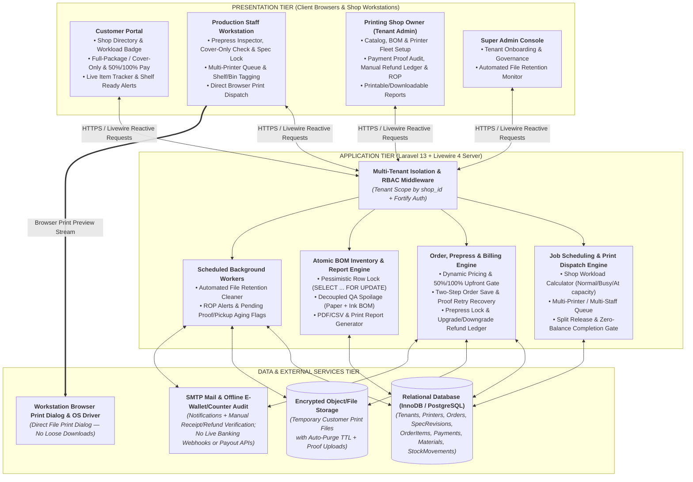
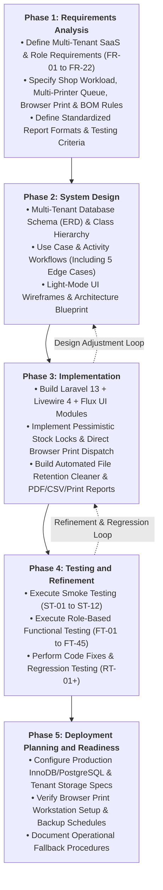
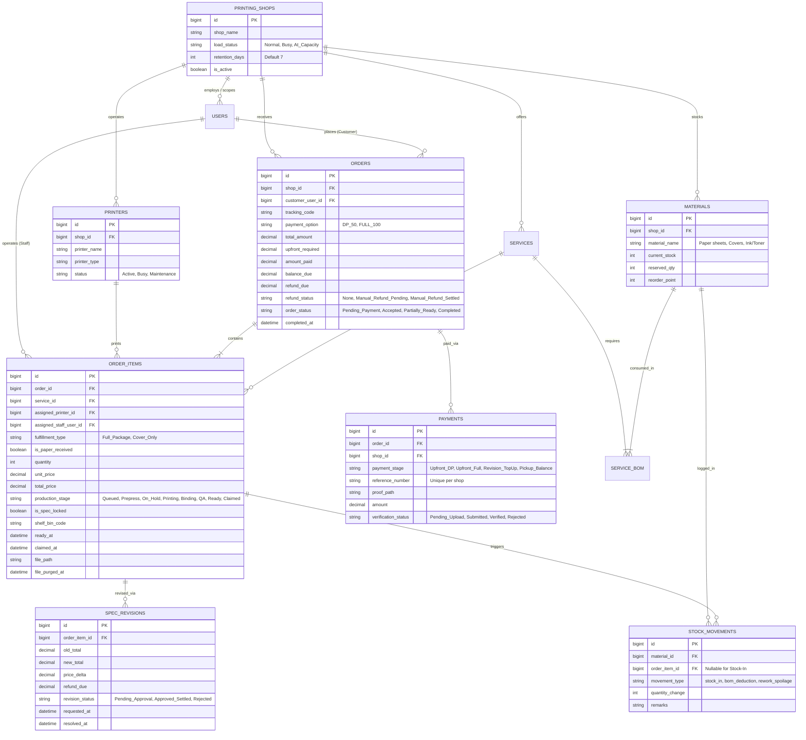

# Part 3: Chapter 3 (Methodology), Diagrams, Light-Mode UI, & Appendices A–C — *PressQueue* v2 Guide & Full Draft

> **System Name**: **PressQueue**
> **Approved v2 Title**: ***PressQueue: A Multi-Tenant Web-Based Printing Shop Operations, Job Scheduling, and Inventory Management System***
> **Scope of This Document**: Complete section-by-section v2 text, tables, diagram specifications, and appendices for **Chapter 3 (`Methodology`)** and **Appendices A, B, and C**, modeled directly after the panel-approved USM BSIS reference manuscript `outline_example_1.pdf` (*Eventia*) to ensure **100% exemption from UERC Human-Subject Ethics Review** while addressing every technical mandate from Panelists `N`, `B`, and `R`.

---

## 1. Summary of Structural Changes in Chapter 3 (v1 → v2)

| v1 Section (`outline_capstone_v1_FinalDraft.pdf`) | v2 Section (`PressQueue` — Modeled on `outline_example_1.pdf`) | Why It Changed |
| :--- | :--- | :--- |
| `Research Design` (Developmental + ISO/IEC 25010 descriptive survey) | **`Research Design`** (Developmental Research Design supported by **Requirements-Based Functional Testing** and **Deployment-Readiness Planning**) | Eliminates human survey respondents; classifies test cases objectively as **`Passed`**, **`Failed`**, or **`Needs Revision`**. |
| `Project Participants` (`Table 1`: 3 Shop Owners, 9 Staff, 20 Customers) | **`Testing Personnel and Materials`** (No external human sample; test cases executed by project developers across 4 role accounts and reviewed by adviser/panel) | **Core UERC Ethics Exemption**: Explicitly states that functional testing verifies deterministic software behavior rather than collecting human survey ratings. |
| `Data Collection Procedure` (Workplace interviews, observations, survey questionnaires) | **`Data Collection Procedure`** (Deriving test cases from SRS `FR-01`–`FR-22`, preparing synthetic multi-tenant data and sample print files, executing test steps, recording observed vs. expected outputs) | Removes all human-subject field data collection (interviews/observations/surveys) that would otherwise trigger ethics clearance. |
| `Statistical Treatment` & `Table 2` (Weighted Mean $\bar{x}$ & 5-Point Likert Scale) | **`Data Analysis Procedure`** & **`Validity of the Testing Procedure`** (Comparing observed outputs against expected acceptance criteria + requirement traceability + regression verification) | Replaces subjective Likert statistics with deterministic ISO/IEC/IEEE 29119 functional verification analysis. |
| `Software Development Methodology: Agile Scrum Model` | **`Software Development Methodology: Modified Waterfall Model`** (5 sequential phases with feedback loops: *Requirements Analysis*, *System Design*, *Implementation*, *Testing and Refinement*, *Deployment Planning and Readiness*) | Panel (`N`, `R`, Adviser) & `outline_example_1.pdf` (pp. 52–77, Figure 4). |
| *Missing in v1* | **`Phase 4: Project Assessment and System Testing Plan`** (**Smoke Testing `Table 1`**, **Role-Based Functional Testing `Tables 2–5`**, and **Regression Testing**) | Provides the complete testing blueprint and role-by-role component breakdown required by the panel. |
| *Missing in v1* | **`Phase 5: Deployment Planning and Readiness`** (**`Table 10: Proposed Production Deployment Specification`**, **`Figure 5: Deployment Diagram`**, and **`Fallback Procedures`**) | Demonstrates production SaaS readiness and operational recovery for pending-payment proof retries, manual refunds, printer errors, and stock locks. |
| `Appendix A: Survey Questionnaire` | **`Appendix A: Smoke Testing Plan (ST-01 to ST-12)`**, **`Appendix B: Functional Testing Plan (FT-01 to FT-45)`**, **`Appendix C: Regression Test Records (RT-____)`** | Replaces human survey forms with complete, executable ISO/IEC/IEEE 29119 test documentation. |

---

## 2. Ready-to-Use Text: Opening Methodology Sections (`3.1` to `3.7`)

### 3.1 `Research Design`

> This capstone project employs a **developmental research design** supported by **requirements-based functional testing** and **deployment-readiness planning**. The developmental phase encompasses the requirements specification, multi-tenant architectural modeling, and full-stack implementation of **PressQueue: A Multi-Tenant Web-Based Printing Shop Operations, Job Scheduling, and Inventory Management System**.
>
> System verification is conducted through structured **Smoke Testing**, **Role-Based Functional Testing**, and **Regression Testing** aligned with ISO/IEC/IEEE 29119. Rather than collecting subjective user perception ratings through external survey questionnaires, the verification process evaluates whether each implemented module satisfies its documented functional requirements (`FR-01` to `FR-22`) across representative multi-tenant scenarios, role permissions, validation boundaries, and concurrency rules. Each executed test case is recorded with its expected output, observed output, and verification status classified as **Passed**, **Failed**, or **Needs Revision**. Any test case marked as *Failed* or *Needs Revision* undergoes code refinement and subsequent **Regression Testing** until all defined acceptance criteria are met.

### 3.2 `Project Locale`

> The design, development, and functional verification of **PressQueue** will be conducted at the College of Information and Computing Sciences (CICS), University of Southern Mindanao (USM), Main Campus, Kabacan, Cotabato. While the software is engineered as a cloud-ready, multi-tenant Software-as-a-Service (SaaS) platform capable of onboarding independent printing shops across any locality, the operational workflows, pricing structures, multi-printer scheduling rules, and Bill of Materials (BOM) inventory configurations modeled in the test environment reflect standard commercial and campus-adjacent printing shop operations within Kabacan, Cotabato.

### 3.3 `Testing Personnel and Materials` *(Replaces `Project Participants`)*

> The functional-testing procedure does not require a human respondent sample because it verifies deterministic software behavior against approved functional requirements rather than collecting subjective user ratings or questionnaire responses. The project developers will prepare, execute, and document the smoke, functional, and regression test cases using structured role-based test accounts representing all four system actors:
>
> 1. **Super Admin** (platform-level tenant onboarding, subscription status, and automated file retention policy monitoring);
> 2. **Printing Shop Owner / Tenant Administrator** (shop profile setup, service and BOM configuration, printer fleet and staff registration, flexible payment proof verification, manual refund ledger tracking, stock management, and standardized report generation);
> 3. **Production Staff** (prepress artwork inspection, Cover-Only sheet intake confirmation, specification locking, multi-printer item-level queue execution, shelf/bin tagging, direct browser print dispatch, and decoupled quality-assurance spoilage logging for paper sheets and ink/toner consumables); and
> 4. **Customer** (multi-tenant marketplace browsing with real-time shop workload visibility across *Normal*, *Busy*, and *At capacity* tiers, Full-Package or Cover-Only order placement, two-step pending order saving with flexible 50% downpayment or 100% full payment proof submission, pre-print specification revision requests, and item-level order tracking).
>
> Testing materials consist of the **Smoke Testing Plan (`Appendix A`)**, the **Functional Testing Plan (`Appendix B`)**, the **Regression Test Record Template (`Appendix C`)**, synthetic multi-tenant shop datasets, and sample print-ready documents (PDF, PNG, and JPEG files of varying page counts and dimensions). The capstone adviser and defense panel members may inspect the test plan, execution logs, and system build for completeness and technical accuracy.

### 3.4 `Data Collection Procedure`

> Data collection for system verification follows a structured, requirements-based test execution protocol:
>
> 1. **Test Case Derivation:** The project developers map each approved functional requirement (`FR-01` to `FR-22`) and technical edge case into numbered smoke test cases (`ST-01` to `ST-12`) and role-based functional test cases (`FT-01` to `FT-45`).
> 2. **Test Environment and Synthetic Data Preparation:** The project developers configure the test environment with multiple isolated tenant shops (e.g., *Shop A – Normal*, *Shop B – At capacity*), registered printers (`PRINTERS`), raw material inventory items (paper and ink/toner consumables) with Bill of Materials (BOM) mappings and Reorder Point (ROP) thresholds, role-based test accounts, and synthetic print files.
> 3. **Smoke Test Execution:** Prior to detailed functional testing, the project developers execute the smoke test suite (`ST-01` to `ST-12`) to verify that core application routes, authentication guards, tenant workspace isolation, database connections, and the browser print/report preview interface respond without critical errors.
> 4. **Role-Based Functional Test Execution:** For each functional test case (`FT-01` to `FT-45`), the project developers perform the documented preconditions and step-by-step inputs—covering valid workflows, invalid inputs, concurrent stock reservations, two-step pending-payment proof retries, prepress specification locks with upgrade/downgrade revision billing, split multi-item production queues with zero-balance parent completion, direct browser print dispatch, paper and ink QA spoilage deductions, automated file retention cleanup, and printable/downloadable report generation—and record the observed system behavior alongside verification screenshots or logs.
> 5. **Defect Resolution and Regression Logging:** Any test case whose observed behavior deviates from the expected result is logged as *Failed* or *Needs Revision*, corrected in the codebase, and re-tested together with its dependent workflows using the **Regression Test Record (`Appendix C`)**.

### 3.5 `Data Analysis Procedure` *(Replaces `Statistical Treatment`)*

> Because system verification is grounded in deterministic requirements testing rather than survey sampling, data analysis is conducted by comparing the **Actual Result** of each executed test case against its predefined **Expected Result** in `Appendix A` and `Appendix B`. Each test case is evaluated using three status classifications:
>
> - **Passed:** The observed system output, database state transition, role access boundary, or generated report matches the expected acceptance criteria completely.
> - **Failed:** The system produces an error, permits an unauthorized action, miscalculates pricing or BOM stock deductions, or fails to produce the expected output.
> - **Needs Revision:** The core function executes, but minor interface formatting, validation messaging, or report layout details require adjustment to fully satisfy the specification.
>
> Summary tables aggregating the total number of executed, passed, failed, and regression-verified test cases across all four user roles and system modules will be presented in the final manuscript to demonstrate complete requirement conformance.

### 3.6 `Validity of the Testing Procedure`

> The validity of the testing procedure is established through direct **requirements traceability** and adherence to **ISO/IEC/IEEE 29119** test documentation standards. Every smoke and functional test case is explicitly linked to one or more functional requirements (`FR-01` to `FR-22`) in the Software Requirements Specification and covers both positive execution paths (valid transactions) and negative boundary conditions (concurrent stock contention, locked specification edits and downgrades, interrupted proof submissions during connectivity drops, and unauthorized cross-tenant access attempts). Prior to final test execution, the test tables and test case specifications are reviewed by the capstone adviser to ensure complete coverage of the approved project objectives.

### 3.7 `Ethical Consideration`

> This capstone project adheres to institutional and software engineering ethics standards:
>
> 1. **Absence of Human-Subject Questionnaires or Personal Data Collection:** Functional verification is conducted exclusively by the project developers using role-based test accounts and synthetic business data; no external human respondents are surveyed, interviewed, or profiled.
> 2. **Synthetic Data and Privacy Protection:** All tenant shop profiles, customer names, payment reference numbers, and uploaded print documents used during testing are synthetic and non-identifying.
> 3. **Multi-Tenant Data Security and Storage Hygiene:** The software architecture enforces strict logical tenant isolation (`shop_id`), password hashing, role-based access control, and an automated file retention policy that purges customer artwork files after order completion to prevent unauthorized document retention.

---

## 3. System Architecture (`3.8`)

### 3.1 Diagram Specification for `Figure 2. Multi-Tenant System Architecture of PressQueue`



---

## 4. Software Development Methodology: 5-Phase Modified Waterfall Model (`3.9`)

### 4.1 Diagram Specification for `Figure 4. Modified Waterfall Model`



### 4.2 Phase 1 to Phase 3 Narrative Summary
- **Phase 1: Requirements Analysis**: Defines the 22 functional requirements (`FR-01` to `FR-22`) across the four roles (Super Admin, Printing Shop Owner, Production Staff, Customer), establishing rules for shop workload indicators (*Normal*, *Busy*, *At capacity*), multi-printer/multi-staff item-level scheduling with split pickup release, direct browser print dispatch, flexible upfront payment verification (50% downpayment or 100% full payment) with two-step pending-payment recovery, Cover-Only intake verification, prepress specification locking with pre-print upgrade/downgrade manual-refund tracking, atomic BOM stock reservation, decoupled paper and ink QA spoilage logging, automated post-completion file cleanup, and standardized printable/downloadable reports.
- **Phase 2: System Design**: Models the system through the Multi-Tenant Architecture (`Figure 2`), Use Case Diagram (`Figure 6`), Class Diagram (`Figure 7`), Entity-Relationship Diagram (`Figure 8`), Activity Diagrams (`Figures 9–28`), and Light-Mode User Interface Wireframes.
- **Phase 3: Implementation**: Constructs the application using **PHP 8.4/8.5**, **Laravel 13**, **Livewire 4**, **Flux UI**, **Tailwind CSS v4**, and **MySQL 8.0 (InnoDB) / PostgreSQL** for row-locked production workloads (with SQLite supported for single-writer local testing), integrating Laravel Task Scheduling (`schedule:run`) for automated post-completion artwork file deletion and direct browser print dialog rendering (`window.print()`) while calculating material consumption from locked order specs, BOM formulas, and QA spoilage logs.

---

## 5. Phase 4: Testing and Refinement — `Project Assessment and System Testing Plan`

> [!IMPORTANT]
> This section is modeled directly after **Pages 54–74 of `outline_example_1.pdf` (*Eventia*)** and is the centerpiece of your ethics-exempt verification methodology.

### 5.1 Smoke Testing

#### Objectives of Smoke Testing
Smoke testing serves as the initial build-verification stage prior to comprehensive functional testing. Its objective is to confirm that **PressQueue** launches cleanly, core routes and role-based dashboards load without fatal HTTP or runtime errors, multi-tenant workspace isolation (`shop_id`) is enforced, database connectivity is operational, and the print/report rendering engine initializes properly.

#### Roles to Be Tested in Smoke Testing
1. **Super Admin**
2. **Printing Shop Owner (Tenant Admin)**
3. **Production Staff**
4. **Customer**

#### Test Environment
- **Application Stack:** Laravel 13, Livewire 4, Flux UI, Tailwind CSS v4 (PHP 8.4+, MySQL 8.0 InnoDB / PostgreSQL for production concurrent row locks; SQLite 3 for general single-writer local testing)
- **Client Workstation:** Modern Web Browser (Google Chrome / Microsoft Edge) connected to a configured local/network OS printer driver
- **Test Data:** Seeded multi-tenant database containing 2 synthetic printing shops (*Tenant A* and *Tenant B*), 4 role accounts, 3 registered printers, BOM-mapped paper and ink/toner stock items, and sample PDF/PNG print files

#### `Table 1. Components to Be Tested Through Smoke Testing`

| Smoke Test ID | Component / Feature | Role Tested | Verification Objective | Traceability |
| :-: | :--- | :--- | :--- | :-: |
| **ST-01** | Public Landing Page & Multi-Tenant Marketplace | Guest / Customer | Verify that the landing page and shop directory load with real-time Shop Workload Indicators (*Normal*, *Busy*, *At capacity*). | `FR-02` |
| **ST-02** | Role-Based Authentication & Redirects | All 4 Roles | Verify that login, logout, and role-specific dashboard redirects succeed for Super Admin, Shop Owner, Production Staff, and Customer. | `FR-01` |
| **ST-03** | Multi-Tenant Workspace Isolation Guard | Shop Owner / Staff | Verify that *Shop A*'s owner/staff cannot access *Shop B*'s orders, printers, inventory, or reports via URL manipulation. | `FR-01` |
| **ST-04** | Super Admin Tenant & Storage Policy Console | Super Admin | Verify that the Super Admin tenant registry and automated file retention settings page load without errors. | `FR-01`, `FR-21` |
| **ST-05** | Shop Owner Service Catalog, BOM & Printer Setup | Shop Owner | Verify that the service catalog, BOM material mapping (paper and ink/toner), and printer fleet management pages load and render existing records. | `FR-03`, `FR-13` |
| **ST-06** | Customer Custom Order Form & Dynamic Price Calculator | Customer | Verify that selecting a shop, service, fulfillment mode (Full-Package or Cover-Only), paper gsm, quantity, and payment option dynamically updates the total price, 50% downpayment, and 100% full payment summary. | `FR-08`, `FR-11` |
| **ST-07** | Artwork File Upload & Prepress Queue Display | Customer / Staff | Verify that uploading a valid PDF/PNG print file attaches cleanly to the order item and appears in the Production Staff prepress queue. | `FR-09` |
| **ST-08** | Multi-Printer & Multi-Staff Production Queue Board | Production Staff | Verify that the item-level production queue board loads active items, assigned printers, shelf/bin tags, and assigned staff filters cleanly. | `FR-04`, `FR-05` |
| **ST-09** | Direct Browser Print Dispatch Modal | Production Staff | Verify that clicking *"Print Directly"* opens the browser print preview dialog for the locked file without saving loose downloads to the local desktop. | `FR-06` |
| **ST-10** | Warehouse Inventory & ROP Alert Badge | Shop Owner | Verify that the inventory ledger loads current stock levels, reserved quantities, and active Reorder Point (ROP) low-stock badges. | `FR-14`, `FR-15` |
| **ST-11** | Standardized Report Center (Inventory, Sales, Schedule) | Shop Owner | Verify that the Report Center loads and previews the *Inventory Report*, *Sales Report*, and *Schedule/Job Status Report* without errors. | `FR-16`–`FR-18` |
| **ST-12** | Printable & Downloadable Report Export (PDF/CSV/Print) | Shop Owner | Verify that triggering PDF download, CSV export, and direct browser print from the Report Center responds cleanly. | `FR-16`–`FR-18` |

---

### 5.2 Functional Testing

#### Roles and Scope of Functional Testing
Once all 12 smoke test cases pass, **Role-Based Functional Testing (`FT-01` to `FT-45`)** verifies every functional requirement (`FR-01` to `FR-22`) and all 5 technical edge cases raised by the defense panel across the four user roles:
- **`Table 2`**: Super Admin Components (`FT-01` to `FT-06`)
- **`Table 3`**: Printing Shop Owner Components (`FT-07` to `FT-22`)
- **`Table 4`**: Production Staff Components (`FT-23` to `FT-35`)
- **`Table 5`**: Customer Components (`FT-36` to `FT-45`)

#### `Table 2. Components to Be Tested Through Functional Testing — Super Admin Role`

| Test ID | Component / Feature | Functional Verification Scope | SRS Ref |
| :-: | :--- | :--- | :-: |
| **FT-01** | Tenant Shop Registration Approval | Approving or rejecting new printing shop tenant applications and provisioning isolated tenant workspaces (`shop_id`). | `FR-01` |
| **FT-02** | Tenant Suspension & Reactivation | Suspending an inactive or non-compliant shop tenant and verifying that its public marketplace listing and staff logins are blocked. | `FR-01` |
| **FT-03** | Global File Retention Policy Configuration | Setting the default post-completion artwork retention period (e.g., 7 days) and maximum upload file size limits. | `FR-21` |
| **FT-04** | Automated File Retention Cleanup Execution | Running the scheduled cleanup command (`pressqueue:purge-expired-files`) and confirming that print files for orders completed $>X$ days ago are deleted from disk while order/receipt records remain intact. | `FR-21` |
| **FT-05** | Active Order Artwork Protection Guard | Verifying that the automated file cleanup job never deletes artwork files belonging to orders in *Queued*, *Printing*, *Binding*, or *On Hold* status. | `FR-21` |
| **FT-06** | Platform-Wide Storage & Tenant Health Audit | Viewing aggregate disk storage usage reclaimed by file cleanup and active tenant counts without exposing private tenant financial details. | `FR-01`, `FR-21` |

#### `Table 3. Components to Be Tested Through Functional Testing — Printing Shop Owner (Tenant Admin) Role`

| Test ID | Component / Feature | Functional Verification Scope | SRS Ref |
| :-: | :--- | :--- | :-: |
| **FT-07** | Shop Profile & Workload Threshold Configuration | Configuring shop operating hours, contact details, manual e-wallet QR/account details, and queue thresholds governing *Normal*, *Busy*, and *At capacity* workload badges. | `FR-02` |
| **FT-08** | Printer Fleet Registration & Status Management | Adding multiple physical printers (`PRINTERS` table: name, type, supported paper sizes, speed rating, status: *Active* / *Maintenance*) for job scheduling. | `FR-03` |
| **FT-09** | Production Staff Account & Role Assignment | Creating production staff accounts scoped to the shop tenant and assigning their operational permissions. | `FR-01`, `FR-03` |
| **FT-10** | Service Catalog & Dynamic Pricing Matrix Setup | Creating printing and finishing services with variable pricing rules per paper gsm, size, color mode, Cover-Only option, and binding type. | `FR-08` |
| **FT-11** | Raw Material Inventory & BOM Formula Mapping | Adding raw materials (paper sheets, binding covers, and configured ink/toner consumables) and linking them to services via Bill of Materials (BOM) consumption ratios. | `FR-13` |
| **FT-12** | Reorder Point (ROP) Threshold & Alert Triggering | Setting minimum safety thresholds (`reorder_point`) on materials and verifying that in-app and email alerts fire when available stock drops to or below the ROP. | `FR-15` |
| **FT-13** | Stock-In Replenishment Logging | Recording newly delivered supplier stock into warehouse inventory and verifying that `available_qty` updates and active ROP alerts clear automatically. | `FR-13`, `FR-15` |
| **FT-14** | Flexible Payment Verification & Order Acceptance | Auditing submitted GCash/Maya screenshots and reference numbers for either a 50% downpayment or 100% full payment, officially marking the order *Accepted* and unlocking production queueing. | `FR-11` |
| **FT-15** | Two-Step Pending Proof Recovery & External Receipt Audit | *(Panel Edge Case R3)* Auditing a retried proof submission from a `pending_payment` order interrupted mid-upload, rejecting duplicate reference numbers per shop, and logging offline owner reconciliation for pre-order external transfers. | `FR-12` |
| **FT-16** | Pre-Print Specification Revision Approval & Refund Ledger | *(Panel Edge Case R5)* Approving pre-print specification changes (200gsm to 300gsm upgrade requiring `additional_due` top-up verification, or 300gsm to 200gsm downgrade lowering `balance_due` or flagging `refund_due` as *Manual Refund Pending* / *Manual Refund Settled*). | `FR-10` |
| **FT-17** | Manual Workload Reassignment Across Printers/Staff | Reassigning queued order items from a bottlenecked or maintenance-mode printer/staff member to an available printer/staff member. | `FR-03`, `FR-05` |
| **FT-18** | Balance Settlement, Child Claim Gate & Official Receipt | Settling remaining pickup balance (or confirming zero balance on 100% prepaid orders), ensuring parent order reaches *Completed* only when every item is claimed with `balance_due <= 0`, and generating the official receipt. | `FR-04`, `FR-11` |
| **FT-19** | Standardized Inventory & Stock Movement Report | *(Panel Mandate B2)* Generating, filtering by date/type, directly printing, and downloading (PDF/CSV) the formal **Inventory and Stock Movement Report** (including BOM deductions and paper/ink QA spoilage). | `FR-16` |
| **FT-20** | Standardized Sales & Revenue Report | *(Panel Mandate B2)* Generating, filtering by date/service, directly printing, and downloading (PDF/CSV) the formal **Sales and Revenue Report** (downpayments, full payments, settled pickup balances, manual refunds, and net revenue). | `FR-17` |
| **FT-21** | Standardized Live Schedule & Job Status Report | *(Panel Mandate B2)* Generating, directly printing, and downloading (PDF/CSV) the formal **Schedule and Job Status Report** explicitly listing: *(a) Jobs Currently Printing (with Printer & Staff)*, *(b) Jobs Already Printed*, and *(c) Jobs Ready for Pickup* (with shelf/bin tag and aging indicators). | `FR-18` |
| **FT-22** | Shop Analytics Dashboard & Retention Override | Viewing real-time KPI summaries and configuring shop-specific file retention days (`retention_days`). | `FR-19`, `FR-21` |

#### `Table 4. Components to Be Tested Through Functional Testing — Production Staff Role`

| Test ID | Component / Feature | Functional Verification Scope | SRS Ref |
| :-: | :--- | :--- | :-: |
| **FT-23** | Prepress Artwork Inspection — Approval & Spec Lock | Inspecting a customer's uploaded print file, marking it *Prepress Approved*, and verifying that `is_spec_locked` is set to `true` on the order item. | `FR-09`, `FR-10` |
| **FT-24** | Prepress Artwork Rejection & Re-Upload Prompt | Rejecting a corrupted, low-resolution, or wrong-dimension file with remarks and verifying that the customer is notified to upload a corrected file. | `FR-09` |
| **FT-25** | Cover-Only Paper Intake Check & Shift Option | Confirming physical customer-supplied sheet receipt (`is_paper_received = true`) on *Cover-Only* orders before printing, or shifting short-stock full-package items to *Cover-Only* with recalculated paper deductions. | `FR-09`, `FR-14` |
| **FT-26** | Multi-Printer & Multi-Staff Job Assignment | *(Panel Mandate N5)* Assigning approved order items to specific active printers (`assigned_printer_id`) and production staff (`assigned_staff_user_id`) based on current queue load and deadline priority. | `FR-03`, `FR-05` |
| **FT-27** | Split Item-Level Fulfillment & Shelf/Bin Tagging | *(Panel Edge Case R4)* Advancing a 10-minute flyer item to *Ready for Pickup* with an optional `shelf_bin_code` and `ready_at` aging timestamp while a 3-day bookbinding item stays in *Binding*, keeping the parent order *Partially Ready* until all items are *Claimed* and paid in full. | `FR-04` |
| **FT-28** | Enforcement of Prepress Spec Lock & Printing Freeze | *(Panel Edge Case R5)* Verifying that an active pre-print revision moves the item to *On Hold — Pending Revision Resolution*, while starting physical *Printing* blocks further specification revisions or downgrades permanently. | `FR-10` |
| **FT-29** | Direct Browser Print Dispatch | *(Panel Mandate N3)* Opening locked order artwork directly through the browser print dialog without saving loose files onto desktop folders, triggering print execution while using locked specs rather than firmware counters for deductions. | `FR-06` |
| **FT-30** | Atomic BOM Stock Deduction Upon Print Execution | Verifying that confirming browser print execution converts the item's `reserved_qty` into an actual `bom_deduction` entry in `STOCK_MOVEMENTS` and decrements physical warehouse stock. | `FR-06`, `FR-14` |
| **FT-31** | Concurrent Stock Reservation Lock Under Contention | *(Panel Edge Case R1)* Simulating two simultaneous checkouts for 500 sheets when only 600 sheets exist on an InnoDB/PostgreSQL transaction, verifying pessimistic row-locking (`SELECT ... FOR UPDATE`) allows the first and blocks the second. | `FR-14` |
| **FT-32** | Post-Press Finishing & Binding Stage Transition | Advancing printed items requiring lamination, cutting, or bookbinding through the *Finishing/Binding* stage and updating operator workload counts. | `FR-04`, `FR-05` |
| **FT-33** | Quality Assurance (QA) Pass, Shelf Assignment & Pickup Alert | Marking an inspected item as *Ready for Pickup*, optionally recording `shelf_bin_code` and `ready_at`, and dispatching an automated pickup notification for early item release. | `FR-04`, `FR-20` |
| **FT-34** | QA Failure & Decoupled Paper/Ink Spoilage Logging | *(Panel Edge Case R2)* Failing a print run during QA inspection, logging wasted paper sheets AND configured BOM ink/toner consumables as `rework_spoilage` in `STOCK_MOVEMENTS`, returning the item to *Printing*, and keeping `ORDERS.total_amount` locked. | `FR-07`, `FR-14` |
| **FT-35** | Printer Maintenance Failover Re-Queueing | Marking an active printer as *Under Maintenance* mid-shift and verifying that its remaining queued items can be batch-reassigned to another compatible printer. | `FR-03`, `FR-05` |

#### `Table 5. Components to Be Tested Through Functional Testing — Customer Role`

| Test ID | Component / Feature | Functional Verification Scope | SRS Ref |
| :-: | :--- | :--- | :-: |
| **FT-36** | Customer Account Registration & Authentication | Registering a customer account, verifying email/credentials, and logging into the multi-tenant marketplace. | `FR-01` |
| **FT-37** | Marketplace Browsing & Real-Time Shop Workload Visibility | *(Panel Mandate N2)* Browsing approved printing shops and verifying that each shop card accurately displays its live **Shop Workload Indicator** (*Normal*, *Busy*, or *At capacity*) based on active queue count without promising an arbitrary completion time. | `FR-02` |
| **FT-38** | Multi-Item & Cover-Only Custom Order Quote | Creating a single order containing distinct items (including Full-Package flyers and Cover-Only binding) and verifying item-level and total price calculation plus payment choice (50% DP vs 100% full). | `FR-04`, `FR-08` |
| **FT-39** | Artwork File Upload & Format/Size Validation | Uploading valid print-ready files (PDF/PNG/JPEG) and verifying that unsupported file formats or files exceeding the size limit are rejected with clear validation messages. | `FR-09` |
| **FT-40** | Flexible Upfront Payment Submission (50% DP or 100% Full) | Selecting either the minimum 50% downpayment or 100% full payment option on checkout, uploading a GCash/Maya screenshot and reference number, and blocking invalid sub-50% entries. | `FR-11` |
| **FT-41** | Concurrent Checkout Stock Protection Feedback | *(Panel Edge Case R1)* Attempting to confirm an order for a paper substrate whose remaining available stock was locked by another customer milliseconds earlier, and verifying an immediate insufficient-stock alert. | `FR-14` |
| **FT-42** | Two-Step Pending-Payment Proof Retry Under Network Drop | *(Panel Edge Case R3)* Simulating a connectivity failure right after order persistence (`pending_payment` saved with tracking code) and verifying that the customer can retry payment proof upload cleanly without creating duplicate orders or double stock reservations. | `FR-12` |
| **FT-43** | Pre-Print Spec Revision Request (Upgrade & Downgrade) | *(Panel Edge Case R5)* Verifying direct overwriting is blocked after prepress lock (`is_spec_locked = true`) and completely disabled once *Printing* begins, while pre-print Revision Requests compute upgrade top-ups and downgrade `balance_due` reductions or `Manual Refund Pending` flags. | `FR-10` |
| **FT-44** | Granular Item-Level Tracker & Early Partial Pickup | *(Panel Edge Case R4)* Viewing a mixed order tracker and verifying independent status visibility (Flyer = *Ready for Pickup* with optional shelf/bin label; Binding = *Printing/Binding*) before the full order completes. | `FR-04`, `FR-20` |
| **FT-45** | Completed Order History & Post-Retention Metadata Access | Viewing past completed orders after the automated file retention window has expired: verifying that order summaries and official receipts remain accessible while the purged artwork file displays a clean *"File purged per retention policy"* badge. | `FR-20`, `FR-21` |

---

### 5.3 Regression Testing

Whenever any smoke test (`ST-01` to `ST-12`) or functional test (`FT-01` to `FT-45`) results in a status of **Failed** or **Needs Revision**, the project developers follow a strict four-step **Regression Testing** protocol:
1. **Defect Isolation & Root-Cause Logging:** Record the failed test ID, observed defect behavior, and affected component in the Regression Test Record (`Appendix C`).
2. **Code Refinement:** Modify the relevant Livewire component, Eloquent model, database transaction lock, or report view to resolve the defect.
3. **Re-Execution of Failed Test Case:** Re-run the exact test steps of the failed test case using the same preconditions to confirm the defect is resolved.
4. **Adjacent Dependency Verification:** Re-run dependent test cases within the same workflow module (for example, after fixing a BOM deduction bug in `FT-30`, re-run `FT-31` for concurrent locking, `FT-34` for QA spoilage, and `FT-19` for the Inventory Report) to ensure the fix did not introduce new regressions.

---

## 6. Phase 5: Deployment Planning and Readiness (`3.9.5`)

> [!TIP]
> Modeled directly after **Pages 74–77 of `outline_example_1.pdf`**, Phase 5 demonstrates how **PressQueue** transitions from a verified prototype to a production-ready multi-tenant SaaS environment with concrete operational fallback procedures.

### 6.1 `Table 10. Proposed Production Deployment Specification`

| Deployment Layer | Component / Service | Proposed Production Specification | Operational Purpose |
| :--- | :--- | :--- | :--- |
| **Compute & Web Server** | Linux Cloud VPS (Ubuntu 24.04 LTS) with Nginx + PHP-FPM 8.4+ | Minimum 2 vCPU, 4 GB RAM, 80 GB NVMe SSD | Hosts the Laravel 13 + Livewire 4 multi-tenant application and HTTP request workers. |
| **Database Engine** | MySQL 8.0+ (InnoDB) or PostgreSQL | Transaction isolation level `READ COMMITTED` / `REPEATABLE READ` with row-level locking (`SELECT ... FOR UPDATE`) | Enforces atomic concurrent stock reservations, multi-tenant records, and ledger integrity with daily backups (whereas single-writer SQLite serializes writes globally in local dev/testing). |
| **Queue & Scheduler Daemon** | Supervisor + Laravel Scheduler (`cron`) | Persistent queue worker (`queue:work`) + 1-minute cron tick (`schedule:run`) | Dispatches asynchronous email/pickup aging alerts, flags overdue pending payment proofs for Shop Owner review, and runs daily **Automated File Retention Cleanup** (`pressqueue:purge-expired-files`). |
| **File Storage Layer** | Local Encrypted Disk Volume or S3-Compatible Object Storage | Dedicated `/storage/app/tenant-uploads/` partition with configurable retention TTL (default: 7 days post-completion) | Temporarily stores customer print files during active production and payment proof screenshots while auto-purging heavy print assets after completion. |
| **Workstation Browser Print Setup** | Client Browser + OS Printer Driver / Host RIP Application | Chrome/Edge workstation connected via USB/LAN to shop printers with installed OS drivers (plus RIP export for wide-format plotters) | Enables **Direct Browser Print Dispatch** (`window.print()`) straight from Production Staff queues without loose desktop downloads. |
| **Security & SSL** | Let's Encrypt TLS 1.3 + Cloudflare DNS | Full HTTPS encryption, CSRF protection, Fortify 2FA/Passkeys, and tenant-scoped middleware | Secures customer file uploads, authentication sessions, and payment proof assets (automated payment webhooks excluded). |

### 6.2 Diagram Specification for `Figure 5. Production Deployment Diagram`

```mermaid
flowchart LR
    subgraph ClientNet["SHOP & CUSTOMER NETWORKS"]
        CustDev["<b>Customer Devices</b><br/><i>(Mobile / Desktop Browser)</i>"]
        ShopWS["<b>Shop Workstation</b><br/><i>(Chrome/Edge + OS Printer Driver / RIP)</i>"]
        PhysPrint["<b>Physical Shop Printers</b><br/><i>(Digital Press / Large Format / Inkjet)</i>"]
        ShopWS ==>|Browser Print Dialog / RIP Export| PhysPrint
    end

    subgraph CloudVPS["PRODUCTION CLOUD SERVER (Ubuntu LTS)"]
        Nginx["<b>Nginx Reverse Proxy</b><br/><i>(TLS 1.3 / HTTPS)</i>"]
        App["<b>Laravel 13 + PHP-FPM</b><br/><i>(PressQueue Multi-Tenant Core)</i>"]
        Sup["<b>Supervisor + Cron Daemon</b><br/><i>(Alerts, SLA Flags & Auto File Cleaner)</i>"]
        MySQL[("<b>MySQL 8.0 InnoDB / PostgreSQL</b><br/><i>(Row-Locked Tenant DB)</i>")]
        Storage[("<b>Tenant File Storage</b><br/><i>(Auto-Purged Artwork & Proof Volume)</i>")]
        Backup[("<b>Encrypted Daily Backups</b>")]

        Nginx --> App
        App <--> MySQL
        App <--> Storage
        Sup --> App
        Sup --> Storage
        MySQL -.->|Nightly Dump| Backup
    end

    CustDev & ShopWS <-->|HTTPS (Port 443)| Nginx
```

### 6.3 Operational Fallback Procedures

To guarantee operational continuity when network, hardware, or payment exceptions occur, **PressQueue** enforces seven documented fallback procedures:

1. **Upfront Payment Connectivity Drop Fallback (Panel Edge Case R3):** Because automated payment gateway webhooks are out of scope, PressQueue uses **two-step pending-payment persistence**: clicking checkout first saves a `pending_payment` order record with a unique tracking code before opening proof upload. If the customer's connection drops after transferring their 50% downpayment or 100% full payment via GCash or Maya, they simply return to *My Orders* or their tracking link and retry uploading the receipt screenshot and reference number without duplicating orders or stock reservations (`FT-15`, `FT-42`). Duplicate reference numbers per shop are rejected, unconfirmed pending proofs trigger Owner SLA alerts, and any external e-wallet transfer sent before saving a web order is reconciled offline by the Shop Owner via counter receipt inspection.
2. **Concurrent Stock Contention Fallback (Panel Edge Case R1):** When two customers attempt to check out the last remaining batch of a paper substrate at the exact same millisecond on InnoDB or PostgreSQL, database row-locking (`SELECT ... FOR UPDATE`) serializes the transactions. The second customer receives an immediate stock-shortage prompt offering practical alternatives: *(a)* reduce copy quantity to match remaining stock, *(b)* choose an available alternate paper weight, or *(c)* switch to **Cover-Only** (customer-supplied interior paper, `FT-31`, `FT-41`), noting in `Data` limitations that unlogged offline counter withdrawals are bounded outside software sync.
3. **Quality-Assurance (QA) Failure & Paper/Ink Spoilage Fallback (Panel Edge Case R2):** If a printed batch fails quality inspection (e.g., toner streaking, paper jam, or misregistration), production staff select *"Fail QA & Log Spoilage/Rework"* on the order item. The system deducts BOTH wasted paper sheets and configured BOM ink or toner consumable units under `rework_spoilage` in `STOCK_MOVEMENTS` linked to `order_item_id`, keeps `ORDERS.total_amount` and `amount_paid` locked so the customer is never double-charged, and returns the item to *Printing* (`FT-34`).
4. **Pre-Print Specification Revision & Manual Refund Fallback (Panel Edge Case R5):** Verified 50% downpayment or 100% full payment officially marks the order *Accepted*, while prepress inspection sets `is_spec_locked = true`. Once physical *Printing* begins, further edits or downgrades are blocked (`FT-28`). Prior to printing, a formal *Specification Revision Request* places the item *On Hold*, releases prior BOM stock, locks updated BOM stock, and recalculates order totals: **Upgrades** (e.g., 200gsm to 300gsm) add an `additional_due` charge requiring payment verification before release; **Downgrades** (e.g., 300gsm to 200gsm) reduce remaining `balance_due` when `amount_paid <= new_total`, or calculate `refund_due = amount_paid - new_total` flagged as `Manual Refund Pending` for offline Shop Owner disbursement via direct e-wallet transfer or counter cash (`Manual Refund Settled`, `FT-16`, `FT-43`).
5. **Local Printer Hardware Breakdown & Wide-Format RIP Fallback:** If a physical printer jams or enters maintenance during a print run, production staff toggle the printer's status to *Maintenance* in PressQueue (`FT-35`), enabling batch reassignment to another compatible printer. Standard document jobs print via the browser print dialog (`window.print()`), whereas specialized plotters requiring proprietary Raster Image Processor (RIP) software export the locked job file into the host RIP application.
6. **Split Pickup Release & Shelf Aging Fallback (Panel Edge Case R4):** Because fast document items finish days before binding jobs in mixed orders, staff mark ready items individually with optional `shelf_bin_code` labels and `ready_at` aging timestamps for early customer pickup, while holding the parent order open until every item is *Claimed* and `balance_due <= 0` (`FT-27`). Physical shelf allocation limits remain manual shop operations.
7. **Accidental File Purge Prevention & Offline Report Continuity Fallback:** The automated file retention worker (`pressqueue:purge-expired-files`) evaluates `completed_at <= NOW() - retention_days` and skips any order whose status is not `Completed` (`FT-05`). Because the **Schedule and Live Job Status Report**, **Inventory Report**, and **Sales Report** support one-click PDF/CSV download and physical paper printing (`FT-19` to `FT-21`), staff maintain hard-copy floor logs during internet outages alongside nightly encrypted database backups.

---

## 7. Software Requirements Specification (SRS — `3.10`)

### 7.1 `Table 6. Functional Requirements Specification (FR-01 to FR-22)`

> [!NOTE]
> Notice how **Module 1** is now **Job Scheduling, Multi-Printer Queue & Direct Browser Printing** (per Sir Nelson), `FR-11 (Payment Verification & Order Acceptance)` is organized cleanly inside **Module 2: Order, Prepress & Billing Management**, and **Standardized Printable & Downloadable Reports (`FR-16` to `FR-18`)** and **Automated File Retention (`FR-21`)** are explicitly specified.

| Req ID | Module | Functional Requirement Description | Priority | Target Test Cases |
| :-: | :--- | :--- | :-: | :-: |
| **FR-01** | **Multi-Tenant & RBAC** | The system shall enforce multi-tenant workspace isolation (`shop_id`) and role-based access control across Super Admin, Printing Shop Owner, Production Staff, and Customer accounts. | High | `ST-02`, `ST-03`, `FT-01`, `FT-02`, `FT-09`, `FT-36` |
| **FR-02** | **Module 1: Job Scheduling & Browser Print Dispatch** | The system shall calculate and display each shop service's real-time **Shop Workload Indicator** (*Normal*, *Busy*, or *At capacity*) and active queue depth on the customer marketplace without making guaranteed turnaround promises. | High | `ST-01`, `FT-07`, `FT-37` |
| **FR-03** | **Module 1: Job Scheduling & Browser Print Dispatch** | The system shall allow Shop Owners to register multiple physical printers (`PRINTERS`) and production staff, tracking each printer's operational status (*Active*, *Busy*, *Maintenance*) and staff member's active item count. | High | `ST-05`, `FT-08`, `FT-17`, `FT-35` |
| **FR-04** | **Module 1: Job Scheduling & Browser Print Dispatch** | The system shall decompose multi-item orders into independent item-level tickets (`ORDER_ITEMS`), supporting early pickup readiness (optional `shelf_bin_code` and `ready_at` aging flags) and transitioning the parent order to *Completed* **only** when every child item is *Claimed* and `balance_due <= 0`. | High | `ST-08`, `FT-18`, `FT-27`, `FT-32`, `FT-33`, `FT-44` |
| **FR-05** | **Module 1: Job Scheduling & Browser Print Dispatch** | The system shall prioritize and assign approved order items across specific printers and production staff based on deadline urgency, item complexity, and current machine/staff workload capacity. | High | `ST-08`, `FT-17`, `FT-26`, `FT-35` |
| **FR-06** | **Module 1: Job Scheduling & Browser Print Dispatch** | The system shall enable Production Staff to open locked print files **directly inside the workstation's browser print dialog** without saving loose desktop downloads, tracking BOM consumption from locked order specs and QA logs rather than hardware firmware sheet counters. | High | `ST-09`, `FT-29`, `FT-30` |
| **FR-07** | **Module 1: Job Scheduling & Browser Print Dispatch** | The system shall allow Production Staff to fail an item during Quality Assurance (QA), log wasted **paper sheets and configured ink/toner consumables** as `rework_spoilage`, and return the item to *Printing* **without double-charging the customer**. | High | `FT-34` |
| **FR-08** | **Module 2: Order, Prepress & Billing** | The system shall compute real-time itemized and total pricing across Full-Package and **Cover-Only (customer-supplied paper)** fulfillment modes based on service, paper gsm/size, color mode, quantity, and binding options. | High | `ST-06`, `FT-10`, `FT-38` |
| **FR-09** | **Module 2: Order, Prepress & Billing** | The system shall validate customer-uploaded artwork files (PDF, PNG, DOCX), confirm physical paper receipt (`is_paper_received`) for Cover-Only orders, allow staff to reject defective files for re-upload, and support shifting short-stock items to Cover-Only. | High | `ST-07`, `FT-23`, `FT-24`, `FT-25`, `FT-39` |
| **FR-10** | **Module 2: Order, Prepress & Billing** | The system shall lock item specifications (`is_spec_locked = true`) upon prepress approval, block all edits once physical *Printing* begins, and route pre-print change requests through a **Specification Revision Request** supporting both upgrades (`additional_due`) and downgrades (`balance_due` credit or `refund_due` flagged `Manual Refund Pending`). | High | `FT-16`, `FT-23`, `FT-28`, `FT-43` |
| **FR-11** | **Module 2: Order, Prepress & Billing** | The system shall enforce flexible upfront payment options (**50% downpayment** with pickup balance settlement, or **100% full payment** upfront), mark orders **Accepted** upon Owner verification, and issue digital receipts upon final settlement. | High | `FT-14`, `FT-18`, `FT-40` |
| **FR-12** | **Module 2: Order, Prepress & Billing** | The system shall implement **two-step pending-payment persistence** (saving `pending_payment` order and tracking code prior to proof upload), allow retryable proof upload after connectivity drops without order/stock duplication, reject tenant-duplicate reference numbers, and flag overdue pending proofs for Shop Owner review. | High | `FT-15`, `FT-42` |
| **FR-13** | **Module 3: BOM Inventory & Reporting** | The system shall allow Shop Owners to manage raw material stock items (paper sheets, covers, ink/toner consumables), log supplier stock-in deliveries, and map consumables to services via a **Bill of Materials (BOM)**. | High | `ST-05`, `FT-11`, `FT-13` |
| **FR-14** | **Module 3: BOM Inventory & Reporting** | The system shall enforce **pessimistic database row-locking (`SELECT ... FOR UPDATE`)** inside database transactions (MySQL InnoDB / PostgreSQL) during concurrent checkouts to reserve BOM materials atomically and convert reservations into stock deductions upon execution. | High | `ST-10`, `FT-30`, `FT-31`, `FT-41` |
| **FR-15** | **Module 3: BOM Inventory & Reporting** | The system shall continuously compare available material stock against configured **Reorder Point (ROP)** thresholds and dispatch automated in-app and email low-stock alerts to the Shop Owner. | High | `ST-10`, `FT-12`, `FT-13` |
| **FR-16** | **Module 3: BOM Inventory & Reporting** | The system shall generate a standardized, **printable and downloadable (PDF/CSV) Inventory and Stock Movement Report** detailing current stock balances, reserved quantities, BOM consumption (paper and ink), stock-ins, and QA rework spoilage. | High | `ST-11`, `ST-12`, `FT-19` |
| **FR-17** | **Module 3: BOM Inventory & Reporting** | The system shall generate a standardized, **printable and downloadable (PDF/CSV) Sales and Revenue Report** detailing verified downpayments, 100% full prepayments, settled pickup balances, manual refund adjustments, and net revenue. | High | `ST-11`, `ST-12`, `FT-20` |
| **FR-18** | **Module 3: BOM Inventory & Reporting** | The system shall generate a standardized, **printable and downloadable (PDF/CSV) Schedule and Live Job Status Report** categorizing items into: *(a) Currently Printing (with Printer & Staff)*, *(b) Already Printed / In Finishing*, and *(c) Ready for Pickup* (with shelf/bin tag and aging indicators). | High | `ST-11`, `ST-12`, `FT-21` |
| **FR-19** | **Module 3: BOM Inventory & Reporting** | The system shall provide Shop Owners with an operational analytics dashboard displaying active queue load, net revenue, printer utilization, unclaimed pickup aging, and low-stock indicators. | Medium | `FT-22` |
| **FR-20** | **Module 4: Notifications & Storage Lifecycle** | The system shall dispatch automated in-app and email notifications to customers upon prepress approval/rejection, payment acceptance, specification revision/manual-refund updates, item-level *Ready for Pickup* release, and overdue unclaimed pickup reminders. | Medium | `FT-24`, `FT-33`, `FT-44` |
| **FR-21** | **Module 4: Notifications & Storage Lifecycle** | The system shall execute an **Automated File Retention Cleanup** background job that deletes heavy customer print files from server storage $X$ days after order completion while preserving order, payment proof metadata, and receipt records. | High | `ST-04`, `FT-03`, `FT-04`, `FT-05`, `FT-45` |
| **FR-22** | **Module 4: Notifications & Storage Lifecycle** | The system shall maintain an immutable audit log of critical tenant actions, including payment approvals, specification revisions, manual refund settlements, queue reassignments, QA spoilage deductions, and automated file purges. | Medium | `FT-04`, `FT-14`, `FT-16`, `FT-34` |

---

## 8. System Design Diagrams & Light-Mode UI Fix Checklist (`3.11`)

### 8.1 Class Diagram Fixes (`Figure 7` — Correcting v1 `Figure 5`)
- **Fix Inverted Inheritance Arrows**: Place `User` at the top as the superclass (`id`, `shop_id`, `name`, `email`, `password_hash`, `role`). Draw open-triangle generalization arrows (`--|>` in UML) pointing **UPWARD** from `SuperAdmin`, `PrintingShopOwner`, `ProductionStaff`, and `Customer` into `User`.
- **Add Multi-Tenant, Printer, Revision, Payment, and Reporting Classes**:
  - `PrintingShop` (`Tenant`): `id`, `shop_name`, `slug`, `load_status`, `retention_days`, `is_active`, `calculateShopLoad()`.
  - `Printer`: `id`, `shop_id`, `printer_name`, `printer_type`, `supported_sizes`, `status`, `assignOrderItem()`.
  - `OrderItem`: `id`, `order_id`, `service_id`, `fulfillment_type`, `is_paper_received`, `assigned_printer_id`, `assigned_staff_user_id`, `production_stage`, `is_spec_locked`, `shelf_bin_code`, `ready_at`, `claimed_at`, `file_path`, `file_purged_at`, `openBrowserPrintView()`, `lockSpecifications()`, `logQaSpoilage()`.
  - `Payment` & `SpecRevision`: handle flexible payment proofs (`50%` DP / `100%` full), unique per-tenant references, upgrade `additional_due`, downgrade `refund_due`, and `refund_status` (`Manual_Refund_Pending` / `Manual_Refund_Settled`).
  - `ReportService`: `generateInventoryReport()`, `generateSalesReport()`, `generateScheduleStatusReport()`, `exportPdf()`, `exportCsv()`, `printDirect()`.

### 8.2 Entity-Relationship Diagram (ERD) Fixes (`Figure 8` — Correcting v1 `Figure 6`)



### 8.3 Activity Diagram Fixes (`Figures 9–28`)
1. **Fix v1 `Figure 20` (Prepress Review Activity Diagram)**:
   - Connect the hanging node *"Views Order Detail & File Integrity"* downward into the decision diamond *"Is File Printable?"*.
   - Confirm physical paper receipt (`is_paper_received`) for *Cover-Only* orders, and on the *"Paper Not Available in Shop → Shift to Cover-Only"* branch, insert the process node **`Recalculates Order Item Price & Releases BOM Paper Reservation`** before merging into **`Sets Prepress Status = Ready & Locks Item Spec (is_spec_locked = true)`**.
2. **Fix v1 `Figure 21` (Job Scheduling Activity Diagram)**:
   - Connect *"Closes Modal"* on the right-hand branch to the final Bullseye End node.
   - Add swimlanes/steps for **Selecting Target Printer (`PRINTERS`) and Production Staff Based on Active Load**, **Assigning Optional Shelf/Bin Labels Upon Early Item Readiness**, and **Checking All Items Claimed + Zero Balance Due Before Completing Parent Order**.
3. **Fix v1 `Figure 24` (ROP Alerting Activity Diagram)**:
   - Replace the accidentally duplicated `Figure 11` image with the actual **Automated Reorder Point (ROP) Evaluation & Alert Dispatch Activity Diagram**: `BOM Deduction / Spoilage Logged` → `System Calculates Available Stock (current_stock - reserved_qty)` → Decision `[Available Stock <= reorder_point?]` → `[Yes]` → `Creates Low-Stock Alert & Sends Email to Shop Owner` → `End` (and `[No]` → `End`).
4. **Fix v1 `Figure 25` (Stock-In Replenishment Activity Diagram)**:
   - Label the empty diamond **`[Is Input Valid?]`** (`[No]` → `Displays Validation Error` → loops back to `Enters Restock Quantity`; `[Yes]` → `Increments current_stock, Logs stock_in Movement & Clears Active ROP Alert`).
5. **Add 5 New Activity Diagrams Required by Panel (`N`, `B`, `R`)**:
   - **Two-Step Pending-Payment Persistence & Proof Retry Activity Diagram (`R3`)**: Shows saving `pending_payment` order + tracking code *before* screenshot upload, recovering from connectivity drop via retryable proof upload with unique reference guard, and offline Shop Owner audit for pre-order external transfers.
   - **Direct Browser Print Dispatch & Decoupled Paper/Ink QA Spoilage Activity Diagram (`N3`, `R2`)**: Shows staff clicking *"Print Directly"*, opening the browser print preview dialog cleanly without desktop downloads, deducting BOM stock, and inspecting output (`[QA Passed?]` → sets `Ready for Pickup`, `shelf_bin_code`, `ready_at`; `[QA Failed?]` → logs paper & BOM ink/toner `rework_spoilage` without changing `ORDERS.total_amount` and loops back to *Printing*).
   - **Pre-Print Specification Revision (Upgrade & Downgrade/Manual Refund) Activity Diagram (`R5`)**: Shows verifying physical printing has not begun, placing item *On Hold*, recalculating BOM & price for Upgrades (`additional_due` top-up) or Downgrades (`balance_due` credit or `refund_due` `Manual Refund Pending` settled offline via e-wallet/cash).
   - **Automated Post-Completion File Retention Cleanup Activity Diagram (`N4`)**: Shows daily scheduler selecting completed orders where `NOW() - completed_at >= retention_days`, deleting heavy artwork binaries from disk, setting `file_purged_at`, and preserving receipt/order records.
   - **Standardized Printable & Downloadable Report Generation Activity Diagram (`B2`)**: Shows Shop Owner selecting Report Type (*Inventory/Stocks*, *Sales*, or *Schedule/Job Status*), applying date/status filters, previewing the table, and choosing **Print Directly**, **Download PDF**, or **Download CSV**.

### 8.4 Light-Mode UI Screenshots Mandate (`Figures 29–46`)
- **Panel & Print Readability Rule**: Every UI figure in Chapter 3 must be captured in **Light Mode (`bg-white` / `bg-zinc-50` with high-contrast dark text)** instead of dark mode so that table borders, form labels, and status badges remain crisp when printed on paper.
- **New UI Screens to Include**:
  1. **Customer Marketplace with Shop Workload Badges** (*Normal* in green, *Busy* in amber, *At capacity* in red — queue load indicator without guaranteed turnaround claims).
  2. **Multi-Printer & Multi-Staff Production Queue Board** with the **"Print Directly"** browser print modal, Cover-Only intake check, and optional `shelf_bin_code` / pickup aging badge.
  3. **Flexible Payment & Revision Recovery Views** showing 50% DP vs 100% Full selection, retryable proof upload on a saved `pending_payment` order, and `Manual Refund Pending` badge on pre-print downgrade overpayments.
  4. **Standardized Report Center** displaying the **Inventory Report**, **Sales Report**, and **Schedule & Live Job Status Report** (*Printing Now*, *Already Printed*, *Ready for Pickup*) with visible **`Print Report`**, **`Download PDF`**, and **`Export CSV`** buttons.

---

## 9. Project Cost Estimation & Gantt Chart (`3.12`)

### 9.1 `Table 11. Project Cost Estimate` *(Panel Mandate `B3`: Removed "Token of appreciation")*

| Expense Category | Item Description | Quantity / Duration | Unit Cost (PHP) | Total Cost (PHP) |
| :--- | :--- | :-: | --: | --: |
| **Cloud & Domain Infrastructure** | Cloud VPS Hosting (2 vCPU, 4 GB RAM, 80 GB SSD for Staging/Testing) | 4 Months | ₱650.00 / mo | ₱2,600.00 |
| | Custom Domain Name Registration (`.com` / `.shop`) | 1 Year | ₱750.00 / yr | ₱750.00 |
| **Internet & Utilities** | Development & Functional Testing Connectivity Allowance | 4 Months | ₱1,000.00 / mo | ₱4,000.00 |
| **Printing & Documentation** | Capstone Outline & Final Manuscript Printing, Binding, and Reproduction | 1 Lot | ₱3,500.00 | ₱3,500.00 |
| **Total Estimated Project Cost** | | | | **₱10,850.00** |

### 9.2 `Table 12. Modified Waterfall Project Schedule (Gantt Chart)`

| Modified Waterfall Phase & Deliverable | Aug 2026 | Sep 2026 | Oct 2026 | Nov 2026 | Dec 2026 | Jan 2027 | Feb 2027 | Mar 2027 |
| :--- | :-: | :-: | :-: | :-: | :-: | :-: | :-: | :-: |
| **Phase 1: Requirements Analysis** *(SRS FR-01 to FR-22, Multi-Tenant & Scheduling Rules)* | ███ | ███ | | | | | | |
| **Phase 2: System Design** *(Architecture, ERD, Class, Activity Diagrams & Light-Mode UI)* | | ███ | ███ | ███ | | | | |
| **Phase 3: Implementation** *(Multi-Tenant Core, Multi-Printer Queue, Direct Spooler, BOM & Reports)* | | | | ███ | ███ | ███ | | |
| **Phase 4: Testing and Refinement** *(Smoke `ST-01–12`, Functional `FT-01–45` & Regression Testing)* | | | | | | ███ | ███ | |
| **Phase 5: Deployment Planning and Readiness** *(Server Setup, Fallback Verification & Final Manuscript)* | | | | | | | ███ | ███ |

---

## 10. Complete Appendices (`Appendix A`, `Appendix B`, and `Appendix C`)

> [!IMPORTANT]
> Modeled directly after **Appendices A, B, and C of `outline_example_1.pdf` (pp. 80–148)**, these three appendices replace the v1 human-respondent survey questionnaire with complete, ready-to-insert ISO/IEC/IEEE 29119 test case tables.

---

### `APPENDIX A: SMOKE TESTING PLAN AND TEST CASES`

**Project Title:** *PressQueue: A Multi-Tenant Web-Based Printing Shop Operations, Job Scheduling, and Inventory Management System*
**Testing Stage:** Smoke Testing (Build Verification)
**Status Classifications:** `Passed` | `Failed` | `Needs Revision`

| Smoke Test ID | Component / Page | Role | Preconditions | Test Steps | Expected Result | Actual Result | Status |
| :-: | :--- | :--- | :--- | :--- | :--- | :--- | :-: |
| **ST-01** | Public Landing & Marketplace Workload Badges | Guest / Customer | Application server and seeded database are running. | 1. Open browser and navigate to `/`.<br/>2. Click *Browse Printing Shops*. | Landing page and marketplace directory load with HTTP 200; each shop displays its live *Shop Workload Indicator* badge (*Normal*, *Busy*, *At capacity*). | *To be recorded during test execution* | `[ ]` |
| **ST-02** | Role-Based Authentication & Redirects | All 4 Roles | Seeded accounts exist for Super Admin, Shop Owner, Staff, and Customer. | 1. Navigate to `/login`.<br/>2. Log in sequentially with each role account.<br/>3. Click *Logout*. | Each role authenticates cleanly and redirects to its designated portal (`/super-admin`, `/shop/dashboard`, `/staff/queue`, `/marketplace`). | *To be recorded during test execution* | `[ ]` |
| **ST-03** | Multi-Tenant Isolation Guard | Shop Owner / Staff | Logged in as *Shop A* Owner (`shop_id = 1`). | 1. Attempt to access a *Shop B* order or report route (`?shop_id=2` or `/shop/2/orders`). | System blocks cross-tenant access with HTTP 403 Forbidden or scopes query strictly to `shop_id = 1`. | *To be recorded during test execution* | `[ ]` |
| **ST-04** | Super Admin Governance & Retention Console | Super Admin | Logged in as Super Admin. | 1. Open *Tenant Registry*.<br/>2. Open *File Retention Policy Settings*. | Both administration views render tenant records and retention settings without runtime errors. | *To be recorded during test execution* | `[ ]` |
| **ST-05** | Shop Catalog, BOM & Printer Fleet Setup | Shop Owner | Logged in as Shop Owner. | 1. Open *Services & BOM*.<br/>2. Open *Printer Fleet* (`PRINTERS`). | Service catalog, BOM mappings (paper and ink/toner), and registered printers list load cleanly. | *To be recorded during test execution* | `[ ]` |
| **ST-06** | Custom Order Form & Dynamic Price Calculator | Customer | Logged in as Customer; viewing an active shop. | 1. Select *Flyer Printing* or *Cover-Only Binding*.<br/>2. Choose *A4 200gsm*, *Color*, *Qty: 100*, and toggle *50% Downpayment* vs *100% Full Payment*. | Price summary, 50% downpayment amount, and 100% full payment summary compute and update reactively on screen. | *To be recorded during test execution* | `[ ]` |
| **ST-07** | Artwork File Upload & Prepress Queue | Customer / Staff | Customer is on order creation screen. | 1. Upload sample `test_artwork.pdf` (5 MB).<br/>2. Open Staff *Prepress Queue*. | File uploads cleanly and appears in the Production Staff prepress queue with preview link. | *To be recorded during test execution* | `[ ]` |
| **ST-08** | Multi-Printer & Staff Production Queue Board | Production Staff | Logged in as Production Staff. | 1. Navigate to `/staff/queue`.<br/>2. Filter by *Assigned Printer*, *Assigned Staff*, and *Shelf/Bin Tag*. | Item-level queue board loads all active `OrderItems` grouped by stage, printer, shelf tag, and staff member. | *To be recorded during test execution* | `[ ]` |
| **ST-09** | Direct Browser Print Dispatch Modal | Production Staff | At least 1 order item is in *Prepress Ready* / *Printing* state. | 1. Click *Print Directly* on the item card. | Browser print preview dialog opens cleanly for the locked print file without saving a loose download copy to the desktop. | *To be recorded during test execution* | `[ ]` |
| **ST-10** | Warehouse Inventory & ROP Alert Badge | Shop Owner | Logged in as Shop Owner; 1 material is seeded at or below `reorder_point`. | 1. Navigate to `/shop/inventory`. | Inventory table loads current stock, `reserved_qty`, and highlights the low-stock item with an active *ROP Alert* badge. | *To be recorded during test execution* | `[ ]` |
| **ST-11** | Standardized Report Center Preview | Shop Owner | Logged in as Shop Owner. | 1. Open `/shop/reports`.<br/>2. Switch tabs between *Inventory Report*, *Sales Report*, and *Schedule & Job Status Report*. | All three standardized reports render their structured data tables and summary headers cleanly. | *To be recorded during test execution* | `[ ]` |
| **ST-12** | Report Print & Download Actions (PDF/CSV) | Shop Owner | Viewing any report in `/shop/reports`. | 1. Click *Print Report*.<br/>2. Click *Download PDF*.<br/>3. Click *Export CSV*. | Browser print dialog opens cleanly in light mode, PDF file downloads, and CSV file downloads without error. | *To be recorded during test execution* | `[ ]` |

---

### `APPENDIX B: FUNCTIONAL TESTING PLAN AND TEST CASES`

**Project Title:** *PressQueue: A Multi-Tenant Web-Based Printing Shop Operations, Job Scheduling, and Inventory Management System*
**Testing Stage:** Role-Based Functional Testing (`FT-01` to `FT-45`)
**Status Classifications:** `Passed` | `Failed` | `Needs Revision`

#### Part B.1 — Super Admin Functional Test Cases (`FT-01` to `FT-06`)

| Test Case ID | Module / Feature | Objective | Preconditions | Test Steps | Expected Result | Actual Result | Status |
| :-: | :--- | :--- | :--- | :--- | :--- | :--- | :-: |
| **FT-01** | Tenant Onboarding (`FR-01`) | Verify approval of a new printing shop tenant registration. | Pending shop registration exists in Super Admin queue. | 1. Log in as Super Admin.<br/>2. Open *Pending Tenants*.<br/>3. Click *Approve Tenant*. | Shop status updates to *Active*, isolated `shop_id` workspace is provisioned, and Shop Owner can log in. | *To be recorded* | `[ ]` |
| **FT-02** | Tenant Suspension (`FR-01`) | Verify that suspending a tenant blocks marketplace visibility and shop logins. | Active tenant *Shop B* exists. | 1. Click *Suspend Tenant* on *Shop B*.<br/>2. Check Customer Marketplace and attempt login as *Shop B* Owner. | *Shop B* is hidden from the public marketplace and *Shop B* accounts receive a suspension notice upon login. | *To be recorded* | `[ ]` |
| **FT-03** | Retention Policy Configuration (`FR-21`) | Verify configuring global post-completion artwork retention period. | Logged in as Super Admin. | 1. Open *Storage & Retention Settings*.<br/>2. Set default retention window to `7 days` and save. | Configuration persists in database and applies as the default policy for tenant workspaces. | *To be recorded* | `[ ]` |
| **FT-04** | Automated File Retention Cleanup (`FR-21`, `FR-22`) | Verify that completed order artwork files older than the retention window are automatically deleted. | Seeded order marked *Completed* 8 days ago (`completed_at = NOW() - 8 days`) with attached 10 MB PDF file. | 1. Trigger scheduled command `php artisan pressqueue:purge-expired-files`.<br/>2. Inspect server storage and order record. | Physical PDF binary is deleted from disk, `file_purged_at` timestamp is recorded, audit log is created, and order/receipt metadata remains intact. | *To be recorded* | `[ ]` |
| **FT-05** | Active Order File Protection (`FR-21`) | Verify that active/incomplete order files are never deleted by the cleanup worker. | Seeded orders in *Queued*, *Printing*, *Binding*, and *On Hold* statuses created 10 days ago. | 1. Trigger `php artisan pressqueue:purge-expired-files`.<br/>2. Inspect attached artwork files for all non-completed orders. | Zero files belonging to active or on-hold orders are deleted; all remain accessible for production. | *To be recorded* | `[ ]` |
| **FT-06** | Storage Reclamation Audit (`FR-01`, `FR-21`) | Verify accuracy of reclaimed storage metrics on Super Admin dashboard. | `FT-04` has been executed. | 1. Open Super Admin *Storage Audit* panel. | Dashboard displays updated count of purged files and total megabytes reclaimed across tenants. | *To be recorded* | `[ ]` |

#### Part B.2 — Printing Shop Owner (Tenant Admin) Functional Test Cases (`FT-07` to `FT-22`)

| Test Case ID | Module / Feature | Objective | Preconditions | Test Steps | Expected Result | Actual Result | Status |
| :-: | :--- | :--- | :--- | :--- | :--- | :--- | :-: |
| **FT-07** | Shop Profile & Workload Thresholds (`FR-02`) | Verify shop profile configuration and queue workload threshold rules. | Logged in as Shop Owner. | 1. Set *Busy* threshold to `5 active items` and *At capacity* threshold to `12 active items`.<br/>2. Save settings. | Thresholds save cleanly and govern the shop's public *Shop Workload Indicator* (*Normal*, *Busy*, *At capacity*). | *To be recorded* | `[ ]` |
| **FT-08** | Multi-Printer Registration (`FR-03`) | Verify registering multiple printers with capacity and paper size attributes. | Logged in as Shop Owner. | 1. Add *Printer 1: Canon ImagePRESS (A4/A3, Active)*.<br/>2. Add *Printer 2: Epson SureColor Tarpaulin (Large Format, Active)*. | Both printers are saved under the shop's `PRINTERS` registry and become selectable in the production queue. | *To be recorded* | `[ ]` |
| **FT-09** | Production Staff Management (`FR-01`, `FR-03`) | Verify creating staff accounts scoped strictly to the owner's shop. | Logged in as Shop Owner. | 1. Create staff accounts *Staff Operator 1* and *Staff Operator 2*.<br/>2. Log in as *Staff Operator 1*. | Staff accounts are scoped to the owner's `shop_id` and appear in the workload assignment roster. | *To be recorded* | `[ ]` |
| **FT-10** | Service Catalog & Pricing Matrix (`FR-08`) | Verify configuring custom services with paper gsm, Cover-Only, and finishing price modifiers. | Logged in as Shop Owner. | 1. Create service *Booklet & Flyer Printing*.<br/>2. Set rates for *80gsm*, *200gsm (+₱5/sheet)*, *300gsm (+₱10/sheet)*, *Hardbound (+₱150)*, and *Cover-Only mode*. | Service and pricing matrix save and compute exact quotes across both fulfillment modes. | *To be recorded* | `[ ]` |
| **FT-11** | Raw Material & BOM Mapping (`FR-13`) | Verify linking services to paper sheets and configured ink/toner consumables via Bill of Materials (BOM). | Services and raw materials exist. | 1. Map *A4 200gsm Flyer* to deduct `1 sheet` of *A4 200gsm Glossy Paper* and `1 unit` of *CMYK Ink/Toner Allocation* per copy. | BOM formula saves cleanly and computes both paper and ink consumption ratios per order item quantity. | *To be recorded* | `[ ]` |
| **FT-12** | Reorder Point (ROP) Alert Trigger (`FR-15`) | Verify automated low-stock alert generation when available stock hits ROP. | *A4 200gsm Paper* has `current_stock = 550`, `reorder_point = 100`. | 1. Reserve/deduct `460 sheets` via an approved order item (`available = 90 <= 100`). | System triggers an immediate in-app low-stock badge and dispatches an ROP alert email to the Shop Owner. | *To be recorded* | `[ ]` |
| **FT-13** | Stock-In Replenishment (`FR-13`, `FR-15`) | Verify recording supplier stock-in deliveries and auto-clearing ROP alerts. | *A4 200gsm Paper* is in low-stock state (`available = 90`). | 1. Open *Inventory* → *Stock-In*.<br/>2. Record `+1,000 sheets` with supplier delivery reference. | `current_stock` increases by 1,000, a `stock_in` ledger entry is created, and the low-stock ROP alert clears automatically. | *To be recorded* | `[ ]` |
| **FT-14** | Flexible Payment Verification & Acceptance (`FR-11`) | Verify auditing 50% downpayment or 100% full payment proofs and marking orders Accepted. | Customer submitted Order A (`total = ₱1,000`, `₱500` DP receipt) and Order B (`₱1,000` full receipt). | 1. Open *Payment Audit*.<br/>2. Verify reference numbers and approve both receipts. | Both orders transition to *Accepted* with exact `amount_paid` and `balance_due` (`₱500` on Order A; `₱0` on Order B), unlocking prepress queues. | *To be recorded* | `[ ]` |
| **FT-15** | Pending Proof Recovery & External Audit (`FR-12`) | *(Edge Case R3)* Verify auditing a retried proof upload, rejecting duplicate references, and logging offline pre-order receipt reconciliation. | Retried `pending_payment` proof uploaded after network drop; second test attempts reused reference number; third test checks counter receipt. | 1. Approve retried proof upload.<br/>2. Attempt submitting duplicate ref within same shop.<br/>3. Record offline pre-order receipt check. | Retried order unlocks without duplicating stock locks; duplicate reference number fails validation cleanly; owner reconciliation unlocks pre-order transfer. | *To be recorded* | `[ ]` |
| **FT-16** | Pre-Print Spec Revision & Refund Ledger (`FR-10`, `FR-22`) | *(Edge Case R5)* Verify handling both pre-print upgrades (top-up) and pre-print downgrades (`balance_due` reduction or `Manual Refund Pending`). | Item 1 (`total = ₱1,000`, `₱500` DP paid) requests 200gsm → 300gsm (`+₱500`). Item 2 (`total = ₱1,000`, `₱1,000` full paid) requests downgrade (`-₱300`) before *Printing*. | 1. Approve Item 1 upgrade and verify `additional_due` proof.<br/>2. Approve Item 2 downgrade and mark `Manual Refund Settled` after offline payout log. | Item 1 adds top-up before printing; Item 2 computes `refund_due = ₱300` flagged `Manual Refund Pending`, switching to `Manual Refund Settled` on confirmation with audit trail. | *To be recorded* | `[ ]` |
| **FT-17** | Manual Queue Reassignment (`FR-03`, `FR-05`) | Verify reassigning queued items across printers and staff to balance shop workload. | Multiple items queued on *Printer 1*. | 1. Reassign Item #2 from *Printer 1 / Staff 1* to *Printer 2 / Staff 2*. | Item queue assignment updates immediately and refreshes both staff boards and printer load counts. | *To be recorded* | `[ ]` |
| **FT-18** | Balance Settlement & Parent Completion Gate (`FR-04`, `FR-11`) | Verify settling pickup balance and ensuring parent order completes only when all items are claimed with `balance_due <= 0`. | Mixed order has Flyer *Claimed*, Binding *Ready for Pickup*, and `balance_due = ₱500`. | 1. Attempt closing order while Binding is unpicked or balance unpaid.<br/>2. Collect `₱500` balance, mark Binding *Claimed*, and issue receipt. | Early completion attempt is blocked; order transitions to *Completed* (`completed_at` set) only once all items are *Claimed* and `balance_due = ₱0.00`. | *To be recorded* | `[ ]` |
| **FT-19** | Standardized Inventory & Stock Report (`FR-16`) | *(Panel Mandate B2)* Verify generating, printing, and downloading (PDF/CSV) the formal Inventory Report. | Inventory movements (`stock_in`, `bom_deduction`, `rework_spoilage` for paper and ink) exist. | 1. Open *Reports* → *Inventory & Stock Movement Report*.<br/>2. Filter by current month.<br/>3. Click *Print*, *Download PDF*, and *Export CSV*. | Report accurately displays opening balance, stock-ins, BOM deductions, QA paper/ink spoilage, reserved stock, and ending balance; exports match table data. | *To be recorded* | `[ ]` |
| **FT-20** | Standardized Sales & Revenue Report (`FR-17`) | *(Panel Mandate B2)* Verify generating, printing, and downloading (PDF/CSV) the formal Sales Report. | Downpayments, 100% prepayments, settled balances, and manual refunds exist. | 1. Open *Reports* → *Sales & Revenue Report*.<br/>2. Select date range.<br/>3. Click *Print*, *Download PDF*, and *Export CSV*. | Report accurately totals downpayments, prepayments, pickup balances, manual refund adjustments, and net revenue; print, PDF, and CSV match. | *To be recorded* | `[ ]` |
| **FT-21** | Standardized Live Schedule & Job Status Report (`FR-18`) | *(Panel Mandate B2)* Verify generating, printing, and downloading (PDF/CSV) the Schedule & Job Status Report. | Shop has items in *Printing*, *Binding*, and *Ready for Pickup* with shelf tags. | 1. Open *Reports* → *Schedule & Job Status Report*.<br/>2. Inspect grouped sections.<br/>3. Click *Print*, *Download PDF*, and *Export CSV*. | Report lists: *(a) Printing Now (Printer & Staff)*, *(b) Already Printed / In Finishing*, and *(c) Ready for Pickup (Shelf/Bin & Aging)*; exports cleanly. | *To be recorded* | `[ ]` |
| **FT-22** | Shop Analytics & Retention Override (`FR-19`, `FR-21`) | Verify shop KPI dashboard accuracy and shop-level file retention day customization. | Logged in as Shop Owner. | 1. Inspect KPI cards (including unclaimed aging count).<br/>2. Update shop retention setting from `7 days` to `14 days`. | KPI counts match report totals and shop-specific retention window updates to 14 days. | *To be recorded* | `[ ]` |

#### Part B.3 — Production Staff Functional Test Cases (`FT-23` to `FT-35`)

| Test Case ID | Module / Feature | Objective | Preconditions | Test Steps | Expected Result | Actual Result | Status |
| :-: | :--- | :--- | :--- | :--- | :--- | :--- | :-: |
| **FT-23** | Prepress Approval & Spec Lock (`FR-09`, `FR-10`) | Verify that approving customer artwork locks the item's technical specifications. | Paid order item with uploaded PDF is in *Pending Prepress*. | 1. Open item in *Prepress Queue*.<br/>2. Inspect file and click *Approve Artwork*. | Item advances to *Prepress Ready*, `is_spec_locked` is set to `true`, and BOM materials are reserved. | *To be recorded* | `[ ]` |
| **FT-24** | Prepress Rejection & Re-Upload (`FR-09`, `FR-20`) | Verify rejecting a blurry or corrupted print file and notifying the customer. | Order item has a low-resolution image attached. | 1. Click *Reject Artwork*.<br/>2. Enter reason: *"Resolution below 300 DPI; please re-upload print-ready PDF."* | Item status updates to *Awaiting File Re-Upload* and customer receives an immediate notification with staff remarks. | *To be recorded* | `[ ]` |
| **FT-25** | Cover-Only Intake Check & Shift Option (`FR-09`, `FR-14`) | Verify confirming customer-supplied sheet delivery on *Cover-Only* orders or shifting out-of-stock full-package orders to *Cover-Only*. | Order A is *Cover-Only*; Order B requests out-of-stock specialty paper. | 1. Check Order A physical sheets and set `is_paper_received = true`.<br/>2. Shift Order B to *Cover-Only (Customer-Supplied Paper)*. | Order A unlocks for binding; Order B releases shop paper reservation, recalculates price, and waits for customer sheet drop-off. | *To be recorded* | `[ ]` |
| **FT-26** | Multi-Printer & Staff Workload Assignment (`FR-03`, `FR-05`) | *(Panel Mandate N5)* Verify assigning items across multiple printers and staff based on active workload. | 2 active printers and 2 staff members exist; 4 items are *Prepress Ready*. | 1. Assign Urgent Flyer items to *Printer 1 / Staff 1*.<br/>2. Assign Large-Format item to *Printer 2 / Staff 2*. | Items are routed to their respective printer and staff queues; shop load and printer utilization counters update in real time. | *To be recorded* | `[ ]` |
| **FT-27** | Split Item-Level Release & Shelf/Bin Tracking (`FR-04`) | *(Edge Case R4)* Verify independent item completion, optional shelf/bin tagging, and parent hold until all items are claimed. | Single Order #105 contains Item A (*100 Flyers*) and Item B (*3 Hardbound Theses*). | 1. Advance Item A to *Ready for Pickup* and assign `shelf_bin_code = Shelf-A2` (`ready_at` logged).<br/>2. Mark Item A *Claimed* while Item B stays in *Binding*. | Item A shows *Ready for Pickup (Shelf-A2)* then *Claimed*, triggering early customer alert; parent Order #105 remains *Partially Ready* until Item B finishes and is claimed. | *To be recorded* | `[ ]` |
| **FT-28** | Prepress Spec Lock & Physical Printing Freeze (`FR-10`) | *(Edge Case R5)* Verify that a pre-print revision pauses the item while physical *Printing* blocks subsequent specification changes permanently. | Item 1 is *Prepress Ready* (`On Hold` revision); Item 2 has transitioned to *Printing*. | 1. Try printing Item 1 while revision is unresolved.<br/>2. Attempt submitting a spec change/downgrade on Item 2 (*Printing*). | Item 1 blocks printing until revision resolves; Item 2 rejects all post-printing revision or downgrade requests cleanly. | *To be recorded* | `[ ]` |
| **FT-29** | Direct Browser Print Dispatch (`FR-06`) | *(Panel Mandate N3)* Verify opening locked artwork inside the browser print dialog without saving loose files to the desktop. | Order item (`100 copies`) is assigned to *Printer 1* on the staff workstation. | 1. Click *Print Directly*.<br/>2. Confirm locked document opens inside browser print preview dialog and mark batch *Printed*. | Browser print dialog dispatches the locked file straight to the selected workstation printer without creating loose local desktop copies. | *To be recorded* | `[ ]` |
| **FT-30** | Atomic BOM Stock Deduction on Print (`FR-06`, `FR-14`) | Verify that confirming print execution converts reserved BOM stock into an actual warehouse deduction. | Item in `FT-29` had `100 sheets` of A4 200gsm reserved (`current_stock = 600`, `reserved_qty = 100`). | 1. Complete print confirmation in `FT-29`.<br/>2. Inspect `MATERIALS` and `STOCK_MOVEMENTS`. | `current_stock` decrements from `600` to `500`, `reserved_qty` decrements from `100` to `0`, and `bom_deduction (-100)` is logged in `STOCK_MOVEMENTS`. | *To be recorded* | `[ ]` |
| **FT-31** | Concurrent Stock Reservation Lock (`FR-14`) | *(Edge Case R1)* Verify that simultaneous requests for 500 sheets when only 600 sheets exist do not over-allocate stock. | On MySQL InnoDB / PostgreSQL, *A4 200gsm Paper* has `current_stock = 600`, `reserved_qty = 0`. Two concurrent transactions request `500 sheets` each. | 1. Trigger Transaction A (`500 sheets`) and Transaction B (`500 sheets`) inside row-locked transactions concurrently.<br/>2. Inspect lock serialization and stock balances. | Pessimistic row lock (`SELECT ... FOR UPDATE`) commits Transaction A (`reserved_qty = 500`, `available = 100`) and blocks Transaction B with an insufficient-stock alert (`500 requested > 100 available`). | *To be recorded* | `[ ]` |
| **FT-32** | Finishing & Binding Stage Transition (`FR-04`, `FR-05`) | Verify advancing printed items through post-press finishing and binding. | Multi-day thesis item has completed printing. | 1. Click *Move to Finishing / Binding* on the item card.<br/>2. Assign binding operator. | Item stage updates to *Finishing / Binding* and reflects under the *"Already Printed / In Finishing"* section of the Schedule Report. | *To be recorded* | `[ ]` |
| **FT-33** | QA Inspection Pass, Shelf Tag & Pickup Alert (`FR-04`, `FR-20`) | Verify passing an item in Quality Assurance, recording optional bin/aging metadata, and dispatching pickup notification. | Item is in *Quality Check* stage. | 1. Enter optional `shelf_bin_code` and click *Pass QA — Mark Ready for Pickup*. | Item updates to *Ready for Pickup* (`ready_at` set) and dispatches automated email and in-app pickup alert with bin location. | *To be recorded* | `[ ]` |
| **FT-34** | QA Failure & Decoupled Paper/Ink Spoilage Logging (`FR-07`, `FR-14`) | *(Edge Case R2)* Verify logging wasted paper AND configured ink/toner units from a failed QA rerun without double-charging the customer. | 500-sheet print job (`Order Total = ₱2,500`) fails QA due to toner streak. | 1. Click *Fail QA & Log Spoilage/Rework*.<br/>2. Record `500 wasted sheets` and BOM ink units with reason *"Toner streak on batch"*.<br/>3. Inspect `STOCK_MOVEMENTS` and `ORDERS.total_amount`. | System logs `rework_spoilage` deductions for both paper sheets and ink/toner BOM units, returns item to *Printing*, and keeps `ORDERS.total_amount` locked at `₱2,500`. | *To be recorded* | `[ ]` |
| **FT-35** | Printer Breakdown Failover Re-Queueing (`FR-03`, `FR-05`) | Verify batch-reassigning queued items when an active printer is placed under maintenance. | *Printer 1* has 3 queued items and experiences a hardware jam. | 1. Toggle *Printer 1* status to *Maintenance*.<br/>2. Click *Reassign Queued Items to Printer 3*. | *Printer 1* is locked from new assignments and all 3 queued items transfer cleanly to *Printer 3*. | *To be recorded* | `[ ]` |

#### Part B.4 — Customer Functional Test Cases (`FT-36` to `FT-45`)

| Test Case ID | Module / Feature | Objective | Preconditions | Test Steps | Expected Result | Actual Result | Status |
| :-: | :--- | :--- | :--- | :--- | :--- | :--- | :-: |
| **FT-36** | Customer Registration & Login (`FR-01`) | Verify customer registration, input validation, and marketplace login. | Guest user on `/register`. | 1. Submit registration form with valid name, email, and password.<br/>2. Log in. | Customer account is created and redirected to the multi-tenant marketplace. | *To be recorded* | `[ ]` |
| **FT-37** | Marketplace Shop Workload Visibility (`FR-02`) | *(Panel Mandate N2)* Verify that customers can compare real-time shop queue workload tiers before ordering. | *Shop A* has 2 active items (*Normal*); *Shop B* has 15 active items (*At capacity*). | 1. Browse the Customer Marketplace.<br/>2. Compare *Shop A* and *Shop B* cards. | *Shop A* displays a green *Normal* badge; *Shop B* displays a red *At capacity* badge based strictly on active queue depth without arbitrary turnaround promises. | *To be recorded* | `[ ]` |
| **FT-38** | Multi-Item & Cover-Only Order Creation (`FR-04`, `FR-08`) | Verify adding Full-Package and Cover-Only items into one order with accurate pricing. | Logged in as Customer viewing *Shop A*. | 1. Add Item 1: *100 Flyers (200gsm, Color)*.<br/>2. Add Item 2: *2 Hardbound Theses (Cover-Only mode)*.<br/>3. Review order summary. | Both items calculate distinct itemized prices, combined total, 50% DP option, and 100% full payment option cleanly. | *To be recorded* | `[ ]` |
| **FT-39** | Artwork Upload & File Validation (`FR-09`) | Verify file format and size validation on customer artwork uploads. | Customer is on the order item upload step. | 1. Attempt to upload an invalid `.exe` file.<br/>2. Upload a valid `flyer_design.pdf` file. | System blocks the `.exe` file with a clear validation error and accepts the `.pdf` file cleanly. | *To be recorded* | `[ ]` |
| **FT-40** | Flexible Upfront Payment Choice (`FR-11`) | Verify selecting 50% downpayment or 100% full payment upfront and rejecting invalid entries below 50%. | Order total is `₱1,200` (50% DP = `₱600`; Full = `₱1,200`). | 1. Attempt proof amount `₱300` (rejected).<br/>2. Select `50% DP (₱600)` or `100% Full (₱1,200)` with GCash/Maya screenshot and reference ID. | Below-50% amount is blocked; choosing 50% DP (`₱600`, balance `₱600`) or 100% Full (`₱1,200`, balance `₱0`) submits cleanly for Owner review. | *To be recorded* | `[ ]` |
| **FT-41** | Concurrent Checkout Stock Alert (`FR-14`) | *(Edge Case R1)* Verify user-friendly fallback prompt when another customer locks the last batch of paper milliseconds earlier. | Customer attempts to confirm an order for 500 sheets after `FT-31` Transaction A locked 500 of 600 sheets. | 1. Click *Confirm Order & Reserve Stock*. | System displays a clear alert stating only `100 sheets` remain and offers quantity reduction, alternate stock, or *Cover-Only* switch. | *To be recorded* | `[ ]` |
| **FT-42** | Two-Step Pending-Payment Proof Retry (`FR-12`) | *(Edge Case R3)* Verify that a saved `pending_payment` order supports proof upload retry after a connectivity drop without duplication. | Customer confirmed checkout (`pending_payment` saved with tracking code) and lost internet during screenshot upload. | 1. Reconnect and open *My Orders* or tracking link.<br/>2. Click *Upload Payment Proof* and submit GCash screenshot + unique Reference ID. | Order retains all items and single stock lock cleanly, attaches the proof without creating duplicate orders, and notifies the Shop Owner. | *To be recorded* | `[ ]` |
| **FT-43** | Pre-Print Spec Revision Request (`FR-10`) | *(Edge Case R5)* Verify direct editing is locked after prepress, pre-print revisions support upgrades and downgrades, and edits lock once *Printing* begins. | Item is *Prepress Approved* (`is_spec_locked = true`). | 1. Confirm direct edit is disabled.<br/>2. Submit pre-print Revision Request (200gsm → 300gsm upgrade, then test downgrade case).<br/>3. Verify post-printing edit rejection. | Pre-print request computes upgrade `additional_due` or downgrade credit/`Manual Refund Pending`; once *Printing* starts, further revisions are blocked. | *To be recorded* | `[ ]` |
| **FT-44** | Granular Item-Level Tracker & Partial Release (`FR-04`, `FR-20`) | *(Edge Case R4)* Verify independent stage tracking and early pickup notification per item in a mixed order. | Mixed Order #105 has Item A (*Flyers = Ready for Pickup, Shelf-A2*) and Item B (*Thesis = Binding*). | 1. Open *My Orders* → *Order #105*. | Tracker displays Item A (*Ready for Pickup at Shelf-A2 — Claimable Now*) and Item B (*Binding — In Progress*) with accurate remaining pickup balance. | *To be recorded* | `[ ]` |
| **FT-45** | Post-Retention Order History & Receipt View (`FR-20`, `FR-21`) | Verify that customers can still view and print official receipts for completed orders after their heavy artwork files have been auto-purged. | Completed order from `FT-04` has had its PDF artwork purged after 7 days. | 1. Log in as Customer and open *Completed Orders*.<br/>2. View order details and click *View Official Receipt*. | Order summary, item specifications, pricing, and printable official receipt load completely; artwork link shows *"Print file automatically removed after 7-day retention period"*. | *To be recorded* | `[ ]` |

---

### `APPENDIX C: REGRESSION TEST RECORD TEMPLATE`

**Project Title:** *PressQueue: A Multi-Tenant Web-Based Printing Shop Operations, Job Scheduling, and Inventory Management System*
**Testing Stage:** Regression Testing (Post-Fix Re-Verification)

| Regression ID | Original Failed Test ID | Module / Feature | Defect Description Observed | Code / Design Fix Applied | Dependent Test IDs Re-Executed | Re-Test Result (`Passed` / `Failed`) | Date Verified |
| :-: | :-: | :--- | :--- | :--- | :-: | :-: | :-: |
| **RT-01** | `FT-__` | *Example: Atomic BOM Reservation (`FR-14`)* | *To be logged if any test case fails during Phase 4 execution* | *Document exact fix applied in controller/model/migration* | `FT-30`, `FT-31`, `FT-34` | `[ ]` | *YYYY-MM-DD* |
| **RT-02** | `FT-__` | | | | | `[ ]` | |
| **RT-03** | `FT-__` | | | | | `[ ]` | |
