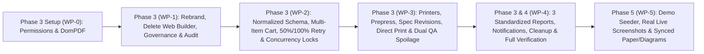

# PressQueue v2 — FR Audit, Codebase Gap Analysis & Modified Waterfall Implementation Plan (Session Handoff Ready)

> **Handoff Status (Ready to Execute `WP-0` → `WP-1` Immediately):** All architectural decisions, dependency installs, and legacy file/test deletions below have been **explicitly approved by the user**. Start directly at **Work Package 0 (`WP-0`)** and proceed sequentially through **Work Package 5 (`WP-5`)**.
>
> **SDLC Alignment:** Strictly follows the **5-Phase Modified Waterfall Model** documented in Chapter 3 of `capstone_paper/outline_paper/papers/outline_capstone_v2.docx`. Tasks are organized as sequential **Work Packages (`WP-0` to `WP-5`)** inside *Phase 3 (Implementation)*, *Phase 4 (Testing and Refinement)*, and *Phase 5 (Deployment Planning, Live Screenshots & Manuscript Sync)*. **Never use Agile/Sprint terminology** in plans or manuscript updates.

---

## 0. Executive Handoff Context for New Agent

### Mandatory Project Rules & Conventions
- Read `AGENTS.md`, `.agents/AGENTS.md`, and `.ai/rules/index.md` → `.ai/rules/pages.md` before editing any code.
- **Strict English Response Mandate:** Always respond in English regardless of prompt language.
- **Tenant Isolation Rule (`.ai/rules/pages.md`):** `PrintShop` is the tenant boundary in a shared database. Owners resolve their own shop; staff require `staff_shop_id`. Never fall back to `PrintShop::first()`. Customer ordering enforces an explicit selected shop and rechecks approval, active service, and unexpired service pauses.
- **Livewire Page Convention:** Full-page Livewire components live in `resources/views/pages/` with the `⚡` prefix (e.g., `⚡owner-dashboard.blade.php`), referenced via `pages::` and registered with `Route::livewire()`.
- **Activate Domain Skills Before Coding:** Read `.agents/skills/{laravel-best-practices,livewire-development,fluxui-development,fortify-development,pest-testing,tailwindcss-development}/SKILL.md` as relevant.

### User-Approved Decisions (Locked — Do Not Re-Ask)
1. **PDF Package Approved (`WP-0`):** Run `./vendor/bin/sail composer require barryvdh/laravel-dompdf` for real `.pdf` downloads on the 3 Standardized Reports (`FR-16`) and Official Receipts (`FR-10`).
2. **Retire & Delete `Web Builder` Approved (`WP-1`):** Because PressQueue v2 is a **multi-tenant SaaS marketplace** with a unified customer view (`⚡shops.blade.php` → `⚡shop.blade.php`), per-shop `Web Builder` is obsolete (shop profile details live in `⚡owner-platform.blade.php`). The user explicitly approved deleting:
   - `resources/views/pages/owner/⚡web-builder.blade.php`
   - `tests/Feature/WebBuilderAppTest.php`
   - And removing all `web_builder` / `owner.web-builder` references from:
     - `app/Services/PrintServiceCatalog.php` (lines 42–50, 125)
     - `routes/web.php` (line 36)
     - `resources/views/pages/owner/⚡owner-dashboard.blade.php` (lines 71, 226)
     - `resources/views/pages/owner/⚡thesis-binding.blade.php` (lines 542, 619)
     - `resources/views/pages/owner/⚡inventory-hub.blade.php` (line 632)
     - `tests/Feature/PlatformNavigationTest.php` (line 184)
     - `tests/Feature/BusinessOwnerWizardTest.php` (lines 17, 25, 36)
3. **UI Design & Theme Direction:**
   - **Preserve the app's authentic editorial Light-Mode aesthetic** (`Instrument Sans` typography from Bunny fonts, warm ivory/stone surfaces, burnt-orange/amber accents, clean Flux UI cards as built in `welcome.blade.php` and `layouts/auth/split.blade.php`). Avoid generic AI-styled pill-heavy layouts.
   - Fix the Light-Mode white-on-white brand text contrast issue on `resources/views/layouts/auth/split.blade.php` while rebranding `Printify → PressQueue`.
   - Keep the **Printing Shop Owner App Launcher Dashboard** (`⚡owner-dashboard.blade.php`) and **More Services App Store Modal** (`Install / Remove` shop services) intact (minus `Web Builder`)—the user specifically wants those featured in the live screenshots (`WP-5`).
4. **FR Titles Locked; 4 Body Refinements Deferred to `WP-5`:**
   - None of the `17` FR titles (`FR-01`–`FR-17`) change (`FR Title == Use Case Oval == Activity Diagram` 1-to-1 parity is strictly enforced by Adviser Ma'am Danilyn A. Flores).
   - Four minor behavioral body-clause refinements (`FR-05`, `FR-08/11`, `FR-10`, `FR-13/17`) are queued for `WP-5` final manuscript sync.

### Completed Paper & Diagram Assets (Already Ready)
- **Manuscript:** `capstone_paper/outline_paper/papers/outline_capstone_v2.docx` already has Chapter 3 (`FR-01`–`FR-17`, `Table 6`, `UC-1`–`UC-4`, `AD-01`–`AD-17`), Appendices `F–H` (`ST-01`–`ST-12`, `FT-01`–`FT-46`), and `Appendix I (TAM)` synced cleanly. *(Chapter 2 RRL is intentionally set aside with active Word comment `id=172: "to be fixed"`.)*
- **Completed Diagrams (`capstone_paper/outline_paper/diagrams/`):**
  - `PressQueue_Conceptual_Framework_v2.png` (Figure 1)
  - `PressQueue_Modified_Waterfall_v2.png` (Figure 2)
  - `PressQueue_Deployment_Diagram_v4.png` (Figure 3 — refined single-VPS UML 2.5 version; user embeds images manually into Word unless asked)
- **Live Screenshots Target Folder:** `capstone_paper/outline_paper/diagrams/ui/` (cleaned & ready for real Light-Mode captures in `WP-5`).

---

## 1. Locked 17 Functional Requirements & Defense-Result Gap Audit

Cross-checked against `capstone_paper/outline_paper/scratch/outline_defense_results_v2.pdf` (**Panels N, B, R [Edge Cases `R1–R5`]** & **Adviser Modeling Audit**). All 17 FR titles are locked word-for-word:

1. `FR-01` Account Registration and Tenant Onboarding
2. `FR-02` Authentication, Profile Security, and Session Logout
3. `FR-03` Multi-Tenant Approval and Workspace Isolation
4. `FR-04` Shop Operations, Printer Fleet, and Service Availability Configuration
5. `FR-05` Dynamic Service Catalog and Bill of Materials Configuration
6. `FR-06` Raw Material Inventory, Stock-In Replenishment, and Reorder Point Alerting
7. `FR-07` Marketplace Shop Directory and Live Workload Display
8. `FR-08` Dynamic Quotation, Print Validation, and Multi-Item Order Placement
9. `FR-09` Upfront Payment Submission and Proof Retry Recovery
10. `FR-10` Payment Proof Verification, Counter Settlement, and Official Receipt
11. `FR-11` Prepress Artwork Inspection, Cover-Only Intake, and Specification Lock
12. `FR-12` Pre-Print Specification Revision and Manual Refund Management
13. `FR-13` Multi-Printer Scheduling, Failover, and Split Order Tracking
14. `FR-14` Direct Browser Print Dispatch and Quality Inspection
15. `FR-15` Concurrent Stock Reservation and Atomic BOM Deduction
16. `FR-16` Standardized Printable and Exportable Operational Reports
17. `FR-17` Automated File Retention, Audit Trail, and Workflow Notifications

### Defense-Result Traceability & 4 Minor Body-Clause Refinements (Deferred to `WP-5`)

| Defense Source (`outline_defense_results_v2.pdf`) | Linked FR(s) | Audit Status | Action / Body Clause Note (`WP-5`) |
| :--- | :--- | :--- | :--- |
| **System Rebrand (`Printify → PressQueue`) & Light Mode UI** (p. 1) | All (`FR-01`–`FR-17`) | Covered | Rebrand live codebase & fix white-on-white login header in Light Mode (`WP-1`). |
| **Multi-Tenant Platform & Live Shop Workload** (p. 1) | `FR-03`, `FR-04`, `FR-07` | Covered | Add `Suspended` moderation status + configurable `Busy`/`At capacity` thresholds. |
| **Multi-Printer & Multi-Staff Job Scheduling** (p. 1) | `FR-04`, `FR-13` | Covered | Move production scheduling from `orders` to `order_items` + add `printers` table. |
| **Direct Browser Print Dispatch** (p. 1) | `FR-14` | Covered | Replace attachment download with inline locked browser print preview stream. |
| **Automated Post-Completion File Cleanup** (p. 1) | `FR-03`, `FR-17` | Covered | Build `platform_settings`, `file_purged_at`, and daily retention purge command. |
| **3 Standardized Printable & Downloadable Reports** (p. 1) | `FR-16` | Covered | Build Inventory, Sales, and Live Schedule reports (`Print View / PDF / CSV`). |
| **Modular Owner App Launcher** (user addition) | `FR-05` | **Body Clause #1 (`WP-5`)** | Mention enabling/disabling (`Install / Remove`) modular shop service apps in `FR-05` body prose. |
| **Adviser Audit — Cover-Only Paper Rejection → Shift to Shop Paper** (p. 2) | `FR-08`, `FR-11` | **Body Clause #2 (`WP-5`)** | Implement reverse Cover-Only rejection → shift to Full-Package shop paper (`WP-3`) and add clause to `FR-11` body prose + paper-substitution fallback in `FR-08`/`FR-15`. |
| **Adviser Audit — ERD Normalization (`orders` vs `order_items`)** (p. 2) | `FR-08`, `FR-13` | Schema mandate (`WP-2`) | Store per-item `service_key` on `order_items` (supporting mixed multi-service carts) and make `orders.service_key` nullable/deprecated; retain `unit_price` and `total_price` on `order_items`. |
| **Edge Case `R1` — Millisecond Concurrent Stock Contention** (p. 3) | `FR-08`, `FR-15` | Covered (`WP-2`) | Implement ordered `lockForUpdate()` transactions + `reserved_qty` + shortage prompt. |
| **Edge Case `R2` — QA Rerun Dual Paper & Ink Spoilage** (p. 3) | `FR-14`, `FR-15` | Covered (`WP-3`) | Log decoupled paper + BOM ink/toner `rework_spoilage` linked to `order_item_id` with customer total locked. |
| **Edge Case `R3` — Two-Step Payment Retry & Aging Unverified Proofs** (p. 4) | `FR-09`, `FR-10` | **Body Clause #3 (`WP-5`)** | Implement aging unverified payment flags (`WP-2`/`WP-4`) and add explicit clause to `FR-10` body prose. |
| **Edge Case `R4` — Split Early Pickup, `Partially Ready`, & Unclaimed Aging** (p. 4) | `FR-13`, `FR-17` | **Body Clause #4 (`WP-5`)** | Implement `Partially Ready` + `ready_at` aging alerts (`WP-3`/`WP-4`) and mention explicitly in `FR-13` & `FR-17` body prose. |
| **Edge Case `R5` — Prepress Lock, Pre-Print Spec Revisions & Manual Refunds** (p. 5) | `FR-11`, `FR-12` | Covered (`WP-3`) | Build `is_spec_locked`, `spec_revisions` hold/recalculation, `Manual Refund Pending → Settled`, and post-printing freeze. |

---

## 2. Live Codebase Audit (`Laravel 13 + Livewire 4 + Sail`)

### Environment & Toolchain Baseline
- **Runtime:** Laravel Sail (`compose.yaml`) running **PHP 8.5** (`sail-8.5/app`) + **PostgreSQL 18** (`postgres:18-alpine`) — supports real ACID `SELECT ... FOR UPDATE` row-level locking natively.
- **Installed Packages (`composer.json` & `package.json`):** `laravel/framework ^13.17`, `livewire/livewire ^4.1`, `livewire/flux ^2.13.1`, `laravel/fortify ^1.37.2`, `tailwindcss ^4.0.7`, `pdfjs-dist ^3.11.174`, `pestphp/pest ^5.1`, `larastan/larastan ^3.9` (PHPStan Level 7), `laravel/pint ^1.27`.
- **Baseline Test Run (`./vendor/bin/sail artisan test --compact`):** `122` tests total — `116` passed, `6` errored strictly due to container directory permissions on `storage/framework/testing/disks/{local,public}/orders` (`Permission denied`). Fix first in `WP-0`.

### Module-by-Module Codebase Gap Matrix (`FR-01`–`FR-17`)

| FR | Existing Implementation | Exact Gaps to Build |
| :--- | :--- | :--- |
| **FR-01** Onboarding | `CreateNewUser`, `PlatformController::registerOwner/invite/accept`, `⚡owner-wizard.blade.php`, `⚡staff-invitation.blade.php` | Rebrand views/emails `Printify → PressQueue`; remove `web_builder` from preinstalled shop defaults. |
| **FR-02** Auth/Profile/Logout | Fortify auth, 2FA, passkeys, `settings/⚡profile.blade.php`, `settings/⚡security.blade.php`, `Logout` | Rebrand auth layouts/titles; fix invisible white brand text on light-mode `layouts/auth/split.blade.php`. |
| **FR-03** Tenant Governance | `print_shops.approval_status` (`pending/approved/rejected`), `rejection_reason`, `⚡admin-shops.blade.php`, `OrderPolicy` | Add `suspended` status + `Suspend/Reactivate` moderation actions, login/browse enforcement for suspended shops, `platform_settings` table, and Super Admin storage health summary. |
| **FR-04** Shop Ops & Fleet | `PlatformController::saveShop/availability/invite/revoke`, `⚡owner-platform.blade.php`, `shop_services` (`capacity`, `pause_reason`, `paused_until`) | Create `printers` table (`name`, `supported_sizes`, `status`, `is_wide_format`); add `busy_threshold`, `at_capacity_threshold`, `operating_hours` to `print_shops`; add Printer Fleet & Threshold UI to `⚡owner-platform.blade.php`. |
| **FR-05** Catalog & BOM | `PrintServiceCatalog`, `⚡owner-dashboard.blade.php` (App Launcher + More Services Modal), `⚡document-printing.blade.php`, `⚡thesis-binding.blade.php`, `ServiceBom` | Delete retired `Web Builder`; enforce `max_binding_sheets` in `ThesisBindingConfig`; ensure Ink/Toner consumables map smoothly in BOM UI alongside Paper & Binding supplies. |
| **FR-06** Inventory & ROP | `InventoryItem`, `StockMovement`, `⚡inventory-hub.blade.php` | Add `inventory_items.reserved_qty`; compute `available_qty = stock_qty - reserved_qty`; trigger static ROP low-stock in-app + email notifications when `available_qty <= reorder_level`. |
| **FR-07** Marketplace Workload | `⚡shops.blade.php`, `⚡shop.blade.php`, `ShopService::workload()` | Calculate shop-level workload from active `order_items` against owner `busy_threshold` / `at_capacity_threshold`; hide `suspended` shops; rebrand UI copy. |
| **FR-08** Multi-Item Order & Validation | `⚡document-order-wizard.blade.php`, `⚡thesis-order-wizard.blade.php`, `OrderItem::getPhysicalSheetsCount()` | Add unified multi-item cart checkout (mixed Document + Thesis in 1 `Order`); move `service_key` onto `order_items` (nullable on `orders`); enforce `ceil(pages/2) <= max_binding_sheets` & upload bounds; save `pending_payment` order + tracking code BEFORE payment upload; add short-stock fallback prompt. |
| **FR-09** Upfront Payment & Retry | Single-step proof fields on `orders` (`payment_proof_path`, `payment_reference_no`) | Create `payments` table with unique `(print_shop_id, reference_no)`; add `payment_option` (`downpayment_50`, `full_100`), `amount_paid`, `balance_due`, `refund_due`, `refund_status` to `orders`; enforce min `50%` upfront; build Two-Step `Submit / Retry Payment Proof` inside `⚡customer-dashboard.blade.php`. |
| **FR-10** Payment Audit & Receipt | Basic payment verify inside `⚡staff-dashboard.blade.php` | Build dedicated Owner/Counter Payment Audit tab with aging unverified proof flags, `Accepted` transition, offline pre-order counter verification, remaining pickup balance settlement (`balance_due → 0`), and printable/PDF Official Receipt view. |
| **FR-11** Prepress & Spec Lock | `order_items.is_paper_received` | Add `prepress_status`, `prepress_rejection_reason`, `is_spec_locked` on `order_items`; lock specs upon artwork approval; enable customer file re-upload on rejection; add Cover-Only paper rejection → Shift to Full-Package shop paper (recalculating total + BOM paper lock). |
| **FR-12** Pre-Print Revisions & Refunds | *Not yet implemented* | Create `spec_revisions` table + `SpecRevisionService`; put item `on_hold`, release old BOM & lock new BOM, handle upgrade top-ups vs. downgrade balance credits / `Manual Refund Pending → Settled`, and hard-block all edits once `printing` starts. |
| **FR-13** Multi-Printer Queue & Split Tracking | `orders.production_stage`, `assigned_staff_id`, `assigned_machine` (order-level only) | Move scheduling to `order_items` (`printer_id`, `assigned_staff_id`, `production_stage`, `shelf_bin_code`, `ready_at`, `claimed_at`); add `Partially Ready` parent status, `Maintenance` batch failover reassignment, zero-balance + all-items-claimed parent completion gate, and split customer tracker. |
| **FR-14** Direct Print & QA Spoilage | `PlatformController::file()` forces attachment download; `InventoryDeductionService::recordSpoilage()` only logs 1 item | Add inline locked stream route (`Content-Disposition: inline`) + **Direct Browser Print Preview Modal** (`window.print()` via embedded viewer / `pdfjs-dist` without loose downloads, plus RIP export for wide-format); add QA Pass (`shelf_bin_code` + ready alert) and QA Fail logging decoupled Paper + BOM Ink/Toner `rework_spoilage` (`order_item_id`) without touching customer totals. |
| **FR-15** Concurrent Stock Locks | `InventoryDeductionService::deductForOrder()` (no `lockForUpdate()`, no `reserved_qty`) | Implement deterministic ordered `lockForUpdate()` inside `DB::transaction()` for reservation (`reserveForOrderItems`), release (`releaseReservation`), and print-time conversion (`commitReservationOnPrint`) ensuring `available_qty` never drops negative. |
| **FR-16** Standardized Reports | `SalesAnalyticsService`, `⚡analytics-hub.blade.php` (basic KPIs + partial CSV) | Build `ReportService` + 3-tab Report Center: (1) *Inventory & Stock Movement*, (2) *Sales & Revenue* (with DP/full/pickup/manual refunds), (3) *Live Production Schedule & Job Status* (*Currently Printing*, *In Finishing*, *Ready for Pickup* + shelf tags & aging flags), each with **Browser Print View**, **PDF Download**, and **CSV Export**. |
| **FR-17** Retention, Audit & Notifications | `routes/console.php` (`platform:privatize-files`), `Notifiable` trait | Create `audit_logs` & `notifications` tables, `AuditLogger` service, 6 Notification classes + UI notification bell, `print_shops.file_retention_days` override, and scheduled `pressqueue:purge-expired-files` (daily) + `pressqueue:check-aging-alerts` (hourly) commands. |

---

## 3. Modified Waterfall Implementation Roadmap (`WP-0` to `WP-5`)



### Work Package 0 (Phase 3 Environment Preparation)
- Fix Sail container permissions on `storage/framework/testing` so baseline `./vendor/bin/sail composer test` passes `100%` (`122/122` green).
- Install approved PDF package: `./vendor/bin/sail composer require barryvdh/laravel-dompdf`.

---

### Work Package 1 (Phase 3 — Rebrand, Delete `Web Builder`, Tenant Governance & Audit Foundation: `FR-01`, `FR-02`, `FR-03`, `FR-17`)
- **Rebrand & Light-Mode Polish (Preserving Editorial `Instrument Sans` Design System):**
  - Replace `Printify → PressQueue` across `.env`, `.env.example`, `config/app.php`, `welcome.blade.php`, `partials/head.blade.php`, `layouts/auth/*`, `PlatformController.php` emails, and all `resources/views/pages/**`.
  - Fix the invisible white-on-white brand text in Light Mode on `resources/views/layouts/auth/split.blade.php`.
- **Delete Retired `Web Builder` (Explicitly Approved by User):**
  - Delete `resources/views/pages/owner/⚡web-builder.blade.php` and `tests/Feature/WebBuilderAppTest.php`.
  - Remove `web_builder` from `app/Services/PrintServiceCatalog.php`, `routes/web.php`, `⚡owner-dashboard.blade.php`, `⚡thesis-binding.blade.php`, `⚡inventory-hub.blade.php`, `tests/Feature/PlatformNavigationTest.php`, and `tests/Feature/BusinessOwnerWizardTest.php`.
- **Database Migrations & Governance:**
  - Create `platform_settings` (`default_retention_days`, `min_retention_days`, `max_retention_days`, `max_upload_mb`) + `App\Models\PlatformSetting`.
  - Alter `print_shops` (`file_retention_days`, `busy_threshold`, `at_capacity_threshold`, `operating_hours`).
  - Create `audit_logs` + `App\Models\AuditLog` + `App\Services\AuditLogger`.
  - Upgrade `PlatformController::review()` and `⚡admin-shops.blade.php` with `Suspend / Reactivate`, Global File Retention Policy controls, and Storage Health Audit counters (keeping private shop financial ledgers isolated); enforce suspended-shop blocks on login and marketplace browsing.
- **Verification (`Phase 4 Gate`):** Extend `TenantPlatformTest` + run `./vendor/bin/sail composer test`.

---

### Work Package 2 (Phase 3 — Schema Normalization, Multi-Item Checkout, Concurrent Stock Locks & Two-Step Payment Proof Retry: `FR-05`, `FR-06`, `FR-08`, `FR-09`, `FR-10`, `FR-15`)
- **Database Migrations:**
  - `inventory_items`: add `reserved_qty`.
  - `orders`: make `service_key` nullable (Adviser ERD audit); add `tracking_code`, `payment_option`, `amount_paid`, `balance_due`, `refund_due`, `refund_status`, `completed_at`.
  - `order_items`: add `service_key`, `assigned_staff_id`, `production_stage`, `prepress_status`, `prepress_rejection_reason`, `is_spec_locked`, `shelf_bin_code`, `ready_at`, `claimed_at`, `file_purged_at`.
  - `payments`: create ledger table with per-shop unique `(print_shop_id, reference_no)`.
  - `stock_movements`: add nullable `order_item_id` FK.
  - `thesis_binding_configs`: ensure `max_binding_sheets` (default `250`) is persisted and configurable.
- **Core Services & UI:**
  - Upgrade `InventoryDeductionService` with deterministic ordered `lockForUpdate()` pessimistic locking (`reserveForOrderItems`, `releaseReservation`, `commitReservationOnPrint`, `InsufficientStockException` with fallback suggestions).
  - Create `OrderCheckoutService` & `PaymentService`: multi-item cart combining Document Printing + Thesis Binding under 1 parent `Order`, duplex & max-binding-sheet rejection, upload validation, saving `pending_payment` order + tracking code BEFORE proof upload, `50%` min DP vs. `100%` Full validation, duplicate reference block, **Two-Step `Submit / Retry Payment Proof`** in `⚡customer-dashboard.blade.php`, Owner Payment Audit queue with **aging unverified proof flags**, offline pre-order counter audit, counter pickup balance settlement, and **Printable/PDF Official Receipt** (`orders/{order}/receipt`).
- **Verification (`Phase 4 Gate`):** Feature tests for multi-item cart, duplex/binding limit validation, concurrency rollback, proof retry, duplicate reference guard, offline settlement, and Official Receipt + `./vendor/bin/sail composer test`.

---

### Work Package 3 (Phase 3 — Multi-Printer Fleet, Prepress Locks, Spec Revisions & Manual Refunds, Direct Browser Print & Dual QA Spoilage: `FR-04`, `FR-07`, `FR-11`, `FR-12`, `FR-13`, `FR-14`)
- **Database Migrations:**
  - Create `printers` (`print_shop_id`, `name`, `supported_sizes`, `status`, `is_wide_format`) + add `order_items.printer_id` FK.
  - Create `spec_revisions` (`order_item_id`, `requested_by`, `old_specs`, `new_specs`, `old_total`, `new_total`, `delta_amount`, `revision_type`, `status`, `approved_by`, `settled_at`, `notes`).
- **Core Services, Routes & UI:**
  - `SpecRevisionService`: pre-print `on_hold` revision recalculating BOM & totals (Upgrade top-up vs. Downgrade credit / `Manual Refund Pending → Settled`), hard-blocking all edits once `printing` starts.
  - `ProductionQueueService`: item-level prepress (`is_spec_locked = true`, artwork rejection + re-upload, Cover-Only intake & **reverse Cover-Only rejection → shift to shop paper**), multi-printer/staff assignment + `Maintenance` batch failover, split early pickup (`Partially Ready` parent + `shelf_bin_code` + `ready_at`), **zero-balance + all-items-claimed parent completion gate**, and **QA Fail Dual Paper + Ink Rework Spoilage** (`movement_type = 'rework_spoilage'`, linked to `order_item_id`, customer billing strictly unchanged).
  - Inline locked stream route (`orders/{order}/files/preview/{item}`, `Content-Disposition: inline`) + **Direct Browser Print Preview Modal** (`window.print()`, no loose downloads, plus RIP export for wide-format plotters).
  - UI upgrades across `⚡owner-platform.blade.php`, `⚡shops.blade.php`, `⚡staff-dashboard.blade.php`, and `⚡customer-dashboard.blade.php` keeping native `Instrument Sans` styling.
- **Verification (`Phase 4 Gate`):** Feature tests covering every `R2`, `R4`, `R5`, and bidirectional Cover-Only path + `./vendor/bin/sail composer test`.

---

### Work Package 4 (Phase 3 & Phase 4 — Standardized Reports, Notifications, Scheduled Cleanup & Full Test Verification: `FR-06`, `FR-16`, `FR-17`)
- **Standardized Report Center (`App\Services\ReportService` + `⚡analytics-hub.blade.php`):**
  - *Inventory & Stock Movement Report*, *Sales & Revenue Report* (reconciling DP, full prepayments, counter balances, and manual refunds), and *Live Production Schedule & Job Status Report* (*Currently Printing*, *Already Printed / In Finishing*, *Ready for Pickup* with shelf tags & aging flags)—all supporting **Browser Print View**, **PDF Download**, and **CSV Export**.
- **Notifications & Scheduled Jobs (`routes/console.php`):**
  - `notifications` table + 6 `database + mail` Notification classes + top-bar notification popover.
  - `pressqueue:purge-expired-files` (daily): purges expired artwork on fully completed orders past shop/global retention TTL, skips active/on-hold/partially-ready orders, stamps `file_purged_at`, writes `audit_logs`, preserves receipts.
  - `pressqueue:check-aging-alerts` (hourly): flags overdue unverified pending proofs and dispatches unclaimed pickup aging reminders.
- **Verification (`Phase 4 Final Gate`):** Full `./vendor/bin/sail composer test` confirming `0` Pint, PHPStan Level 7, or Pest failures across all `FR-01`–`FR-17` / `FT-01`–`FT-46` scenarios.

---

### Work Package 5 (Phase 5 — Demo Seeder, Live Light-Mode Screenshots & Final Manuscript/Diagram Sync)
- Create `PressQueueDemoSeeder` populating `Super Admin` + 3 isolated tenants (`Normal`, `Busy`, `At capacity + Paused service`), printers, BOM paper/binding/ink inventory, mixed orders, manual refund sample, and spoilage logs.
- Capture **real live Light-Mode screenshots** from running `http://localhost` (native `Instrument Sans` + Flux UI, including Owner App Launcher & More Services App Store Modal) into `capstone_paper/outline_paper/diagrams/ui/`.
- Generate synced Stage 2 & Stage 3 diagrams from the real codebase (`ERD`, `Class Diagram`, `4 Modular Use Case Diagrams [UC-1..UC-4]`, `17 Activity Diagrams [AD-01..AD-17]`, and `Gantt Chart`).
- Apply the 4 minor FR body-clause refinements into Chapter 3 (`outline_capstone_v2.docx`).

---

## 4. Verification Gate (Required After Every Work Package)

```bash
./vendor/bin/sail composer test
```

Runs `php artisan config:clear` → `vendor/bin/pint --parallel --test` → `vendor/bin/phpstan analyse` (Level 7) → `php artisan test`.
