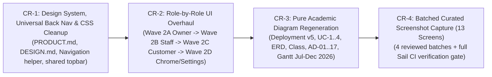

# PressQueue v2 — System Correction Plan v2 (UI Overhaul, Universal Navigation, Pure Academic Diagrams & Curated Screenshots)

> **Status:** `CR-1`, `CR-2`, and `CR-3` (`3A`–`3G`) Complete — Ready for `CR-4` (Batched Curated Screenshot Capture)
> **Baseline Build:** `WP-0` through `WP-5` implemented and verified (`./vendor/bin/sail composer test`: `143` Pest tests passed, `0` PHPStan Level 7 errors, Pint clean).
> **SDLC Alignment:** Strictly follows the **5-Phase Modified Waterfall Model** documented in Chapter 3 of `capstone_paper/outline_paper/papers/outline_capstone_v2.docx` (*Phase 4 Testing and Refinement* feedback loop into *Phase 2 Design* and *Phase 3 Implementation*, followed by *Phase 5 Deployment Planning and Readiness*). **Never use Agile/Sprint terminology.**
> **Locked Constraints:** Do NOT break existing business logic, routes, pricing math, database schema, tenant isolation (`.ai/rules/pages.md`), or the **17 locked FR titles (`FR-01`–`FR-17`)**.

---

## 0. Why Correction Plan v2 Exists

Post-`WP-5` review uncovered four visual, navigation, and academic-presentation defects that must be corrected systematically before finalizing screenshots and manuscript embeds:

1. **Dark-Mode-First Legacy UI & Light-Mode "AI Slop":** While `welcome.blade.php`, `⚡shops.blade.php`, `⚡shop.blade.php`, and `⚡admin-shops.blade.php` already follow a clean editorial Light-Mode aesthetic (`Instrument Sans`, warm stone canvas `#f5f5f4`, white surfaces, disciplined amber accent), operational pages contain **564 hardcoded dark-mode/decorative classes** (`bg-stone-950/900`, `text-rose-300/sky-300/indigo-300/emerald-300`, `blur-3xl` ambient radial glow blobs, emoji filters, promo micro-pills) patched over by a global `html:not(.dark)` CSS inversion hack in `resources/css/app.css` (`L88–L213`).
2. **Missing Universal Back Navigation:** Business Owner sub-apps (`Analytics`, `Inventory`, `Operations`, `Document Printing`, `Thesis Binding`, `Reports`), Customer sub-flows (`Shop Profile`, `Unified Cart`, `Order Wizards`, `Receipts`), Production Staff sub-views/settings, and Fortify Account Settings lack a consistent, deterministic universal back button—leaving users with inconsistent or missing escape paths.
3. **Slide-Deck Clutter on Generated Diagrams:** Unlike the panel-approved reference manuscript (`capstone_paper/outline_paper/scratch/outline_example_1.pdf`), the WP-5 `UC-1`–`UC-4`, `ERD`, `Class`, `AD-01`–`AD-17`, and `Gantt` PNGs include presentation headers (`PHASE 2 SYSTEM DESIGN • ...`), subtitles, pill badges, bottom meta-commentary boxes (`Adviser ERD Normalization Audit`, `1-to-1 parity with Table 6`), AI-internal milestones (`WP-1`–`WP-5`, `PressQueueDemoSeeder`, `PHPStan + 143 Tests`), and minor label collisions (e.g., `[Customer]` on `AD-01`). `PressQueue_Deployment_Diagram_v4.png` also carries a bottom-left `Scope Note / Fallback Summary` box that should be cleaned into a new `v5` version.
4. **Rushed Single-Prompt Screenshot Capture (`17` Screenshots):** All `17` screenshots were captured in one shot before auditing Light Mode and right-sizing coverage. Screenshots must be re-captured **only after the UI overhaul**, right-sized to **13 curated, non-redundant screens** (explicitly including the **Owner More Services App Store Modal**), and visually reviewed in small batches (`3–4` screens per pass).

---

## 1. Execution Roadmap (`CR-1` through `CR-4`)



---

## 2. `CR-1` — Design System Foundation, Universal Back Navigation & Retiring the CSS Hack

### 2.1 Documentation & Token Alignment
- **Update `PRODUCT.md`:** Replace outdated `Printify` and `web builder` references with `PressQueue` multi-tenant SaaS workflows (`FR-01`–`FR-17`).
- **Create `DESIGN.md`:** Codify PressQueue's **Editorial Print-House Light-Mode Design System** (anchored directly in `welcome.blade.php` and `⚡shops.blade.php`):
  - **Surfaces:** Canvas `bg-stone-100 dark:bg-stone-950` (`#f5f5f4`), Primary Card `bg-white dark:bg-stone-900`, Secondary Well `bg-stone-50 dark:bg-stone-900/60`, Hairline Borders `border-stone-200 dark:border-stone-800`, Crisp Elevation `shadow-xs` (`0 1px 2px rgba(28,25,23,0.05)`).
  - **Typography:** `Instrument Sans` throughout; mandatory `tabular-nums` on all prices (`₱`), quantities, sheet counts, stock balances, and tracking/order codes.
  - **Strict WCAG AA Contrast Pairs (Light + Dark explicit pairs — NEVER dark-only `text-*-300/400` on light surfaces):**
    - Primary CTA: `bg-amber-500 hover:bg-amber-600 text-stone-950 font-semibold` (or `bg-stone-900 hover:bg-stone-800 text-white dark:bg-amber-500 dark:text-stone-950`).
    - Success / Normal / Verified: `bg-emerald-50 text-emerald-800 border border-emerald-200 dark:bg-emerald-950/60 dark:text-emerald-300 dark:border-emerald-800`
    - Warning / Busy / Pending: `bg-amber-50 text-amber-800 border border-amber-200 dark:bg-amber-950/60 dark:text-amber-300 dark:border-amber-800`
    - Danger / At capacity / Aging / Refund: `bg-rose-50 text-rose-800 border border-rose-200 dark:bg-rose-950/60 dark:text-rose-300 dark:border-rose-800`
    - Info / Locked / Wide Format: `bg-sky-50 text-sky-800 border border-sky-200 dark:bg-sky-950/60 dark:text-sky-300 dark:border-sky-800`
    - Neutral / Paused / Secondary: `bg-stone-100 text-stone-700 border border-stone-200 dark:bg-stone-800 dark:text-stone-300 dark:border-stone-700`
  - **Anti-Slop Bans:**
    - Zero floating ambient radial glow blobs (`blur-3xl` background auras).
    - Zero emojis (`📚`, `📄`, `⚡`, `📦`, `📕`, `📘`, `🧾`, `🖨️`, `✅`) inside buttons, filter chips, badges, or headings — use crisp monochrome Flux / Heroicon SVGs.
    - Zero noisy promo micro-pills (`• LIVE CASHFLOW`, `• SHOP FLOOR LIVE`, `CORE`, `Single Sign-On Print Operations Facility`).

### 2.2 Universal Contextual Back Navigation Architecture (Business Owner, Customer, Production Staff, Admin & Settings)

**Why Naive `window.history.back()` Fails:**
Raw browser `history.back()` breaks after Livewire redirects, POST form submissions, direct bookmark/email links, or opening a page in a new tab—often bouncing users into login loops or back to a stale form submission.

**Deterministic Design (`App\Support\Navigation` + Shared `<x-app-back-link>` / `<x-platform-header>`):**
1. **Single Source of Truth (`app/Support/Navigation.php`):**
   - Resolves a deterministic `[url, label, breadcrumbs]` structure from the current named route + authenticated user role, with an optional allow-listed `?from=` query override for shared screens reached from multiple parent pages (e.g., `owner.inventory-hub?from=thesis-binding` → `← Thesis Binding`; default → `← App Launcher`).
2. **Consistent Visual Placement (Muscle Memory & Fitts's Law):**
   - Every non-root workspace page renders the exact same labeled back control (`← [Parent Workspace Label]`, minimum `40px–44px` hit target, clear border + hover state + keyboard focus ring) in the **top-left slot of the unified sticky topbar**, paired with a compact secondary breadcrumb on depth-2 views (e.g., `App Launcher / Analytics Hub / Standardized Report`).
   - Root portals (`owner.dashboard`, `staff.dashboard`, `customer.dashboard`, `admin.shops`, `welcome`) display the PressQueue brand mark instead of a dead-end back arrow.
3. **Complete Role-by-Role Back Navigation Map:**

| Role | Current Route / Page | Universal Back Button Label & Deterministic Target | Notes / Optional `?from=` Override |
| :--- | :--- | :--- | :--- |
| **Printing Shop Owner** | `owner.dashboard` (*App Launcher*) | *(Root Hub — no back arrow)* | Brand mark + Quick actions (`Shop Settings`, Notifications, Profile, Logout) |
| **Printing Shop Owner** | `owner.platform` (*Operations, Fleet & Availability*) | `← App Launcher` (`route('owner.dashboard')`) | Replaces inconsistent bare arrow |
| **Printing Shop Owner** | `owner.analytics-hub` (*Analytics, Payments & Reports*) | `← App Launcher` (`route('owner.dashboard')`) | Keeps consistent top-left slot across all 3 tabs |
| **Printing Shop Owner** | `owner.inventory-hub` (*Inventory & BOM Hub*) | `← App Launcher` (`route('owner.dashboard')`) | `?from=thesis-binding` → `← Thesis Binding`; `?from=document-printing` → `← Document Printing` |
| **Printing Shop Owner** | `owner.thesis-binding` (*Thesis Binding Config*) | `← App Launcher` (`route('owner.dashboard')`) | Consistent top-left back button + link to Inventory with `?from=thesis-binding` |
| **Printing Shop Owner** | `owner.document-printing` (*Document Printing Config*) | `← App Launcher` (`route('owner.dashboard')`) | Consistent top-left back button + link to Inventory with `?from=document-printing` |
| **Printing Shop Owner** | `owner.wizard` (*Setup Wizard*) | `← App Launcher` (`route('owner.dashboard')`) | Shown when shop setup is already complete (`Re-run Setup Wizard`) |
| **Printing Shop Owner** | `owner.reports.show` (*Print View Report*) | `← Standardized Reports` (`route('owner.analytics-hub', ['tab' => 'reports'])`) | Hidden in `@media print` |
| **Customer** | `customer.dashboard` (*Customer Portal / My Orders*) | *(Root Hub — no back arrow)* | Includes prominent `Browse Shops` action |
| **Customer** | `shops.index` (*Marketplace Directory*) | `← My Orders` (`route('customer.dashboard')`) when logged in as Customer; `← Home` (`route('home')`) when Guest | Also role-aware if Owner/Staff/Admin peeks at directory (`← My Workspace`) |
| **Customer** | `shops.show` (*Shop Profile & Services*) | `← Find Shops` (`route('shops.index')`) | Deterministic marketplace return |
| **Customer** | `customer.shop.checkout` (*Unified Multi-Item Cart*) | `← [Shop Name]` (`route('shops.show', $shop)`) | Replaces bare arrow with explicit shop name label |
| **Customer** | `customer.shop.order-document` & `customer.shop.order-thesis` | `← [Shop Name]` (`route('shops.show', $shop)`) | Always returns cleanly to the selected shop |
| **Customer / Owner** | `orders.receipt` (*Official Receipt*) | Customer: `← My Orders` (`customer.dashboard`); Owner: `← Payments & Audit` (`owner.analytics-hub?tab=payments`) | Hidden in `@media print` |
| **Production Staff** | `staff.dashboard` / `staff.production-hub` | *(Root Workstation — no dead-end back arrow)* | Job Ticket modal, Direct Browser Print modal, and Spoilage drawer provide explicit `← Back to Queue` / `Close` buttons |
| **Super Admin** | `admin.shops` (*Tenant Governance & Retention*) | *(Root Console — remove stray bare `←` arrow)* | Replace stray back arrow in top-left with PressQueue Admin brand mark |
| **All 4 Roles** | `profile.edit`, `security.edit`, `appearance.edit` (*Fortify Settings*) | Role-aware `← Back to [App Launcher / Production Queue / My Orders / Platform Admin]` via `route('dashboard')` | Prevents users from being trapped inside the starter-kit settings sidebar |

---

## 3. `CR-2` — Role-by-Role UI Overhaul (4 Reviewable Waves)

Each wave updates Blade templates to native Light-Mode-first Tailwind v4 + Flux classes (with explicit `dark:` variants), wires the Universal Back Navigation header, and preserves every Livewire property, wire action, and test selector.

### Wave 2A — Printing Shop Owner Workspaces
- **`resources/views/pages/owner/⚡owner-dashboard.blade.php`:**
  - Preserve the **App Launcher** grid and **More Services App Store Modal** (`Install / Remove`), removing glossy iOS-style gradient squares, purple `CORE` pills, and background amber/purple blur auras.
  - Redesign app tiles as crisp white editorial cards (`border-stone-200`, subtle tinted icon container, crisp title, 1-line operational subtitle, clean `Core` muted tag).
  - Fix the **More Services App Store Modal** duplicate indicator (remove the washed-out pale-lavender `Pre-installed` badge sitting beside the `Pre-installed` pill button—keep one clean muted badge/state per row).
- **`resources/views/pages/⚡owner-platform.blade.php`:**
  - Wire unified topbar with `← App Launcher`.
  - Fix the **Printer Fleet & Failover** row layout so `Canon imagePROGRAF PRO-2100 (Plotter)` aligns its `Status` dropdown, `Failover target` dropdown, `Save status` button, and `Delete` button on a single clean horizontal grid matching all other printers.
- **`resources/views/pages/owner/⚡inventory-hub.blade.php`:**
  - Wire `← App Launcher` (or `?from=` service return) in the unified topbar; remove the green radial background glow and `CORE` pill.
  - Replace jarring bright cyan `₱0.00` KPI (`text-cyan-400`) with disciplined neutral/amber KPI typography (`tabular-nums`).
  - Fix `"1 items"` singular/plural copy (`1 item` vs `N items`) and unreadable pale-mint `7-Day Moving Average` pill.
- **`resources/views/pages/owner/⚡analytics-hub.blade.php`:**
  - Wire `← App Launcher` in the unified topbar; remove `• LIVE CASHFLOW` pill and radial glow.
  - Fix all unreadable pale-rose/pink Light-Mode contrast bugs (`Pending Manual Refunds` heading, `₱93.00`, `Due: ₱669.80`, `₱-60.00`, `Aging (>2h)` badge, `Reject` button) and pale-mint `Export CSV` button to crisp WCAG-AA `rose-700/800` and `emerald-700/800` semantic tokens.
- **`resources/views/pages/owner/⚡document-printing.blade.php`, `⚡thesis-binding.blade.php`, `⚡owner-wizard.blade.php`:**
  - Replace all hardcoded dark-mode `bg-stone-950/900/800` classes (`45` / `55` / `6` occurrences) with native Light-Mode-first cards + `dark:` variants and add `← App Launcher` back navigation.

### Wave 2B — Production Staff Workstation
- **`resources/views/pages/staff/⚡staff-dashboard.blade.php`:**
  - Replace all `80` dark-mode-first classes with native Light-Mode-first surfaces; strip `• SHOP FLOOR LIVE` pill, background glow, and all UI emojis (`📚`, `📄`, `⚡`, `📦`, `📕`, `📘`, `🧾`) in favor of crisp monochrome Flux/Heroicon SVGs.
  - Fix washed-out pastel-on-pastel chips (`Print Preview`, `PENDING`, `Full Package`, `Doc Print`, `Cover Only`) with crisp high-contrast semantic borders and text.
  - Refine the 5-stage queue card density and action button layout so buttons (`Start Printing`, `Move to Binding`, `Pass & Ready`) stay single-line and readable at `1440px` without crowding, with clear `← Back to Queue` / `Close` controls inside Job Ticket, Direct Browser Print Preview, and QA Spoilage modals.

### Wave 2C — Customer Portal & Ordering Flows
- **`resources/views/pages/customer/⚡shop-cart.blade.php`:**
  - Wire `← [Shop Name]` universal back button; remove heavy blurred card shadows and ambient radial halo.
  - Fix broken black-on-blue text on the active `Document Printing` toggle button and style the file upload control cleanly.
- **`resources/views/pages/customer/⚡customer-dashboard.blade.php`:**
  - Fix washed-out pastel badges (`Multi-Service Order`, `Specs Locked`, `Partially ready`, `Ready at Shelf/Bin: A-04`).
  - Fix orphan `PDF` button wrapping under `Order Total` by aligning primary/secondary order actions cleanly in a single right-aligned control group.
- **`resources/views/pages/customer/⚡document-order-wizard.blade.php` & `⚡thesis-order-wizard.blade.php`:**
  - Replace remaining `43` / `35` dark-mode-first classes with native Light-Mode-first cards + `dark:` variants and wire `← [Shop Name]` back navigation.
- **`resources/views/pages/⚡shops.blade.php` & `⚡shop.blade.php`:**
  - Wire role-aware Universal Back Navigation (`← My Orders` / `← Home` on `shops.index`; `← Find Shops` on `shops.show`) while preserving their already-clean editorial Light Mode.

### Wave 2D — Shared Chrome, Super Admin, Settings, Receipts & Retiring `app.css` Override Block
- **`resources/views/pages/⚡admin-shops.blade.php`:** Remove the stray top-left `←` back arrow on the root Super Admin page (replace with PressQueue Admin emblem).
- **`resources/views/layouts/app/sidebar.blade.php` & `resources/views/pages/settings/layout.blade.php`:** Add a clear role-aware `← Back to [Workspace]` link at the top of Settings so no role is stranded inside Fortify Settings.
- **`resources/views/receipts/official-receipt.blade.php` & `resources/views/reports/standardized-report.blade.php`:** Wire deterministic role-aware back buttons (`@media print` hidden) and verify print crispness.
- **`resources/css/app.css`:** Once all views use explicit Light-Mode-first + `dark:` classes, remove the legacy `html:not(.dark) [class*="bg-stone-950"]` / `.text-white:not(...)` inversion hack (`L88–L213`) so CSS specificity is clean and predictable across both modes.

---

## 4. `CR-3` — Pure Academic Diagram Regeneration (Modeled Strictly on `outline_example_1.pdf`)

Every regenerated diagram in `capstone_paper/outline_paper/diagrams/` MUST obey the **Pure Academic Diagram Standard** modeled directly on `capstone_paper/outline_paper/scratch/outline_example_1.pdf` (*Eventia*):

- **BANNED inside diagram PNG canvases:**
  - Slide-deck header banners (`PHASE 2 SYSTEM DESIGN • ...`, `CHAPTER 3 PROJECT MANAGEMENT • ...`).
  - Marketing/explanatory subtitles and heavy horizontal header rules.
  - Top-right pill badges (`UC-1 • 1-to-1 Locked FR Titles`, `AD-01`, `UML 2.5 Class Diagram`, `Modified Waterfall • 14-Week Timeline`).
  - Bottom meta-commentary callout boxes (`Adviser ERD Normalization Audit`, `1-to-1 parity with Table 6`, `Iterative Refinement Feedback Loops`, `Scope Note / Fallback Summary`).
  - Developer/AI internal jargon (`WP-1`–`WP-5`, `PressQueueDemoSeeder`, `PHPStan + 143 Tests`).
- **REQUIRED inside diagram PNG canvases:**
  - Pure white `#ffffff` background, crisp dark-slate `#1e293b` strokes, clean sans-serif typography, orthogonal non-crossing connectors, zero label/border collisions, and `2x–3x` print-ready DPI.
  - Word Figure captions provide figure numbers and titles—never duplicate verbose slide titles inside the image.

### Exact Diagram Inventory & Batched Execution Schedule (`3A`–`3G`, Review-Gated)

To ensure thorough visual review and prevent single-pass context bloat, `CR-3` regenerates all **25** target diagrams across **7 review-gated batches (`3A`–`3G`)** using a reusable Playwright + SVG rendering pipeline (`capstone_paper/outline_paper/scratch/diagram_gen/`) with automated DOM bounding-box collision checks. Every batch pauses for user visual inspection and approval before proceeding to the next batch.

- **Untouched Assets (Do Not Overwrite):**
  - **Figure 1: Conceptual Framework (IPOO)** — `PressQueue_Conceptual_Framework_v2.png` (already pure 4-box IPOO diagram; benchmark: `outline_example_1.pdf` Figure 3).
  - **Figure 2: Modified Waterfall Model** — `PressQueue_Modified_Waterfall_v2.png` (already pure 5-phase model + minimal arrow legend; benchmark: `outline_example_1.pdf` Figure 4).
  - **Figure 3 (Previous Version):** `PressQueue_Deployment_Diagram_v4.png` (preserved untouched alongside new `v5`).

| Batch | Status | Diagrams Included (`capstone_paper/outline_paper/diagrams/`) | Count | `CR-3` Pure Academic Spec & Reference (`outline_example_1.pdf`) |
| :---: | :---: | :--- | :---: | :--- |
| **`3A`** | `[x]` | `PressQueue_Deployment_Diagram_v5.png` *(NEW)*, `PressQueue_Gantt_Chart_v2.png` | **2** | **Deployment v5** (Fig. 5): strip bottom-left `Scope Note / Fallback Summary` box, keep pure UML 2.5 nodes (`PostgreSQL 18 / MySQL 8.0+`) + minimal 2-line arrow legend. **Gantt Chart** (Fig. 36): strip banner/pill/prose & `W1–W14`/`WP-1..5`/`PHPStan` jargon; pure 5-Phase Modified Waterfall across **Jul 2026 – Dec 2026** with monthly columns, numbered sub-activities, milestone diamonds, dependency arrows, and compact bottom legend. |
| **`3B`** | `[x]` | `use_cases/PressQueue_UC-1_Access_Governance_ShopConfig.png`, `UC-2_Marketplace_Ordering_Payment.png`, `UC-3_Prepress_Scheduling_Print_QA.png`, `UC-4_Inventory_Reports_Lifecycle.png` | **4** | **All 4 Modular Use Cases in 1 Batch** (Figs. 18–23): strip banner, subtitle, pill, rule, and bottom legend bar. Pure stick figures + single boundary rectangle titled centered inside top + white ovals using locked `FR-01`–`FR-17` titles verbatim + UML 2.5-compliant `«include»` (base → included) and `«extend»` (extension → base) arrow directions. |
| **`3C`** | `[x]` | `PressQueue_ERD_v2.png`, `PressQueue_Class_Diagram_v2.png` | **2** | **ERD** (Fig. 17): strip banner, subtitle, pill, orange audit box, and footer; 18 live tables with dark-slate headers (`PK/FK/UK`, field, type) + orthogonal Crow's Foot routing. **Class Diagram** (Fig. 24): strip banner, subtitle, pill, and footer; pure 3-compartment UML 2.5 boxes, `User` superclass at top with upward open-triangle generalization, clean multiplicities & uncluttered service dependencies. |
| **`3D`** | `[x]` | `activity_diagrams/PressQueue_AD-01.png` – `PressQueue_AD-05.png` (`UC-1` workflows: `FR-01`–`FR-05`) | **5** | **Pure Monochrome Academic Swimlanes** (Figs. 25–35): portrait-balanced frame, single centered title bar inside frame with verbatim locked FR title, crisp white action boxes & white decision diamonds, `#1e293b` strokes, gray merge bars, zero slide chrome/footer, zero label overlaps (fixing `[Customer]` collision on `AD-01`). |
| **`3E`** | `[x]` | `activity_diagrams/PressQueue_AD-07.png` – `PressQueue_AD-10.png` (`UC-2` workflows: `FR-07`–`FR-10`) | **4** | Pure Monochrome Academic Swimlanes (`FR-07` Marketplace Workload, `FR-08` Multi-Item Order/Quote, `FR-09` 50%/100% Payment & Retry, `FR-10` Proof Audit, Counter Settlement & Receipt). |
| **`3F`** | `[x]` | `activity_diagrams/PressQueue_AD-11.png` – `PressQueue_AD-14.png` (`UC-3` workflows: `FR-11`–`FR-14`) | **4** | Pure Monochrome Academic Swimlanes (`FR-11` Prepress & Cover-Only Shift, `FR-12` Pre-Print Spec Revisions & Manual Refunds, `FR-13` Multi-Printer Scheduling, Failover & Split Tracking, `FR-14` Direct Browser Print & Dual QA Spoilage). |
| **`3G`** | `[x]` | `activity_diagrams/PressQueue_AD-06.png`, `PressQueue_AD-15.png` – `PressQueue_AD-17.png` (`UC-4` workflows: `FR-06`, `FR-15`–`FR-17`) | **4** | Pure Monochrome Academic Swimlanes (`FR-06` Raw Material Inventory & ROP, `FR-15` Concurrent Stock Reservation & Atomic BOM Deduction, `FR-16` 3 Standardized Printable/Exportable Reports, `FR-17` Automated File Retention, Audit Trail & Notifications). |

---

## 5. `CR-4` — Batched, Visually-Reviewed Curated Screenshot Capture (`13` Screens)

After `CR-1` and `CR-2` pass build + tests + visual inspection, clear the stale `17` PNGs in `capstone_paper/outline_paper/diagrams/ui/` and capture **exactly 13 curated Light-Mode screenshots** (`1440×900`, `2x` DPR) in **4 reviewed batches** (visually inspecting every PNG after each batch before moving on):

| Batch | File Name (`capstone_paper/outline_paper/diagrams/ui/`) | Role / View | FR Coverage |
| :---: | :--- | :--- | :--- |
| **Batch 1** | `01_auth_login.png` | Unified Sign-In & Role Entry (`login`) | `FR-01`, `FR-02` |
| **Batch 1** | `02_super_admin_governance.png` | Super Admin Tenant Governance & File Retention (`admin/shops`) | `FR-03`, `FR-17` |
| **Batch 1** | `03_marketplace_directory.png` | Customer Marketplace Directory with Live Workload Badges & Paused Service (`shops`) | `FR-07` |
| **Batch 2** | `04_customer_multi_item_checkout.png` | Multi-Item Cart, Dynamic Quotation & 50%/100% Payment Selection (`customer/shops/{shop}/checkout`) | `FR-08`, `FR-09` |
| **Batch 2** | `05_customer_order_tracking.png` | Customer Split Order Tracker, Shelf Tag & Proof Retry/Receipt (`customer/dashboard`) | `FR-09`, `FR-12`, `FR-13` |
| **Batch 2** | `06_owner_app_launcher.png` | Printing Shop Owner App Launcher (`owner/dashboard`) | `FR-05` |
| **Batch 2** | `07_owner_more_services_modal.png` | Printing Shop Owner More Services App Store Modal (`owner/dashboard` — modal open) | `FR-05` |
| **Batch 3** | `08_owner_operations_and_fleet.png` | Shop Operations, Multi-Printer Fleet Failover & Service Availability (`owner/platform`) | `FR-04` |
| **Batch 3** | `09_owner_inventory_bom.png` | Raw Material Inventory Hub, BOM & Low-Stock ROP Alert (`owner/inventory`) | `FR-06`, `FR-15` |
| **Batch 3** | `10_owner_payment_audit_refunds.png` | Payment Proof Audit (Aging Flags), Counter Settlement & Manual Refund Ledger (`owner/analytics?tab=payments`) | `FR-10`, `FR-12` |
| **Batch 4** | `11_owner_standardized_reports.png` | Standardized Report Center with Print View / PDF / CSV Controls (`owner/analytics?tab=reports`) | `FR-16` |
| **Batch 4** | `12_staff_production_queue.png` | Production Staff Multi-Printer Queue, Prepress Lock & Cover-Only Intake (`staff/dashboard`) | `FR-11`, `FR-13`, `FR-14` |
| **Batch 4** | `13_staff_direct_browser_print.png` | Direct Browser Print Dispatch Preview Modal (`staff/dashboard` — print preview overlay) | `FR-14` |

### Concise Academic Introductory Paragraph for `07_owner_more_services_modal.png` (For Chapter 3 *User Interface Design*)
> To accommodate the varied equipment capabilities of independent local print shops without cluttering each tenant's workspace, PressQueue includes a **More Services App Store** modal accessible directly from the Printing Shop Owner App Launcher. Through this interface, shop owners can selectively install or remove optional printing modules—such as Thesis Binding, Document Printing, and additional commercial services—while retaining essential core operational hubs (Analytics, Inventory, and Production Queue) as pre-installed defaults. Activating or removing a module dynamically updates both the owner's configuration tools and the shop's public service catalog on the customer marketplace.

---

## 6. Verification Gate (Required After `CR-1` & `CR-2`)

```bash
./vendor/bin/sail npm run build
./vendor/bin/sail pint --dirty --format agent && ./vendor/bin/sail composer test
```

- **Automated:** `0` Pint formatting issues, `0` PHPStan Level 7 errors, and `143+` Pest tests passing (plus new feature tests verifying role-aware universal back navigation targets across Owner, Customer, Staff, Admin, and Settings).
- **Visual:** Every rebuilt page inspected in Light Mode (and Dark Mode sanity check) before any screenshot in `CR-4` is finalized; every regenerated diagram in `CR-3` visually inspected against `outline_example_1.pdf`.
